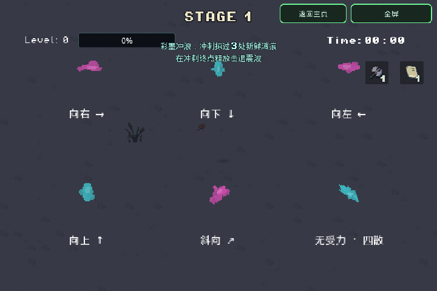
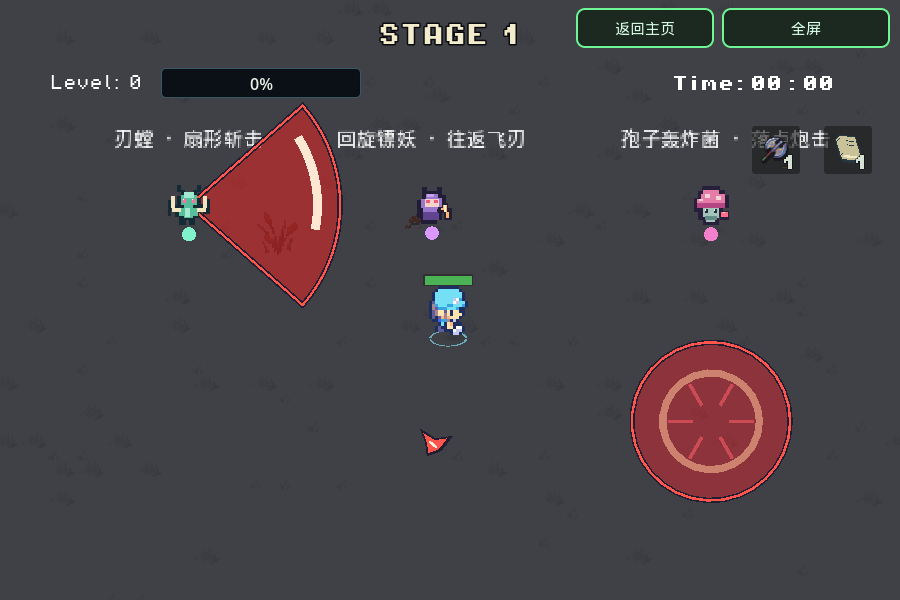
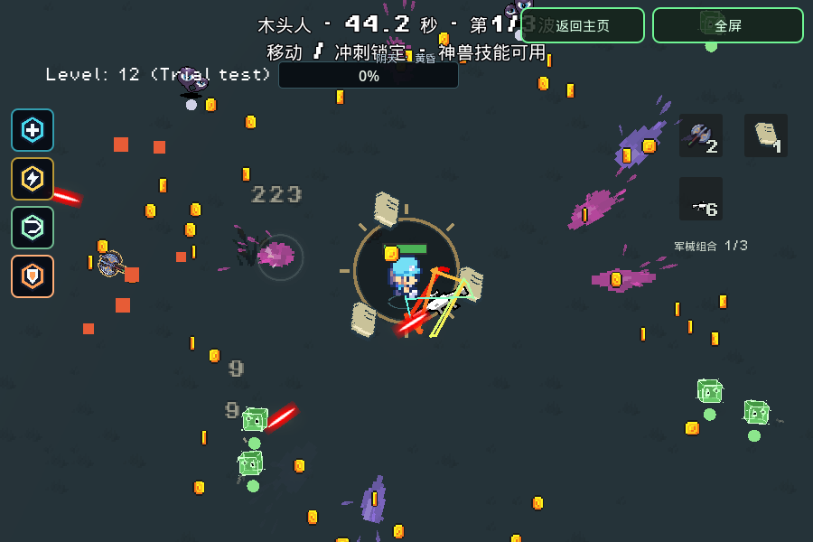
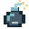

# ⚔️ R O G G E

### 冲进怪潮，把每次升级变成新的连锁反应。

**像素生存 · 22 张装备卡 · 双装备组合 · 彩墨冲浪 · 八种小怪**

[开始一局](https://ybwangrogger.itch.io/rogue-white) · [装备图鉴](#装备图鉴) · [彩墨冲浪](#彩墨冲浪) · [新怪物与攻击方式](#新怪物与攻击方式) · [四神兽与祝福](#四神兽与祝福) · [运行项目](#运行项目)

*武器负责火力，你用走位、冲刺和下一张卡，把怪潮变成自己的节奏。*

---

**当前主分支构建：`20261109-192900`** · [浏览器试玩](https://ybwangrogger.itch.io/rogue-white)

## 一局里会发生什么？

**清怪 → 拾币升级 → 三选一卡 → 叠出构筑 → 挑战 Boss → 带着祝福进入下一关。**

- **每次开局都有变化。** 随机背景色、关卡主力怪主题、升级选项，以及晴、阴、雨、雪与昼夜变化。
- **冲刺是进攻的一部分。** 躲开预警、穿过包围；冲刺掠过新鲜彩墨还能蓄出击退震波，装备踏风徽记后再追加风压。
- **奖励也有意外。** 追逐掉宝的小怪、击败宝藏守卫触发老虎机强化，还可能遇到留下金币或回血球的流星雨。
- **六个主线关卡，逐步升级的挑战。** 从冲锋 Boss、挥剑骑士，到四种属性神兽，再到力量、速度与原地抵挡一分钟怪潮的木头人试炼。
- **拾取也能越玩越热。** 连续拾币会升高音调，经验条点燃 COMBO；配上短促枪声、局部光影和 8-bit 配乐。

## 彩墨冲浪

**清怪留下墨迹 → 冲刺掠过 3 处新鲜墨迹 → 在冲刺终点释放伤害与击退震波。**

这项能力默认开启，不占装备位，也不增加按键。脚下三格显示充能，满额后的震波冷却 6 秒；部分充能可留到下次冲刺。你可以选择安全撤离，也可以抓住倒地墨迹的短暂窗口，冲向下一次反击。

荧光泼溅按怪种固定配色，沿受力方向飞散、落地，约 2 秒后淡出。冲刺吸收的是新鲜墨迹，同一处只会收取一次。

<strong>看一眼泼溅方向与飞散动画</strong>

## 新怪物与攻击方式

八种普通怪种组成每关怪潮。主怪主题仍占多数，三种新支援怪带来不同的躲避选择：

| 怪物 | 它怎样进攻 | 你怎样反制 |
| --- | --- | --- |
|  **刃螳** | 保持挥砍距离，停步锁定扇形区域后出刀 | 绕到侧面或背后，抓住挥砍后的停顿。 |
|  **回旋镖妖** | 慢速刀刃沿固定线路飞出，再原路返回 | 横向离开红线，留意回程；同次攻击最多命中一次。 |
|  **孢子轰炸菌** | 锁定地面圆区，孢子落地后爆发 | 预警后继续移动，不要停在落点内。 |

击杀、冰冻、风吹或明显击退都能中断这些攻击。新远程怪共用现有数量上限，第一关最多两只。

## 运行画面

以下画面来自工程实际运行，展示构筑、怪物预警与 Boss 场景。

<table>
  <tr>
    <td width="50%"> <strong>看懂新攻击，选择反击路线</strong> 三种新支援怪：斩击、回旋与落点炮击。</td>
    <td width="50%"> <strong>倒地墨迹，也能变成进攻资源</strong> 沿着清怪路线冲刺，蓄出彩墨震波。</td>
  </tr>
  <tr>
    <td width="50%"> <strong>读懂冲锋，再抓反击窗口</strong> 第一关 Boss：预警、冲刺与硬直节奏。</td>
    <td width="50%"> <strong>两只神兽，两种压力</strong> 风之双隼：远程风刃与近战俯冲配合。</td>
  </tr>
  <tr>
    <td> <strong>身后留毒，脚下生风</strong> 雪夜、毒雾与机动构筑。</td>
    <td> <strong>下一张卡，改变这一局</strong> 三选一升级，也可以消耗机会重选。</td>
  </tr>
</table>

## 装备图鉴

22 种装备与成长卡可以交叉搭配。斧头、书本提供开局火力，其余能力在升级过程中逐步加入。

| 类型 | 装备 | 打法与作用 |
| --- | --- | --- |
|  飞行武器 | **斧头** | 飞出后回收，沿途打击敌人；升级强化伤害与攻击能力。 |
|  环绕防线 | **书本** | 围绕玩家攻击，最多 12 本；到达数量上限后继续强化伤害。 |
|  自动火力 | **枪支、无人机** | 自动射击与短时激光，持续压制靠近的敌人。 |
|  爆破击退 | **炸弹** | 周期投掷炸弹，爆炸造成范围伤害并击飞小怪；升级提高伤害与范围，缩短冷却，最高 5 级。 |
|  范围雷击 | **闪电戒指** | 周期雷击周围目标；升级提高伤害、雷击数量与范围。 |
|  点燃与控制 | **汽油瓶、寒冰** | 汽油瓶引燃群怪并传播灼烧；寒冰提供控制与冻伤增伤。 |
|  移动毒场 | **剧毒踪迹** | 移动时身后留下毒雾，持续伤害其中的敌人；最高 5 级解锁减速。 |
|  定向击退 | **芭蕉扇** | 吹出气流并击退小怪，对已有灼烧/中毒额外结算一跳，并以深红/深紫身体变色提示；初始间隔 3 秒，每级冷却×0.7，最高 5 级。 |
|  引力聚怪 | **黑洞** | 周期召唤持续 3 秒的小黑洞，聚拢敌人并每秒伤害；升级缩短冷却、扩大范围并提高伤害，最高 5 级。 |
|  暴击强化 | **暴击眼镜** | 每级增加 20% 直接攻击暴击率，最高 5 级；暴击伤害为 150%，满级提高到 200%，以更大的金色伤害字标记。 |
|  触发连锁 | **踏风徽记、回响火种** | 冲刺结束释放风压；累计击杀后，在最后一次击杀处引爆回响。 |
|  生存续航 | **怪物项链、回复、吸血、玉佩** | 击杀掉落回血球、周期回复、伤害吸血，以及击杀补充护盾。 |
|  方向与成长 | **左拳、右拳、拾取、移速** | 强化对应方向的伤害，扩大拾取范围，或提高移动速度。 |

### 试试这些搭配

集齐军械或生机三件套，还会激活同步流光边框与组合效果。

| 构筑方向 | 核心组合 | 体验重点 |
| --- | --- | --- |
| **军械组合** | 枪支 + 无人机 + 炸弹 | 金色流光同步绕边；每 3 秒获得 1 秒无敌护盾。 |
| **生机组合** | 拾取 + 移速 + 回复 | 荧光绿流光同步绕边；经验获取 +30%，移动速度与回复效果 +20%。 |
| **跑毒机动** | 剧毒踪迹 + 踏风徽记 + 移速 | 边移动边铺毒，冲刺脱身时顺手打出风压。 |
| **点燃连爆** | 汽油瓶 + 回响火种 + 寒冰 | 利用灼烧传播和击杀爆发清理聚集的敌人，靠冰冻争取走位空间。 |
| **续航容错** | 怪物项链 + 玉佩 + 回复 / 吸血 | 让击杀转化为回血与护盾，逐步建立更稳的循环。 |
| **风压引力** | 芭蕉扇 + 黑洞 + 汽油瓶 / 闪电戒指 | 用气流打开退路，黑洞重新聚怪，再由范围攻击处理聚集目标。Boss 会受到伤害并抵抗位移。 |

## 四神兽与祝福

击败神兽后，会获得一项主动能力。**直接点击左侧图标释放，图标上的填充变化显示冷却。**

| 神兽 | 战斗特色 | 获得的祝福 |
| --- | --- | --- |
| 🌊 **潮汐巨象** | 水泡落点、潮汐水道与冲锋 | **潮汐复苏**：回复生命。 |
| ⚡ **雷鬃狮王** | 交叉落雷、雷印追击与跳跃突袭 | **雷霆裁决**：雷击屏幕内敌人并清除敌弹。 |
| 🌪️ **苍穹双隼** | 远程风刃与近战俯冲，双 Boss 配合 | **苍风牵引**：牵引全地图已经掉落的金币与回血球。 |
| 🛡️ **熔岩玄龟** | 熔岩环、火种坠落与滚动攻击 | **玄岩壁垒**：短时间大幅降低受到的伤害。 |

神兽拥有二阶段变化。第二、第四位神兽之后，还分别有 **力量试炼** 与 **速度试炼**：应对锁定激光，或把握瞬移斩击后的反击窗口。速度试炼后还有 **木头人挑战**：移动与冲刺锁定，保留自动攻击和神兽技能，在怪潮中坚持一分钟。

## 开始试玩

### [▶ 打开 itch.io，直接在浏览器里玩](https://ybwangrogger.itch.io/rogue-white)

| 操作 | 电脑 | 手机触屏 |
| --- | --- | --- |
| 移动 | 方向键 / WASD | 左侧虚拟摇杆 |
| 冲刺 | **Shift** | 右侧 DASH 按钮 |
| 神兽技能 | 点击左侧图标；E 释放当前技能，Q 切换 | 点击左侧技能图标 |
| 升级选择 | 点击卡片 | 触摸卡片 |

武器自动攻击。游戏内右上角可直接返回主页；Debug 页提供分页练习入口，可以单独测试新怪物、彩墨冲浪或试炼。

可以在设置里选择 **简单、中等、困难**，并调整天气特效、环境音和镜头反馈。

## 运行项目

1. [下载 master 源码 ZIP](https://github.com/wyb969/Rogge/archive/refs/heads/master.zip)，或克隆本仓库。
2. 使用 **Godot 4.7** 导入 `project.godot`。
3. 按 **F5** 运行项目。

<strong>开发验证与恢复记录</strong>

工程最初由线上快照恢复，之后的开发源码与验证记录都保存在本仓库。当前主分支已包含后续卡片、组合、试炼、彩墨与新怪物功能。

- [当前开发交接与验证范围](docs/AI_HANDOFF.md)
- [发布与打包流程](docs/ITCH_PUBLISH.md)
- [新怪物设计](docs/tactical-enemies.md) · [彩墨冲浪](docs/ink-surf.md) · [双装备组合](docs/equipment-combos.md)

恢复过程、资源转换限制和验证结果保存在：

- [恢复说明](RECOVERY_README.md)
- [来源记录](RECOVERY_PROVENANCE.json)
- [功能检查结果](RECOVERY_TEST_RESULTS.json)

未推送的旧本地 Git 历史、未打包文件，以及部分素材的原始编辑数据不包含在这份恢复工程中。后续源码以 GitHub 上的提交为准。

---

**先冲出去，再决定这一局怎么赢。**

[进入怪潮 →](https://ybwangrogger.itch.io/rogue-white)

