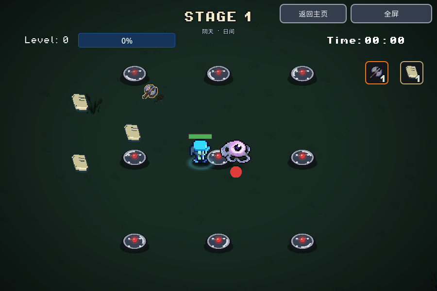
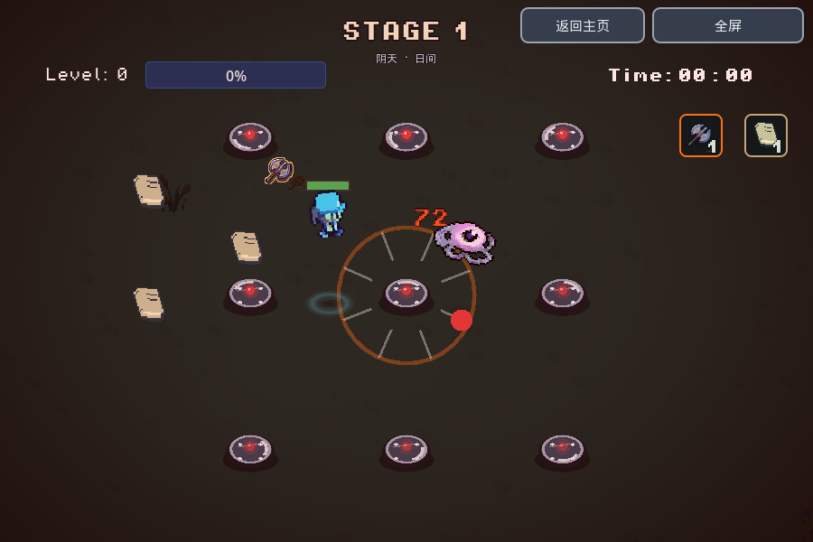
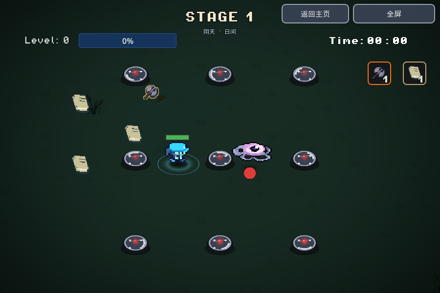
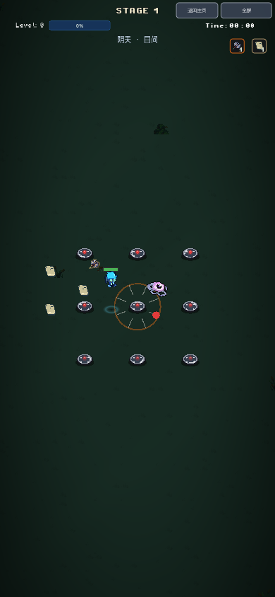
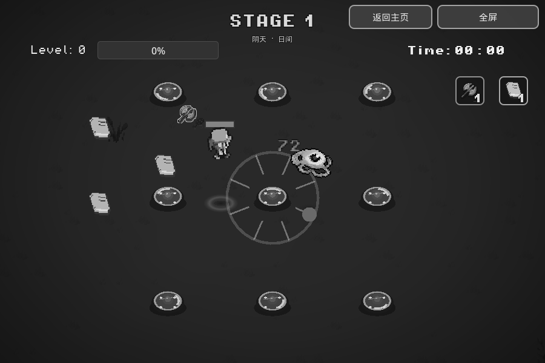

# Ground locator and mine airborne feedback

Version **20261116-160724**. Branch `feature/airborne-feedback-20261116`, based on `ede5163` / `feature/minefields-20261116` (PR #23).

## What changed

- The permanent gold diamond was `player_marker.gd`, not the conditional shield. It now draws one cached 64×64 cyan radial texture as a perspective ground circle at the player's feet, beneath the body. Its outer edge fades to transparent. It stays on the ground while the body rises; the actual shield visual remains conditional and unchanged.
- Mine survivors now show a display-delta-driven 0.44s parabola: player height 42 world units, ordinary monsters 24–34 depending on body scale, Bosses 22. A 0.12s landing squash, tilt and small ground ripple reinforce contact. Ground shadows shrink/fade during flight. Player health follows the raised body; the knight's sword keeps its body-relative offset.
- The physical impulse still lasts 0.28s, integrates collision-aware movement analytically and uses the same push speeds, resistances and damage as before. Cosmetic height never moves a collider or grants invulnerability. Normal control can resume during the last cosmetic portion of the hop.
- Player launch/landing use the existing single camera mixer (strength 5 / 2.7), which preserves the camera-shake setting and existing bounds. Monster-only launches do not shake the camera. No camera, per-target light or particle node was added.
- Electric interruption, trial locks and run cleanup restore the base pose immediately. Mines retain cleanup ownership through the cosmetic tail after physical displacement ends. Enemy render processing is enabled only while hit-flashing or airborne.

## Changed modules

`player_marker.gd`, `terrain_impulse.gd`, `player.gd`, `enemy_shell.gd`, `boss.gd`, `knight_boss.gd`, `beast_boss.gd`, `combat_feedback.gd`, `combat_lighting.gd`, `minefield.gd`; version metadata; focused smoke and native capture fixtures. No mine damage, fuse, rearm, encounter or card values changed.

## Try it

Home → **Debug → 九宫格地雷**. Step onto a red lamp; the surviving player lifts off the ground, travels away and lands. Lure a monster onto another mine to compare. Toggle camera-shake strength to confirm the comfort control. Test an electric interruption or return Home during a hop; no floating pose should survive.

## Evidence and limits

- Godot 4.7 matching-template headless import and Web export: successful, no errors/warnings in those logs.
- Thirteen targeted native-source suites passed: airborne feedback (41 checks), mines (252), player motion, camera motion, visual style, Boss rhythm, knight, guardians, electric grid (1034), wooden trial, motion VFX, combat lighting and weather lighting. The first airborne test run had an incorrect fixture node path (`CollisionShape2D` instead of `Area2D/CollisionShape2D`); the corrected fixture passed. This was not a gameplay failure.
- Four suites run against the final exported Web PCK: airborne, mines, visual style and knight. See `validation/airborne-feedback-20261116.json` for exact results and teardown warnings.
- Native GLES compatibility captures at 900×600 and 390×844 show ground/apex/landing states. Grayscale checks preserve the visible body/ground separation and subtle circle. Captures freeze simulation at deterministic phases; they verify rendering, not perceived smoothness or live browser performance.
- Existing ObjectDB/resource teardown warnings and the native GL shutdown leak remain. They are recorded separately, not described as fixed. No current Safari/browser or real phone FPS validation.

Reproduce from project root (set `GODOT` to the installed Godot 4.7 binary):

```sh
"$GODOT" --headless --rendering-method gl_compatibility --audio-driver Dummy --path . --editor --quit
"$GODOT" --headless --rendering-method gl_compatibility --audio-driver Dummy --path . --script res://tools/smoke_airborne_feedback.gd
"$GODOT" --headless --rendering-method gl_compatibility --audio-driver Dummy --path . --export-release Web /ABSOLUTE/OUTPUT/index.html
DISPLAY=:105 ROGGE_CAPTURE_DIR=/ABSOLUTE/CAPTURES "$GODOT" --rendering-method gl_compatibility --audio-driver Dummy --path . res://tools/preview_airborne_feedback.tscn
```







Published private playtest: https://rogge-palette-playtest-20261109.whiteber.chatgpt.site — version 20261116-160724, deployment succeeded at 2026-11-16 16:11 Beijing. Source is saved in PR #24; formal master/itch remain unchanged. Hosting transforms only the existing WASM gzip loader; all nine original exported files match after decoding/removing the loader injection. See `validation/airborne-playtest-20261116.json`.
