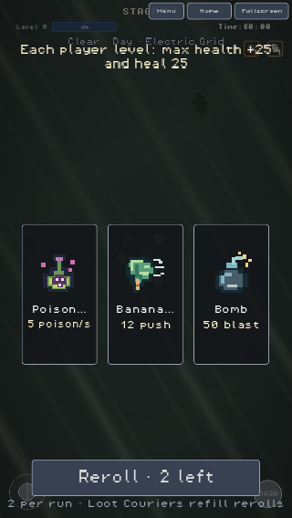
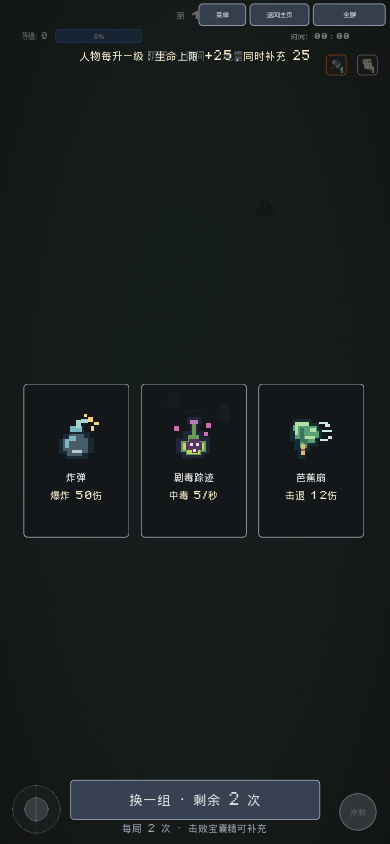
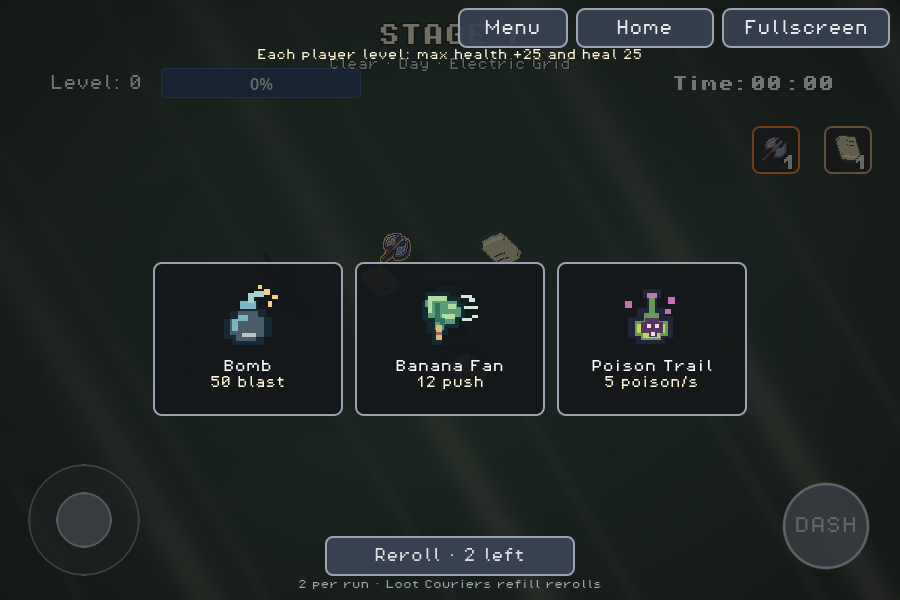
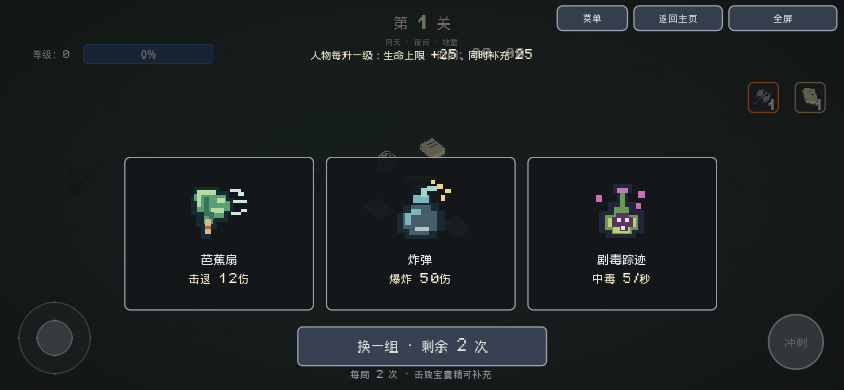
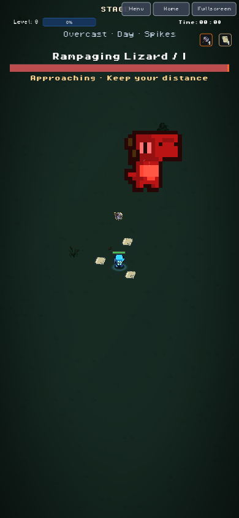
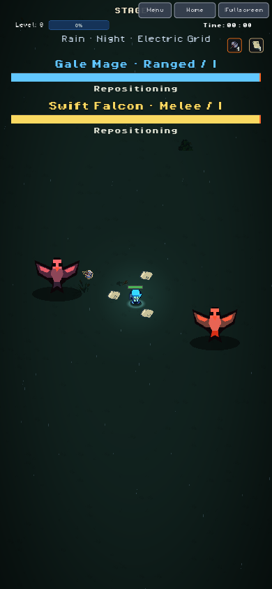
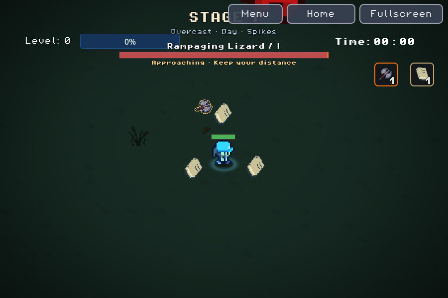

# Boss HUD, control escape and compact cards

Version 20261116-192020. Confirmed: first Boss electric stun called full feedback teardown and hid its reparented health bar. Attack cancellation now only clears warnings. Other Boss bars were present in baseline; the suspected card-container cause was not confirmed. Shared top-screen physical-size HUD, layer90, separate slots for wind twins.

Three horizontal cards in both orientations: 24px outer margins, 12px gaps, maximum190×154. Icons above two lines (name; function and actual next primary value). Long names ellipsize; complete rank and current→next comparison remain in tooltip/Codex. Read-only CardPreview values, unchanged combat formulas. Hover1.02→1.0.

Seven stage Boss actors break free after three continuous controlled seconds and resist electric stun, terrain displacement and poison slow for three seconds. Damage/tint remain active. Pause freezes timers; teardown resets them. Wind custom paths tick control once and release cancelled attack ownership. Regular/trial/treasure enemies unchanged.

## Validation

10 source suites and8 final Web PCK suites pass; [full records](validation/boss-control-hud-20261116.json). New Boss suite476 checks; card suite2108 covers28 cards, both languages and five screen sizes, text/card bounds, hover enter/exit and real third-card selection. Audit1098 translation keys. Import/export no script errors. Existing shutdown ObjectDB/resource/GL warnings remain. Native Compatibility screenshots are not browser/Safari/FPS verification.

```sh
godot --headless --rendering-method gl_compatibility --audio-driver Dummy --path . --editor --quit
python3 tools/audit_localization.py
godot --headless --rendering-method gl_compatibility --audio-driver Dummy --path . --script res://tools/smoke_boss_control_guard.gd
godot --headless --rendering-method gl_compatibility --audio-driver Dummy --path . --script res://tools/smoke_three_cards.gd
godot --headless --rendering-method gl_compatibility --audio-driver Dummy --path . --export-release Web /ABS/web/index.html
# Run selected --script suites with --main-pack /ABS/web/index.pck for packed-resource checks.
ROGGE_CAPTURE_DIR=/ABS/captures godot --rendering-method gl_compatibility --path . res://tools/preview_boss_ui.tscn
```

Reproduce HUD bug: spawn first Boss, apply electric stun, advance physics/render. Baseline health bar hides; fixed bar remains. Control test repeatedly stuns every0.5s, confirms release at3s, movement/damage during immunity, expiry, pause and teardown.








