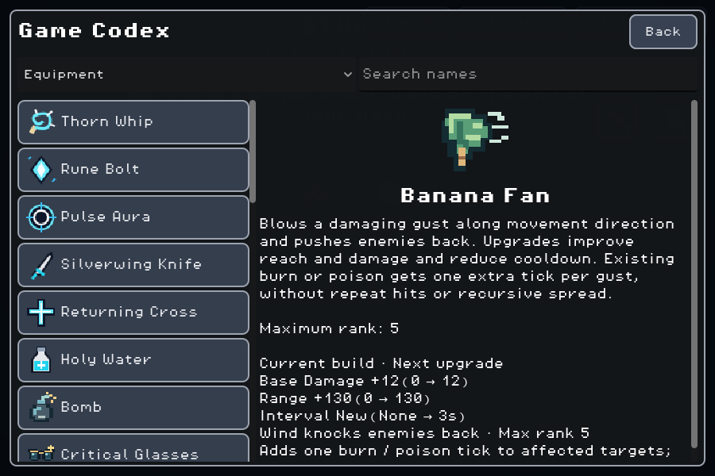
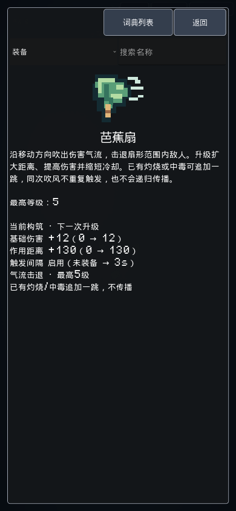
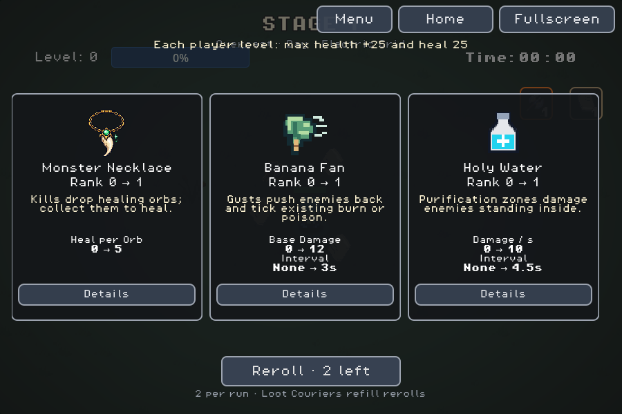
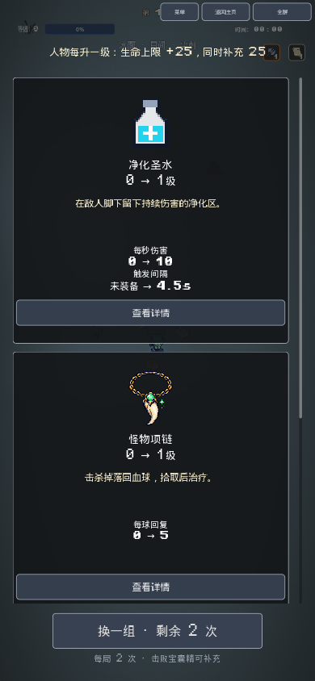
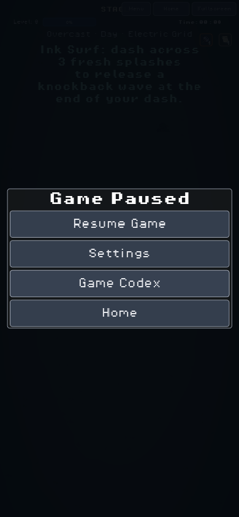
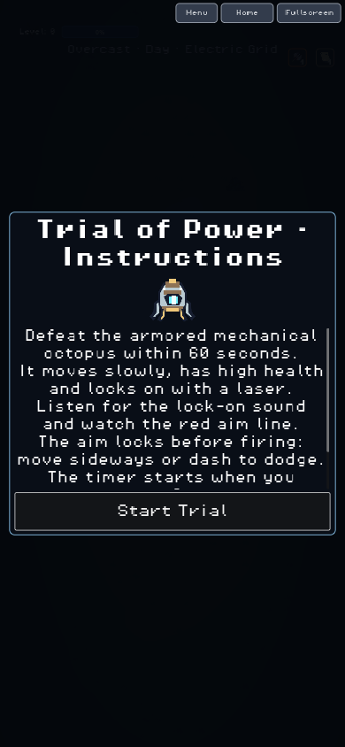

# Game Codex / 游戏词典与暂停菜单

> 后续修正：选卡已改为一屏三卡、无详情按钮/滚动；DASH 中文字体已修复。当前规则见 [three-cards.md](three-cards.md)。下文保留首版实现记录。

版本 **20261116-182759**，分支 `feature/codex-pause-menu-20261116`，基于 `cf109d9` 的中英文版本。

## 使用

- 主页 **Game Codex / 游戏词典**。对局中按 **Esc** 或顶部 **Menu / 菜单**：继续游戏、设置、词典、返回主页。手机不用键盘。
- 词典有装备、怪物、首领、试炼、技能与组合五类，可搜索当前语言名称。横屏列表/详情并排，竖屏进入详情后用“词典列表”返回列表；“返回”回上一个菜单。长正文可以滚动。
- **53 个条目**：28 装备、9 怪物、7 首领条目（包含风双 Boss 与宝藏守卫）、3 试炼、4 神兽技能、2 组合。每条带图标。装备给出用途、升级方向、限制/交互，局内还显示实际当前构筑到下一等级的完整对比。试炼规则和技能描述复用真实模块。
- 设置切换 English / 简体中文后，词典和现有升级卡、持久 HUD、休整/试炼、神兽说明随之刷新。英文仍是默认；不翻译内部 ID，不重置已有设置。局内设置能改音量/控件大小透明度，拖动控件位置仍从主页设置进入，避免查看菜单时误移动或冲刺。

## 卡牌与状态约束

升级卡共用 **280×330** 显示像素的基准尺寸、**72×72** 图标、一句简介、最多两项关键数值（优先保留冷却）、详情按钮。两种语言共用布局；手机竖屏单列、横屏多列，外层滚动，重抽按钮保留。完整效果及其余数值进入详情查看；标题必要时省略并保留 tooltip。

`CardPreview` 仍使用真实升级公式，`CardNumbers.value_pair` 为完整文案和简短卡片共用当前→下一等级格式。首次获得武器的冷却显示“未装备 → 3s / None → 3s”，避免零秒冷却的歧义。没有改变任何战斗、奖励、移速或升级数值。

`SessionMenu` 保存打开前的暂停状态、焦点和触控显示，界面位于输入遮挡层上。原本运行的局返回后继续；原本停在选卡、休整、试炼说明的局返回后仍停在原页面。详情点击不选卡，不消耗重抽、不改变候选或随机种子、不计试炼时间。退出旧局只清理菜单，由已有生命周期决定暂停状态。

## 代码与验证

新增 `script/codex_data.gd`、`codex_page.gd`、`session_menu.gd`；入口接入 main/fullscreen_toggle；卡牌接入 pasue_menu/upgrade_card/CardNumbers。game 与现有奖励/HUD模块增加纯文字刷新，试炼正文增加滚动。翻译集中 `locale/messages.csv`。

```sh
python3 tools/audit_localization.py
GODOT --headless --rendering-method gl_compatibility --audio-driver Dummy --path . --editor --quit
GODOT --headless --rendering-method gl_compatibility --audio-driver Dummy --path . --script res://tools/smoke_codex_menu.gd
GODOT --headless --rendering-method gl_compatibility --audio-driver Dummy --path . --script res://tools/smoke_palette_cards.gd
GODOT --headless --rendering-method gl_compatibility --audio-driver Dummy --path . --script res://tools/smoke_localization.gd
GODOT --headless --rendering-method gl_compatibility --audio-driver Dummy --path . --script res://tools/smoke_trials.gd
GODOT --headless --rendering-method gl_compatibility --audio-driver Dummy --path . --export-release Web /ABS/OUTPUT/index.html
```

用独立 `XDG_DATA_HOME` 测试以免影响用户设置。补充源码 smoke_rest_selection、smoke_session_toolbar、smoke_menu_layout；最终 Web PCK 在原生无头引擎中执行四个专项。新测试涵盖完整词典双语/图标、实际 GUI 菜单和详情点击、Esc 往返、暂停期间移动/生命/冲刺时钟冻结、全部28卡双语尺寸/文字容纳、切语言不重抽、休整/试炼状态及退出。视口 900×600、390×844、844×390。

原生截图：`DISPLAY=:105 ROGGE_CAPTURE_DIR=/ABS/CAPTURES GODOT --rendering-method gl_compatibility --audio-driver Dummy --path . res://tools/preview_codex_menu.tscn`。截图和原生 PCK 测试不等于浏览器/Safari/真实手机测试。导入和导出无脚本错误；既有 ObjectDB/resource 及原生 GL 退出警告单独记录，不宣称已解决。

源码7个专项、最终 Web PCK 4个专项全部通过；新增词典/暂停636项、多语言382项、真实升级数值464项，翻译审计1036键。

检查实录见 [validation/codex-menu-20261116.json](validation/codex-menu-20261116.json)。词典文案依据当前模块核对；翻译审计只检查覆盖/占位符，并不证明译文自然度。后续仍需要玩家试玩反馈。

## 截图








## 试玩与保存

[打开试玩](https://rogge-palette-playtest-20261109.whiteber.chatgpt.site)，版本 **20261116-182759**。[PR #28](https://github.com/wyb969/Rogge/pull/28) 保存源码 `9ac0283`；北京时间 2026-11-16 18:35 发布成功，保持原 owner-private 权限。

Site 源码 `65db5ef5944a407860722c47e3d12fdd41ac84dc`，部署 `appgdep_6afadc58e2c88191a36379885becaa61`。9 个原始导出文件逐字节核对（PCK/WASM 解压后，HTML 仅增加既有 loader）；26 项 loader 检查通过。见 [发布证据](validation/codex-menu-playtest-20261116.json)。正式 master/itch 未更新。
