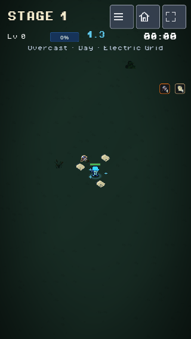
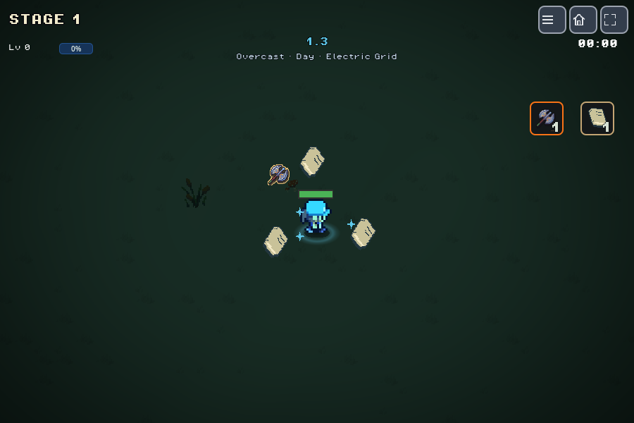
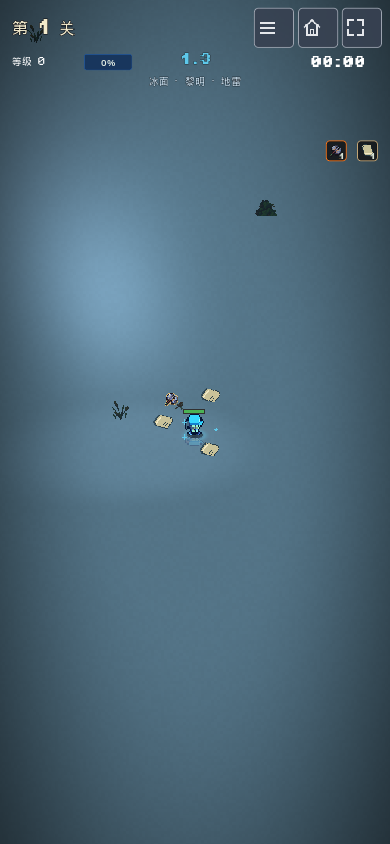
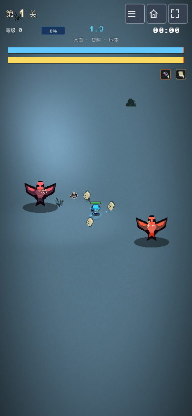

# Compact combat HUD

Version 20261116-194322; based on b32e8d5.

- Three SVG icon buttons replace Menu/Home/Fullscreen text. Original actions, pause ownership and bilingual tooltips remain;40px targets,20px art,4px gaps.
- Remove central courier/combo/debug instructional notices, echo charge text and draft growth/reroll helper paragraphs. Detailed equipment information remains in Codex; trial intro/result pages unchanged.
- Stage Boss HUD shows health only, including separate wind twin bars. Hide title/action and charge progress; keep world-space attack warnings and control immunity unchanged.
- Star-route/Coin Fever timers and timed-trial clocks show numbers only. Remove star charge/time progress bars; XP and skill cooldowns remain. Short bilingual level label avoids clipping.
- Shared displayed-pixel sizing, tiny-window clamp, header rows and lower equipment start avoid toolbar/XP/time overlap. Weather remains as a small header line.

Validation: final Web PCK checks, native bilingual390/320px portrait and900/844px landscape screenshots, and1100-key translation audit in [report](validation/compact-combat-hud-20261116.json). Native capture asserts toolbar/stage non-overlap, real icons/tooltips, hidden explanatory overlays, numeric timer and health-only twin HUD. No browser/Safari/device-FPS test. Existing resource/GL shutdown warnings remain; import/export script errors checked separately.

```sh
godot --headless --rendering-method gl_compatibility --audio-driver Dummy --path . --editor --quit
python3 tools/audit_localization.py
godot --headless --rendering-method gl_compatibility --audio-driver Dummy --path . --export-release Web /ABS/web/index.html
# From an existing empty directory, repeat selected --script tools with --main-pack /ABS/web/index.pck.
ROGGE_CAPTURE_DIR=/ABS/captures godot --rendering-method gl_compatibility --path . res://tools/preview_compact_hud.tscn
```





