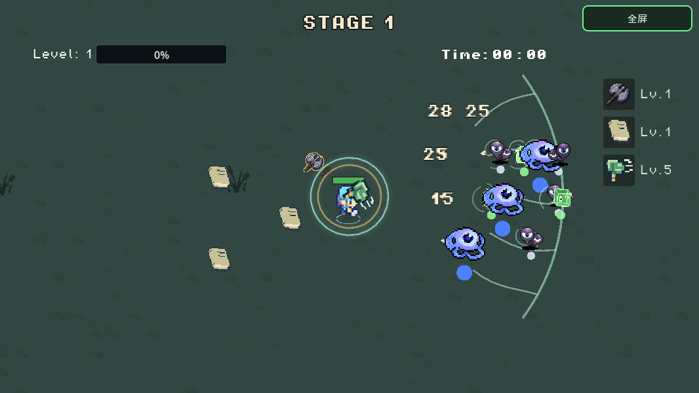
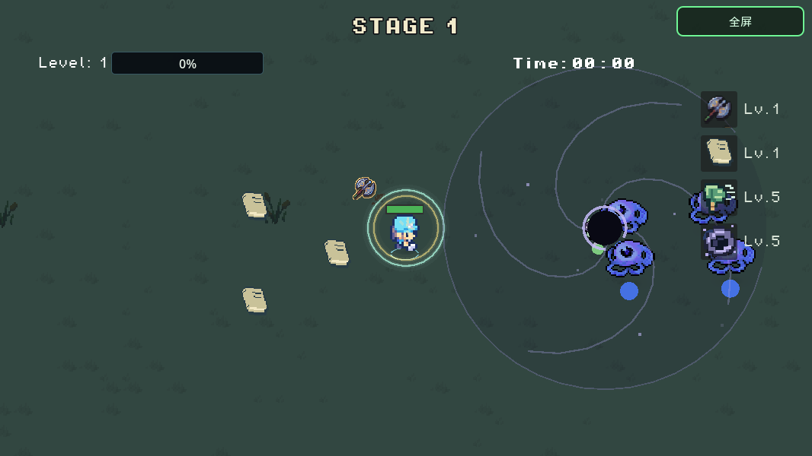
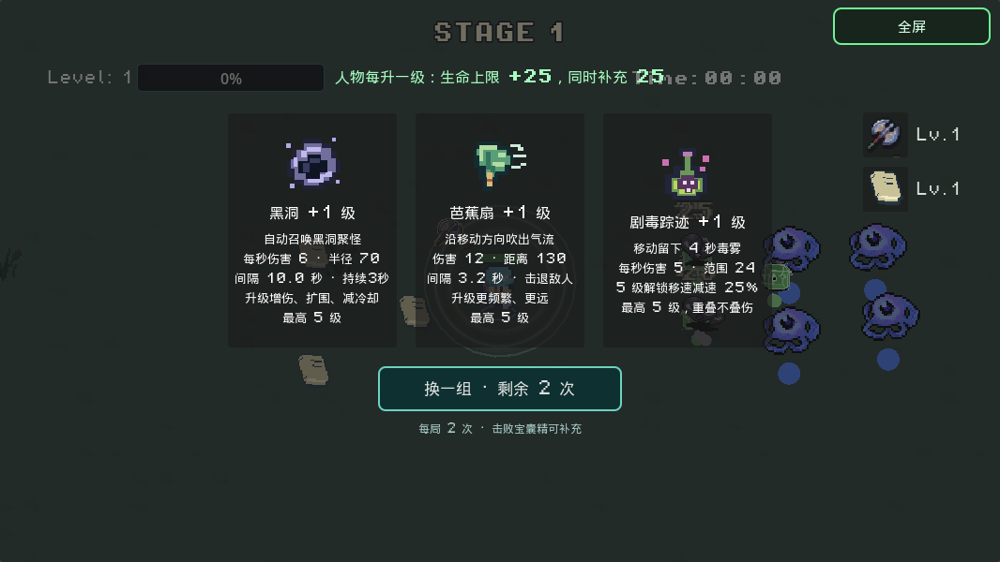

# 芭蕉扇与黑洞

两张自动攻击卡均为最高 5 级，已加入普通升级、重选、装备栏和宝藏老虎机。正常开局不会自带，调试页面可以直接装备测试。

## 芭蕉扇

沿正在冲刺的方向或最后移动方向吹出一道扩散气流。玩家停止移动后保留朝向，键盘和手机摇杆都支持斜向。气流向前传播，同一次吹风对每个敌人只命中一次，不能伤害身后和扇形范围外的敌人。

| 等级 | 单次基础伤害 | 距离 | 间隔（秒） |
| --- | ---: | ---: | ---: |
| 1 | 12 | 130 | 3.20 |
| 2 | 16 | 155 | 2.75 |
| 3 | 20 | 180 | 2.30 |
| 4 | 24 | 205 | 1.85 |
| 5 | 28 | 230 | 1.40 |

气流会实际推移敌人的碰撞体，并带有小范围旋转气流。能打断敏捷小怪的冲刺，避免它立刻贴回来；体型较大和精英敌人抗击退更强。击退会平滑衰减，并按物理步长积分，30、60、120 Hz 测试中的位移一致。



## 黑洞

自动在附近敌人处召唤一个持续 3 秒的黑洞。召唤中心距离玩家至少 88 单位，避免把敌人直接拉到玩家脚下。黑洞使用平滑的向心吸力和少量旋转扰动，范围内每秒结算一次伤害。

| 等级 | 每秒基础伤害 | 半径 | 召唤间隔（秒） |
| --- | ---: | ---: | ---: |
| 1 | 6 | 70 | 10 |
| 2 | 9 | 82 | 9 |
| 3 | 12 | 94 | 8 |
| 4 | 15 | 106 | 7 |
| 5 | 18 | 118 | 6 |

离开范围会清除吸力和未完成的伤害计时。黑洞到期、过关、返回主页或重试时都会清理；暂停选卡期间不会继续造成伤害或消耗寿命。黑洞伤害不递归触发燃烧、冰冻和吸血；击杀仍正常发放经验、怪物项链回血球及其他击杀奖励。



## 组合与 Boss 规则

- 芭蕉扇打开退路，黑洞把敌人重新聚拢，适合配合汽油瓶、闪电戒指和其他范围攻击。
- Boss 和试炼敌人承受正常伤害，但免疫这两张卡的强制位移，避免红色预警和实际攻击错位。
- 速度试炼的无敌阶段不能被新卡绕过；反击窗口内可以正常伤害。
- 伤害仍经过现有防御、方向伤害、冻伤增伤和击杀流程。表中为未加成基础数值。



## 测试入口

主页 → **Debug**：

- 测试芭蕉扇（1级）
- 测试芭蕉扇（5级远距离）
- 测试黑洞（1级）
- 测试黑洞（5级聚怪）
- 测试芭蕉扇 + 黑洞（双5级）

这些入口会准备五个高血量目标，方便观察聚怪和击退。正常重试保留所选调试模式，回主页后普通开局不会继承测试装备。

## 性能与验证

- 使用已有战斗目标索引；活动范围每秒最多扫描 20 次，不逐帧遍历场景树，也不对每个敌人重复查找其他敌人。
- 每张卡只有一个常驻控制节点和一个短音效播放器。芭蕉扇复用 24 个气流扰动记录，黑洞最多存在一个。
- 特效采用简单绘制并限制为 30 Hz，不生成逐敌人的粒子节点，不使用屏幕扭曲或全屏发光。
- 固定的吸力上限与保留时间避免每次扫描叠加速度；状态伤害按实际停留时间结算，长帧不会漏掉生命周期最后一次伤害。
- 48 项原生回归测试通过；新增行为测试也在实际导出的 PCK 中通过。导出成功不代替 Safari 等真实浏览器和手机设备上的试玩检查。

```bash
godot --headless --rendering-method gl_compatibility --audio-driver Dummy --path . --script res://tools/smoke_control_cards.gd
godot --headless --rendering-method gl_compatibility --export-release Web build/index.html
```

网页版需要与引擎版本一致的 Godot 4.7 Web 导出模板。构建时使用无多线程的 Web 预设。
