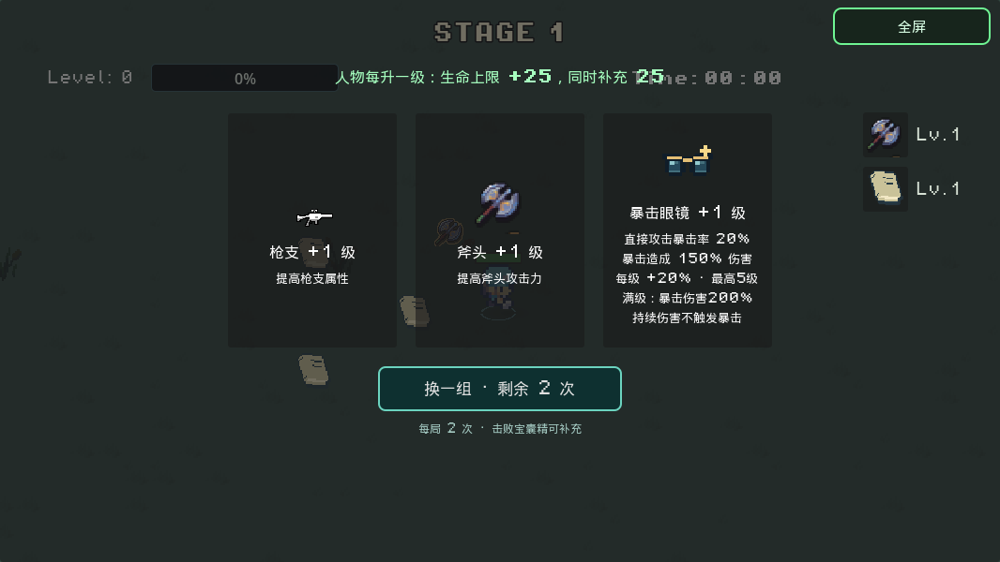
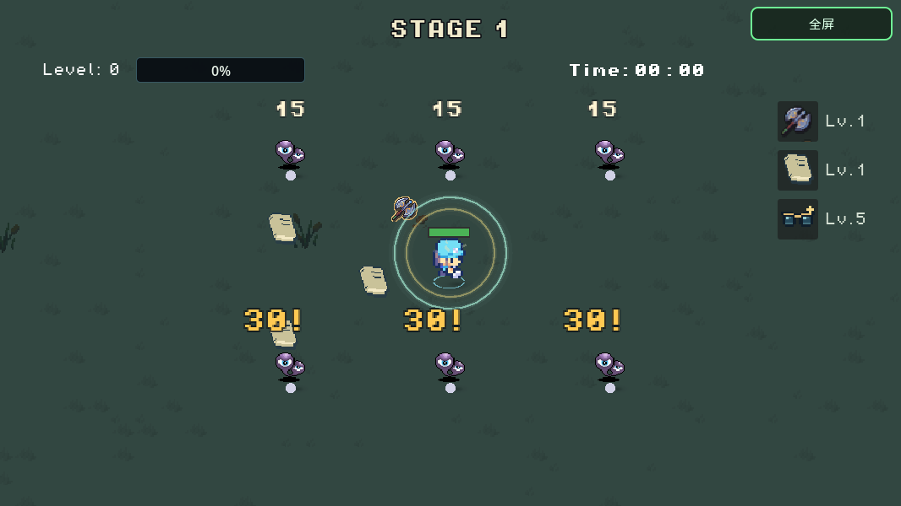

# 暴击眼镜与默认点燃修复

暴击眼镜使用像素墨镜图标，最高 5 级；每次直接攻击命中时独立判定暴击。

| 等级 | 暴击率 | 暴击总伤害倍率 |
| --- | ---: | ---: |
| 1 | 20% | 150% |
| 2 | 40% | 150% |
| 3 | 60% | 150% |
| 4 | 80% | 150% |
| 5 | 100% | 200% |

第五级同时获得必定暴击和倍率提升，不存在第六级。卡片接入普通升级、重选、装备栏和宝藏老虎机；抽奖不会突破等级上限。普通开局不自带，主页 → Debug 可测试 1 级或 5 级。

## 伤害与反馈

- 普通怪、精英和各类 Boss 共用相同的暴击规则，方向加成、冻伤增伤、防御及吸血保持原有流程。
- 暴击使用独立随机数发生器，不占用刷怪/掉落的全局随机序列，也不改写原始命中数据，避免穿透、多目标攻击重复乘倍率。
- 灼烧、毒雾、黑洞持续伤害等 `from_status` 命中不再次暴击；神兽固定比例攻击和速度试炼无敌窗口保持原有约束。
- 暴击字为更大的粗像素字体、更厚暗色描边、金色和 `!` 标记。带状态加成的命中仍保留黄到红渐变，同时放大并加 `!`；治疗仍为绿色。
- 沿用伤害字数量预算和 0.34 秒寿命，不增加逐敌粒子、光源或无限叠加的弹字。

下图为实际原生运行截帧，上排普通伤害 15，下排满级暴击 30：

## 斧头附近出现扩散灼烧的原因

`hand_weapon.gd` 和开局环绕书 `circle_unit.gd` 的命中数据都曾无条件携带 `effect: burn`。没有汽油瓶卡也会叠燃烧，连续命中后可能传播到邻怪；因此只改斧头仍可能看到同样现象。

现在这两种普通攻击只提交直接伤害。汽油瓶爆炸，以及装备汽油瓶后正常触发的附燃、传播逻辑保持。回归检查实际调用斧头扫掠和书本命中，再推进状态计时，确认目标和附近敌人不会出现未获得的灼烧伤害。

## 验证

本轮 27 项不同原生检查通过，最新导出 PCK 的暴击行为检查通过；本地 Chromium 完成 Web 启动、Debug 满级入口、装备/战斗、方向移动、Shift 冲刺和竖屏调整检查。详见 `validation/critical-glasses-20261105.json`。这不代替手机 Safari 长局稳定性验证。

Web 实测还确认原诊断 JS 未被包含在导出包内；已在 Web 预设的 `include_filter` 中加入 `script/web_diagnostics.js`，重新导出后 helper 正常加载，浏览器检查没有控制台错误。使用默认 HTML shell，无额外启动加载器改动。
