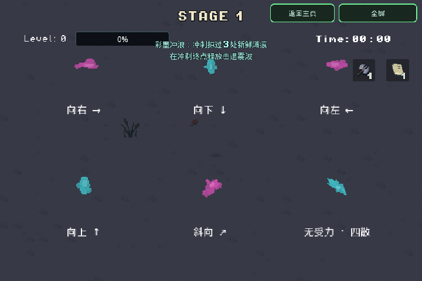

# 死亡地面血迹

版本 `20261108-004105`。小怪、宝藏守卫、试炼敌人与 Boss 的实际致死入口生成地面泼溅，不改变伤害、掉落或阶段规则。

保留上轮2倍尺寸基准，仍受怪物原有尺寸倍率影响。按怪种固定分配明亮荧光色，不读取贴图颜色、不受致命伤害/异常状态/受击闪白影响；精英和木头人怪潮沿用所属怪种。浅色墨迹中心形成荧光观感，使用普通透明混合，没有泛光、额外灯光或叠加白雾。

| 类型 / 配置键 | 固定颜色 |
| --- | --- |
| 普通追击 `chaser` | 荧光粉 `#ff52ce` |
| 壮硕追击 `chaser_brute` | 电紫 `#a47cff` |
| 冲刺 `dasher` | 荧光橙 `#ff9b52` |
| 坦克 `tank` | 亮蓝 `#5e8fff` |
| 远程 `ranged` | 电青 `#40e6ee` |
| 宝物快递 `loot_courier` | 兰花粉 `#f68cf0` |
| 宝藏守卫 `treasure_guardian` | 黄绿 `#d6f25b` |
| 第一关冲刺Boss `charger_boss` | 玫粉 `#ff70a6` |
| 骑士 `knight` | 鸢尾蓝紫 `#a0a4ff` |
| 潮汐 `tide` | 天青 `#55cfff` |
| 雷鬃 `thunder` | 浅紫 `#e1a0ff` |
| 风系基础 `gale` | 薄荷青 `#69f0c8` |
| 风远程 `gale_ranged` | 薄荷绿 `#63f0b0` |
| 风近战 `gale_melee` | 嫩黄绿 `#b5ed74` |
| 熔岩 `aegis` | 蜜桃橙 `#ffb47d` |
| 力量试炼 `power_trial` | 柠檬绿 `#e6f582` |
| 速度试炼 `speed_trial` | 电兰紫 `#cc64ff` |

未知新怪种使用普通追击的荧光粉回退。后续新增怪种时同步补充 `DeathStains.PALETTE`；普通怪按 `EnemyData.title` 分配，宝藏守卫覆盖借用的追击资源，Boss族通过 `_death_stain_kind()` 返回自己的键，风双Boss分别赋色。

血迹绑定世界坐标，绘制在角色和拾取物下方。独立随机流选择48种不规则主痕迹，每次搭配7颗独立参数的液滴。主痕迹0.12秒展开；液滴延迟、飞行时间、弧高、距离、宽高和朝向各自随机，在0.42秒内落地。明确受力时，主痕迹偏转最多约7度，5颗主液滴沿±23度窄锥喷出，2颗短液滴沿±69度散开，均落在受力前方；无方向时全周散开。停留2秒，再用0.5秒淡出。暂停冻结，hitstop不延长实际活动时间。

`CombatFeedback` 持有一个 `DeathStains` MultiMeshInstance2D，128组预分配槽位（每组1主痕迹+7液滴，共1024个Quad实例）、一个共享256×224图集和一个共享着色器。每帧最多接纳20次死亡泼溅，超额仅跳过装饰；满池覆盖最早槽位。没有每次死亡创建节点、计时器、粒子或灯光。空池停止处理和绘制；飞行/展开/淡出最多30Hz同步GPU，落地后不再更新几何直到淡出。图集、Drop对象与槽位只在准备时创建，击杀不添加节点/粒子/计时器。没有纹理取色或致命伤害颜色分支。

`EnemyShell._apply_health_loss` 与 `Boss.apply_hit` 接入致死效果。休息/转场清理、结束、新局和返回主页会清空池；不保留死亡敌人的引用。

`EnemyShell` 优先使用本次伤害方向；没有明确方向时，使用仍生效的吹风、爆炸或黑洞拉力，否则径向散开。Boss使用伤害提供的方向，无方向时四散。所有荧光怪种配色继续固定。

彩墨冲浪会在真实冲刺路径上吸收已落地、尚未淡出的主痕迹，一处只计一次。吸收会提前移除该组装饰；完整规则见 [ink-surf.md](ink-surf.md)。普通走路不会吸收。

验证见 [validation/ink-surf-20261107.json](validation/ink-surf-20261107.json)：12项不同原生检查、5项实际Web PCK检查，血迹275项断言和彩墨23项断言。原生GPU逐帧捕捉方向/飞行/落地及震波；满池仍增加1次绘制调用，但实例/更新量增加，不能据此断言手机GPU耗时不变。浏览器范围和已知退出警告见报告，未做物理Safari性能测试或全量60项回归。

聚焦复验（将 `GODOT_BIN` 指向Godot4.7，使用独立测试用户目录）：

```bash
XDG_DATA_HOME=$(mktemp -d) "$GODOT_BIN" --headless --rendering-method gl_compatibility --audio-driver Dummy --path . --script res://tools/smoke_death_stains.gd
"$GODOT_BIN" --headless --rendering-method gl_compatibility --audio-driver Dummy --path . --editor --import --quit
"$GODOT_BIN" --headless --rendering-method gl_compatibility --audio-driver Dummy --path . --export-release Web /absolute/output/index.html
```

导出PCK验证使用空工程目录及 `--main-pack /absolute/output/index.pck --script res://tools/smoke_death_stains.gd`，避免加载工作区源码。检查仅单独记录已知的退出资源警告；实际解析/运行错误仍判失败。退出资源警告未在本轮修复。


