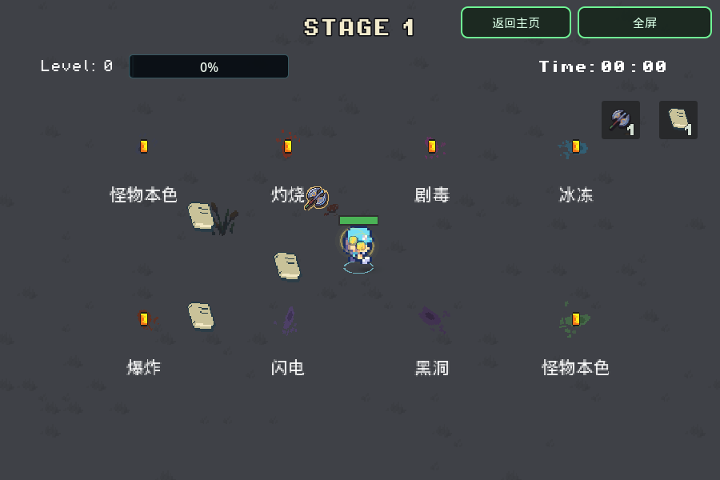

# 死亡地面血迹

版本 `20261107-175332`。小怪、宝藏守卫、试炼敌人与 Boss 的实际致死入口生成地面泼溅，不改变伤害、掉落或阶段规则。

- 普通击杀参考怪物原始贴图的饱和颜色与配置 tint，避开受击闪白；使用较暗的色调，保留掉落和攻击的辨识度。
- 致命伤害优先：灼烧深红、剧毒紫红、冰冻蓝青、闪电紫、爆炸焦红、黑洞暗紫。普通伤害击杀带异常的小怪时，按冰冻、灼烧、中毒的顺序选色。Boss 使用本次致命伤害或本体颜色。
- 血迹绑定世界坐标，绘制在角色和拾取物下方。独立随机流选择12种像素泼溅图案，叠加旋转、方向扰动、拉伸与透明度变化；出生0.12秒内展开，停留2秒，再用0.5秒淡出。暂停冻结，hitstop不延长实际活动时间。

`CombatFeedback` 持有一个 `DeathStains` MultiMeshInstance2D，128个预分配槽位、一个共享128×96图集和一个共享着色器。每帧最多接纳20次死亡泼溅，超额仅跳过装饰；满池覆盖最早槽位。没有每次死亡创建节点、计时器、粒子或灯光。空池停止处理和绘制；展开/淡出最多30Hz同步GPU。颜色缓存最多32项，普通小怪开局预热，Boss贴图在准备血条时预热，不在普通死亡热路径读取图片。

`EnemyShell._apply_health_loss` 与 `Boss.apply_hit` 接入致死效果。`receive_hit` 的新增可选参数只透传颜色信息，原有调用兼容。休息/转场清理、结束、新局和返回主页会清空池；不保留死亡敌人的引用。

验证记录见 [validation/death-stains-20261107.json](validation/death-stains-20261107.json)。16项不同原生检查、5项实际Web PCK检查通过；新增 `smoke_death_stains` 有176项断言。原生GPU已核对各类颜色、淡出和满池；隔离场景128处血迹增加1次绘制调用。真实Chromium分别用900×600与390×844/DPR2操作Debug木头人、进行15秒群怪战斗并返回主页，无脚本/着色器错误或WebGL上下文丢失。手机视口模拟不是Safari真机性能结论，Sites托管适配器另做字节检查。

聚焦复验（将 `GODOT_BIN` 指向Godot4.7，使用独立测试用户目录）：

```bash
XDG_DATA_HOME=$(mktemp -d) "$GODOT_BIN" --headless --rendering-method gl_compatibility --audio-driver Dummy --path . --script res://tools/smoke_death_stains.gd
"$GODOT_BIN" --headless --rendering-method gl_compatibility --audio-driver Dummy --path . --editor --import --quit
"$GODOT_BIN" --headless --rendering-method gl_compatibility --audio-driver Dummy --path . --export-release Web /absolute/output/index.html
```

导出PCK验证使用空工程目录及 `--main-pack /absolute/output/index.pck --script res://tools/smoke_death_stains.gd`，避免加载工作区源码。检查仅单独记录已知的退出资源警告；实际解析/运行错误仍判失败。退出资源警告未在本轮修复。


