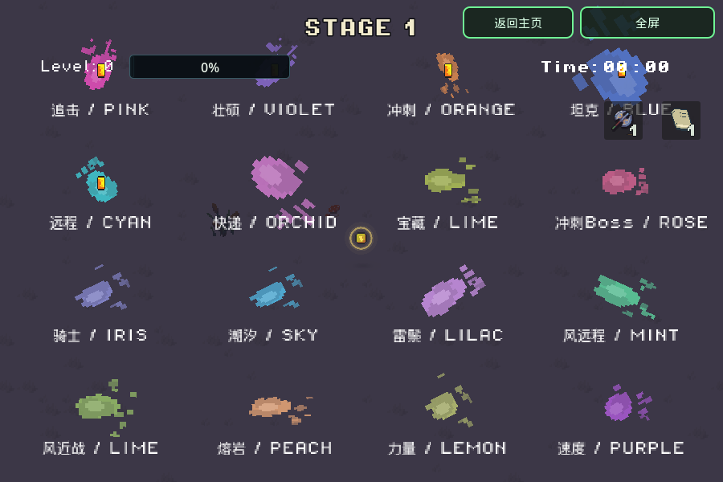

# 死亡地面血迹

版本 `20261107-201644`。小怪、宝藏守卫、试炼敌人与 Boss 的实际致死入口生成地面泼溅，不改变伤害、掉落或阶段规则。

血迹宽高各为首版的2倍（面积约4倍），仍受怪物原有尺寸倍率影响。按怪种固定分配明亮荧光色，不读取贴图颜色、不受致命伤害/异常状态/受击闪白影响；精英和木头人怪潮沿用所属怪种。浅色墨迹中心形成荧光观感，使用普通透明混合，没有泛光、额外灯光或叠加白雾。

| 类型 / 配置键 | 固定颜色 |
| --- | --- |
| 普通追击 `chaser` | 荧光粉 `#ff52ce` |
| 壮硕追击 `chaser_brute` | 电紫 `#a47cff` |
| 冲刺 `dasher` | 荧光橙 `#ff9b52` |
| 坦克 `tank` | 亮蓝 `#5e8fff` |
| 远程 `ranged` | 电青 `#40e6ee` |
| 宝物快递 `loot_courier` | 兰花粉 `#f68cf0` |
| 宝藏守卫 `treasure_guardian` | 黄绿 `#d6f25b` |
| 第一关冲刺Boss `charger_boss` | 玫粉 `#ff70a6` |
| 骑士 `knight` | 鸢尾蓝紫 `#a0a4ff` |
| 潮汐 `tide` | 天青 `#55cfff` |
| 雷鬃 `thunder` | 浅紫 `#e1a0ff` |
| 风系基础 `gale` | 薄荷青 `#69f0c8` |
| 风远程 `gale_ranged` | 薄荷绿 `#63f0b0` |
| 风近战 `gale_melee` | 嫩黄绿 `#b5ed74` |
| 熔岩 `aegis` | 蜜桃橙 `#ffb47d` |
| 力量试炼 `power_trial` | 柠檬绿 `#e6f582` |
| 速度试炼 `speed_trial` | 电兰紫 `#cc64ff` |

未知新怪种使用普通追击的荧光粉回退。后续新增怪种时同步补充 `DeathStains.PALETTE`；普通怪按 `EnemyData.title` 分配，宝藏守卫覆盖借用的追击资源，Boss族通过 `_death_stain_kind()` 返回自己的键，风双Boss分别赋色。

血迹绑定世界坐标，绘制在角色和拾取物下方。独立随机流选择12种像素泼溅图案，叠加旋转、方向扰动、拉伸与透明度变化；出生0.12秒内展开，停留2秒，再用0.5秒淡出。暂停冻结，hitstop不延长实际活动时间。

`CombatFeedback` 持有一个 `DeathStains` MultiMeshInstance2D，128个预分配槽位、一个共享128×96图集和一个共享着色器。每帧最多接纳20次死亡泼溅，超额仅跳过装饰；满池覆盖最早槽位。没有每次死亡创建节点、计时器、粒子或灯光。空池停止处理和绘制；展开/淡出最多30Hz同步GPU。本轮移除了纹理颜色采样、缓存和致命效果颜色透传，热路径只读取已分配的Color。

`EnemyShell._apply_health_loss` 与 `Boss.apply_hit` 接入致死效果。休息/转场清理、结束、新局和返回主页会清空池；不保留死亡敌人的引用。

验证记录见 [validation/neon-splashes-20261107.json](validation/neon-splashes-20261107.json)。6项不同原生检查、3项实际Web PCK检查通过；`smoke_death_stains` 扩为230项断言。原生GPU已核对16种实际出场颜色、淡出和满池，隔离128处仍只增加1次绘制调用。尺寸扩大使像素覆盖面积增加，此计数不代表手机GPU耗时。真实Chromium原始Web导出试玩结果与设备范围见报告；未做物理Safari性能测试或全量59项回归。

聚焦复验（将 `GODOT_BIN` 指向Godot4.7，使用独立测试用户目录）：

```bash
XDG_DATA_HOME=$(mktemp -d) "$GODOT_BIN" --headless --rendering-method gl_compatibility --audio-driver Dummy --path . --script res://tools/smoke_death_stains.gd
"$GODOT_BIN" --headless --rendering-method gl_compatibility --audio-driver Dummy --path . --editor --import --quit
"$GODOT_BIN" --headless --rendering-method gl_compatibility --audio-driver Dummy --path . --export-release Web /absolute/output/index.html
```

导出PCK验证使用空工程目录及 `--main-pack /absolute/output/index.pck --script res://tools/smoke_death_stains.gd`，避免加载工作区源码。检查仅单独记录已知的退出资源警告；实际解析/运行错误仍判失败。退出资源警告未在本轮修复。


