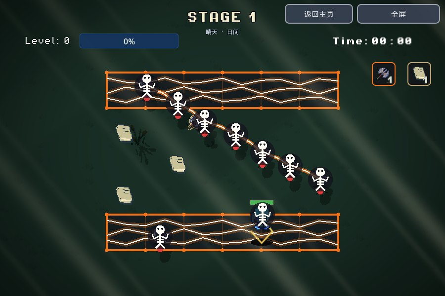
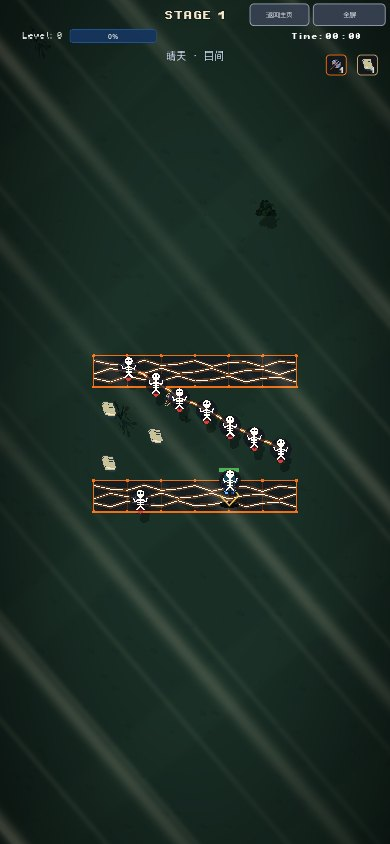

# 晴天电网

Debug →「晴天电网 · 麻痹 / 群怪传导」。该入口使用既有天气练习生命，可切换天气；普通局保持随机天气和正常生命。

## 规则与取舍

- 晴天（CLEAR，包括该天气的夜晚）每关生成两条世界固定的长矩形，长200～280、宽42，随机横/竖；起始点至少60安全余量，两条不重叠。切回同关晴天保留位置，转关重新布局。本版不会随相机移动，也不持续铺满无限地图。
- 4.5秒周期：0.75秒红橙预警、1.2秒通电、2.55秒断电。每个目标每周期最多命中一次，两条网共用去重表。
- 玩家第一关18伤害、逐关+3；怪物为3倍，第一关54、逐关+9。玩家保留原减伤/护盾；Dash与冲刺后无敌、武装组合无敌、受伤保护期间不触发。环境伤害不吃玩家暴击、武器或异常增伤，也不触发新的攻击链。
- 存活的触电者麻痹1秒。玩家触电后3.5秒内不会再次被电，即恢复后有2.5秒电网保护；同时保留至少1.25秒普通受击保护，避免无法移动时被群怪立即连续撞死。这里没有授予2.5秒通用无敌。
- 相距42以内的怪物可逐级传导；怪物不会把电反传到玩家，玩家只因接触电网受伤。怪物、骑士、神兽蓄力/当前攻击被取消，恢复后走正常恢复与重新预警流程，不能续接旧的伤害判定。
- 电流使用白芯/橙边、暗底和电极，与玩家青色攻击区分。触电者闪现小骨架，连线只短暂显示；所有颜色引用GamePalette。

## 实现与成本

`environment_weather.gd`拥有`electric_grid.gd`。后者用两个CanvasItem（地面网格及骨架覆盖层），不创建每怪粒子、灯或Timer。最多64骨架/128连线；每0.1秒在通电阶段对CombatTargets作一次查询，位置快照→空间格桶→迭代队列搜索→先标记全部目标→统一apply_hit。无递归、无每条链再次查全体敌人的调用。

单批最多512目标，超过时按周期轮换覆盖，属于异常超载保护；当前普通刷怪上限32/44加每分钟2，远低于预算。怪物采样位置和电流效果不会无限累积。普通移动扫掠检测防穿网，超过300距离的瞬移只检测落点。

`player.gd`、`enemy_shell.gd`、`boss.gd`拥有独立的electric_stun_left，不借用木头人试炼锁位或全局顿帧。宝藏守卫/信使/骑士/神兽补充其自有物理循环；`enemy_attack_field.gd`拒绝麻痹来源并取消已发起的战术攻击。天气退出、试炼/休息/转场、结束时清暂态；暂停冻结周期。天气FX为0仍显示危险区域。

## 验证

- Godot 4.7 Compatibility无头导入及Web导出；专项源码测试见`validation/electric-grid-20261116.json`。
- 新专项700断言：随机安全布局、世界锚定、链/环/双网去重、180只真实怪物密集传导、实际伤害/1秒麻痹、玩家持输入恢复并完整走出、跨周期保护、Dash/护盾、Boss/战术攻击取消、30/60Hz及慢步长、天气/暂停/结束、节点与效果上限。
- 共12项源码专项；最终实际Web PCK再运行电网、Dash、Boss节奏、Debug四项。PCK测试是原生引擎加载导出的资源，不能替代浏览器运行。
- 原生截图：横屏900×600、竖屏390×844及各自灰度；电流/骨架在灰度仍可区分。图片在`screenshots/electric-grid-20261116/`，为固定场景快照，不代表实际手机性能。
- 既有原生退出资源/GL泄漏警告仍记录，未宣称修复。未作本轮浏览器或Safari真机/群怪帧率测试。首轮测试脚本曾误用不存在的shield_health字段，已改为真实shield属性并重新通过，不是产品代码故障。

复现命令（把GODOT设为4.7引擎路径）：

```sh
"$GODOT" --headless --rendering-method gl_compatibility --audio-driver Dummy --path . --editor --quit
"$GODOT" --headless --rendering-method gl_compatibility --audio-driver Dummy --path . --script res://tools/smoke_electric_grid.gd
"$GODOT" --headless --rendering-method gl_compatibility --audio-driver Dummy --path . --export-release Web /absolute/output/index.html
DISPLAY=:102 ROGGE_CAPTURE_DIR=/absolute/captures "$GODOT" --rendering-method gl_compatibility --audio-driver Dummy --path . res://tools/preview_electric_grid.tscn
```



