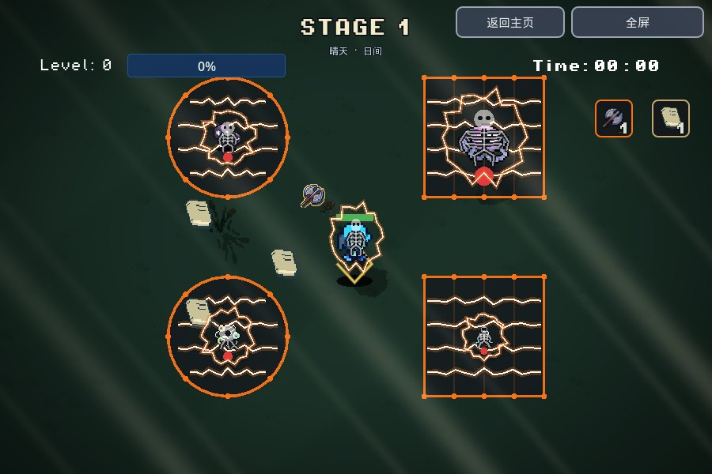
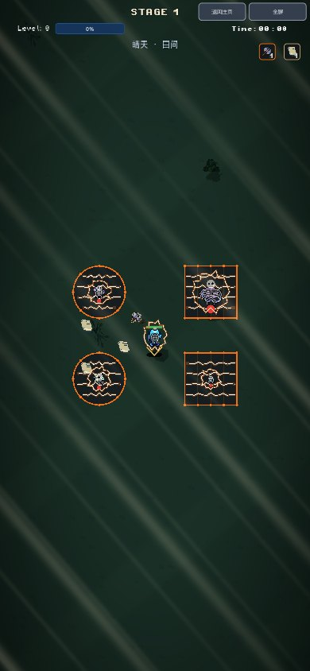
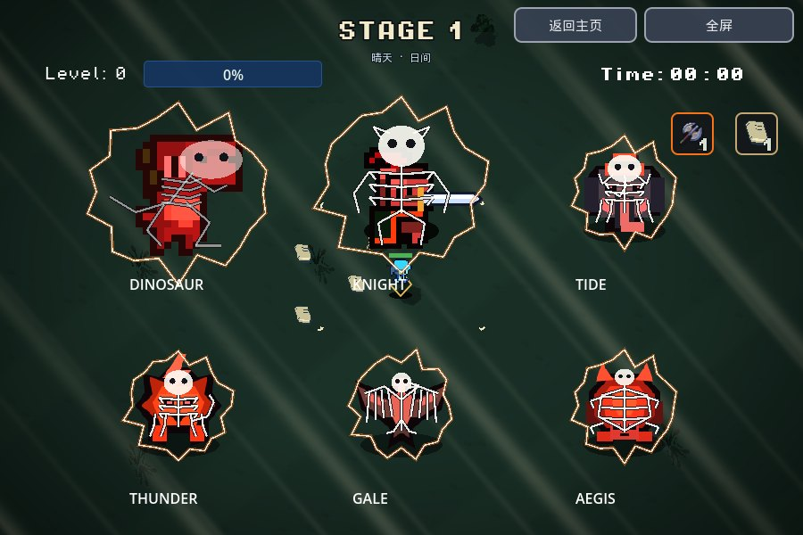

# 晴天电网（v2，20261116-122338）

Debug →「晴天电网 · 麻痹 / 群怪传导」。该入口使用既有天气练习生命，可切换天气；普通局保持随机天气和正常生命。

## 规则与取舍

- 晴天（CLEAR，包括该天气的夜晚）保持4个世界固定圆形/方形区域；圆直径76～108，矩形宽76～108/高70～108。初始与刷新均避开玩家至少60余量。每移动64检查一次，离玩家420以上且离开屏幕90余量的旧区域才被回收，在前方附近重新随机生成，始终只有4个槽。新区域有完整0.75秒预警，站定不刷新、屏内地形不跟随相机滑动。切回同关晴天保留位置并重置预警，转关重新布局。
- 4.5秒周期：0.75秒红橙预警、1.2秒通电、2.55秒断电。每个目标每周期最多命中一次，四个区域共用去重表。
- 玩家第一关18伤害、逐关+3；怪物为3倍，第一关54、逐关+9。玩家保留原减伤/护盾；Dash与冲刺后无敌、武装组合无敌、受伤保护期间不触发。环境伤害不吃玩家暴击、武器或异常增伤，也不触发新的攻击链。
- 存活的触电者麻痹1秒。玩家触电后1.5秒内不会再次被电，即恢复后有0.5秒电网保护；同时保留至少1.25秒普通受击保护，避免无法移动时被群怪立即连续撞死。该0.5秒为电网保护，不额外增加通用无敌。
- 相距42以内的怪物可逐级传导；怪物不会把电反传到玩家，玩家只因接触电网受伤。怪物、骑士、神兽蓄力/当前攻击被取消，恢复后走正常恢复与重新预警流程，不能续接旧的伤害判定。
- 电流使用白芯/橙边、暗底和电极，与玩家青色攻击区分。触电者外围增加闭合不规则电流环（25点固定缓冲）；小怪按追击/敏捷/坦克/眼球绘制不同骨骼并按体型缩放，Boss独立恐龙尾骨/大颚、骑士胸骨、巨象象鼻/象牙、狮尾/四肢、隼翼骨/爪、玄龟背甲/肋骨轮廓。每次触电缓存骨架几何，朝向/锚点跟实际精灵；连线只短暂显示；所有颜色引用GamePalette。

## 实现与成本

`environment_weather.gd`拥有`electric_grid.gd`。后者用两个CanvasItem（地面网格及骨架覆盖层），不创建每怪粒子、灯或Timer。最多64骨架/128连线；每0.1秒在通电阶段对CombatTargets作一次查询，位置快照→空间格桶→迭代队列搜索→先标记全部目标→统一apply_hit。无递归、无每条链再次查全体敌人的调用。

新增`electric_zap_visual.gd`负责骨架与环，仅触电时计算轮廓；绘制环复用缓冲。圆形判定使用线段到圆心距离，圆外接方框的角落不伤人；方形使用矩形扫掠。

单批最多512目标，超过时按周期轮换覆盖，属于异常超载保护；当前普通刷怪上限32/44加每分钟2，远低于预算。怪物采样位置和电流效果不会无限累积。普通移动扫掠检测防穿网，超过300距离的瞬移只检测落点。

`player.gd`、`enemy_shell.gd`、`boss.gd`拥有独立的electric_stun_left，不借用木头人试炼锁位或全局顿帧。宝藏守卫/信使/骑士/神兽补充其自有物理循环；`enemy_attack_field.gd`拒绝麻痹来源并取消已发起的战术攻击。天气退出、试炼/休息/转场、结束时清暂态；暂停冻结周期。天气FX为0仍显示危险区域。

## 验证（本轮）

- Godot 4.7无头导入、Web导出；5项源码专项（电网/天气/风冰环境/Debug/Dash），实际最终Web PCK再次运行电网、天气、Debug。见`validation/electric-grid-v2-20261116.json`。
- 电网1034断言：原传导/伤害/逃离/生命周期测试，以及4区探索长期刷新、避开玩家、新区完整预警、圆角无误伤/圆区扫掠、0.5秒准确保护、4种小怪与6种Boss骨骼、闭合变形电环等。
- 原生横屏900×600、竖屏390×844及Boss骨骼专页900×600，附灰度。画廊为冻结状态的视觉夹具，Boss分散摆放方便检查，不是实际同时出现六个Boss的游戏机制。
- 无本轮浏览器/Safari真机/FPS结论。原生退出资源/GL警告继续保留；开发中一次脚本替换误匹配内嵌_draw导致导入失败，修正后重新导入/专项通过，最终结果记录不混用该失败轮。

命令（GODOT指向4.7）：

```sh
"$GODOT" --headless --rendering-method gl_compatibility --audio-driver Dummy --path . --editor --quit
"$GODOT" --headless --rendering-method gl_compatibility --audio-driver Dummy --path . --script res://tools/smoke_electric_grid.gd
"$GODOT" --headless --rendering-method gl_compatibility --audio-driver Dummy --path . --export-release Web /absolute/output/index.html
DISPLAY=:103 ROGGE_CAPTURE_DIR=/absolute/captures "$GODOT" --rendering-method gl_compatibility --audio-driver Dummy --path . res://tools/preview_electric_grid.tscn
```




