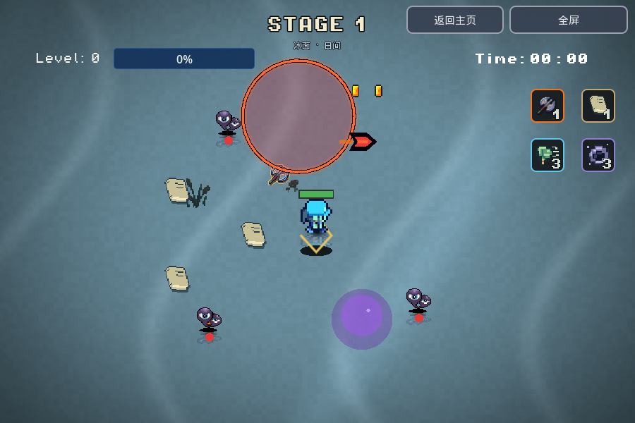
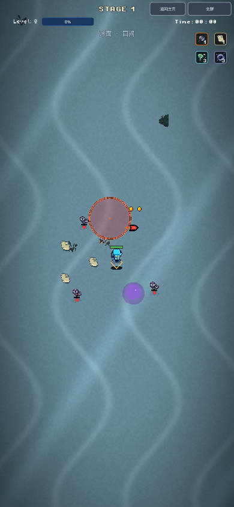
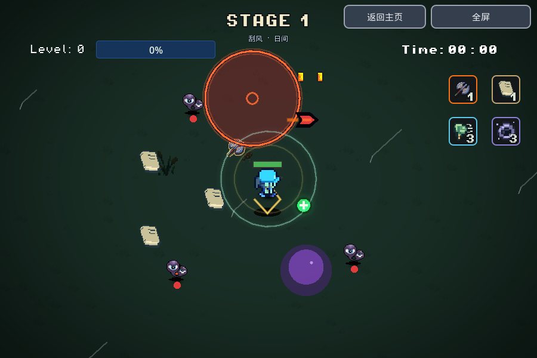
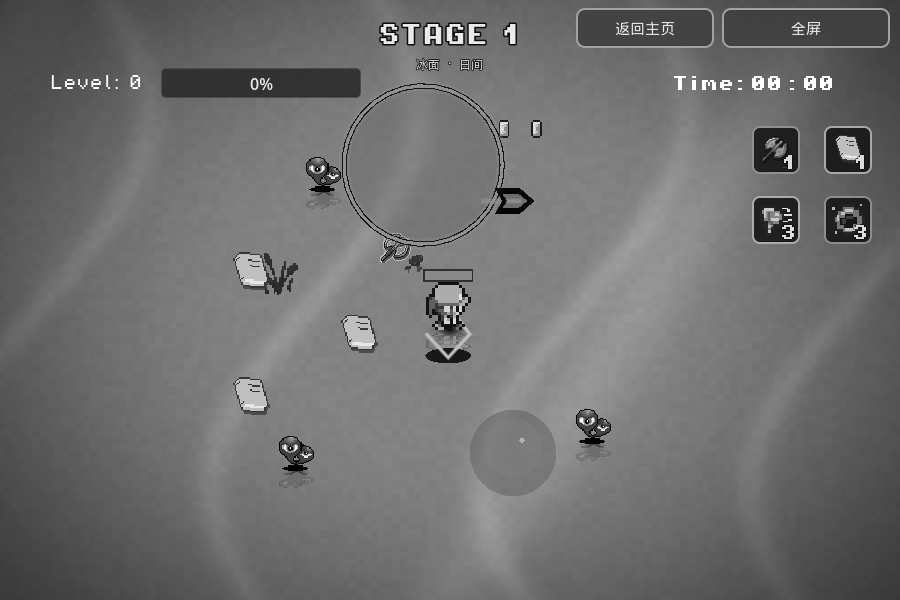

# 刮风与冰面

版本：20261116-101336（北京时间）。基于冬季雪景分支；保留已有28卡、星轨与雪地脚印。新增两个随机天气，不把已有雪天直接变成强制滑冰。

## 玩法与边界

| 环境 | 玩家 | 普通敌人 | 表现 |
| --- | --- | --- | --- |
| 刮风 | 缓慢变化的世界方向，最大16单位/秒偏移；可逆风操控 | 普通追击受0.75×体型抗性风力；Boss游走仅0.3倍 | 世界坐标风线，复用轻风环境音 |
| 冰面 | 加速度900→260，减速度600→100；基础移速100时约1秒停下，可反向刹车 | 普通追击转向带惯性；芭蕉扇、黑洞、炸弹位移速度在原上限和抗性之后×1.3 | 蓝灰冰面、世界纹理与光泽、有限数量倒影 |

- 玩家冲刺方向、速度、持续时间、冷却和结束后0.5秒无敌不变。原有冲刺末速度保留，冰上停得更慢；滑行不延长无敌。
- 敏捷怪冲刺×1.25，距离57.2→71.5；起手时保存倍率，箭头和实际位移共用它。天气在警告中切换也不改变已锁定距离。落地不追加滑行伤害段，接触后停滞仍生效。
- 不漂移已锁定的敌方预警/攻击；Boss攻击位移、坦克突击、战术怪锁定动作不加速。这里“位移技能增强”主要针对玩家的推/吸/爆炸和敏捷怪冲刺，不是一律增加怪物移速。
- 风力与摩擦不受“天气特效”画质滑块影响。关闭特效会停倒影/风线，冰面底色仍保留，避免看不见脚下会滑。
- 暂停、休息、试炼、转场、死亡与结束时不施加环境力；木头人锁位优先。六天气洗牌袋/关卡缓存沿用独立RNG，不改变刷怪随机序列。

## 测试入口

主页 → Debug 首屏：“刮风场景”和“冰面场景”。两项自带3级芭蕉扇/黑洞及练习生命；底部可切天气、昼夜、返回。25项继续分页，普通开局不携带Debug装备。

推荐试玩：横向/纵向走动后松手、立即反向、斜向Dash；在冰面上把怪群推开或吸拢，观察敏捷怪红箭头与落点；再切回晴天比较手感。

## 实现与预算

- `environment_surface.gd`集中环境力与绘制；天气控制器管理6种权重、音频沿用4套素材/3个声部。
- `player.gd`保留move_and_slide和真实位移步态，只改普通移动目标/加减速；`enemy_shell.gd`在普通转向后应用环境目标，不按帧无限叠加风速。宝囊精复用普通运动入口，Boss仅游走时加入轻微偏移。
- `infinite_ground.gdshader`在原舞台底色上叠冰层，不使用屏幕复制、反射相机或新增实时阴影。倒影复用光影模块缓存，最多玩家+16敌人；风线最多48条（每条两段），无逐粒子/逐怪新增节点、无额外场景树群体搜索。
- 配色新增`GamePalette.ICE_GROUND/ICE_REFLECTION`。原雪花和128脚印池不改。

## 验证

本轮14项原生专项最终通过；实际最终Web导出的PCK再跑环境、天气、控制卡、Debug四项。环境新测36断言包含真实键盘加速/松手/反向、Dash、30/60Hz及慢帧冲刺距离、原抗性后的30%位移增强和生命周期。完整结果、导出哈希和既有退出警告见`validation/wind-ice-20261116.json`。

可复现（`GODOT_BIN`指向4.7正式版）：

```sh
"$GODOT_BIN" --headless --rendering-method gl_compatibility --audio-driver Dummy --path . --editor --quit
"$GODOT_BIN" --headless --rendering-method gl_compatibility --audio-driver Dummy --path . --script res://tools/smoke_environment_surface.gd
"$GODOT_BIN" --headless --rendering-method gl_compatibility --audio-driver Dummy --path . --script res://tools/smoke_weather.gd
"$GODOT_BIN" --headless --rendering-method gl_compatibility --audio-driver Dummy --path . --export-release Web /ABSOLUTE/OUTPUT/index.html
"$GODOT_BIN" --main-pack /ABSOLUTE/OUTPUT/index.pck --headless --rendering-method gl_compatibility --audio-driver Dummy --script res://tools/smoke_environment_surface.gd
```

另检查移动/Dash方向与无敌、敏捷怪平衡/停滞、控制卡、炸弹、木头人、Boss节奏、雪景、天气音频和Debug。旧Boss慢速断言现明确关闭随机环境，避免把风力当成毒减速回归。未运行无关完整回归。

原生Compatibility渲染900×600、390×844及灰度图已检查。红色预警、毒圈、人物/金币与冰面保持可辨；截图是构造的可重复场景，不是浏览器实机性能证明。






仍需真机反馈：Safari/手机群怪帧率、长局滑行难度、手柄/触摸手感。没有本轮托管浏览器验证；CLI ObjectDB/resources和原生渲染器关闭时Texture/RID警告仍在。不要将无解析/运行脚本错误表述成无内存问题。
