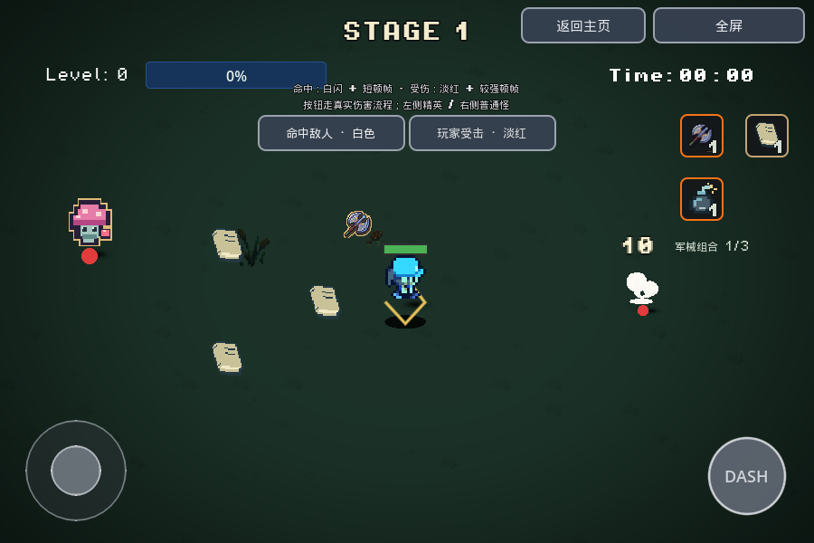
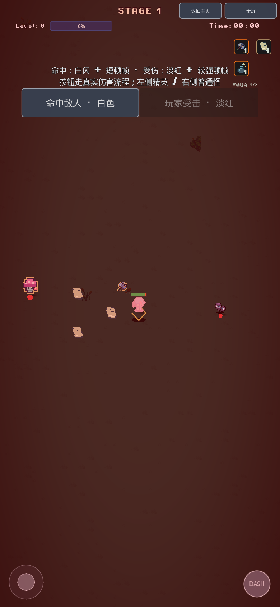

# 命中顿帧与白色／淡红反馈

玩家打中敌人：真实帧轮廓闪白85ms，短顿帧目标28ms。玩家实际损失生命：轮廓闪淡红115ms，较强顿帧目标65ms。画面短时间降到0.05倍速度，并由真实时钟恢复。具体显示时长按渲染帧量化；不把软件浏览器录制当作高帧率性能测试。

## 试玩

主页 → Debug → **命中顿帧 · 白色 / 淡红**。

“命中敌人”交替命中右侧普通怪和左侧精英；“玩家受击”走真实扣血流程，受伤保护期间按钮暂禁用。也可以正常开局体验武器命中。原“动态表现 · 彩墨 / 残影 / 投弹”继续可用。

## 限频与兼容

- 普通命中停顿全局间隔200ms，同目标闪色间隔140ms；重复命中不延长停顿。玩家受伤有独立400ms门限，可将正在进行的短停顿升级，总长度仍限制为起始65ms。
- 持续/二次伤害from_status不触发；护盾完全吸收、冲刺/军械无敌、受伤保护和无效伤害不误闪红。Boss旧的独立慢动作控制已统一，原死亡慢动作优先；不把其他控制器的时间强制恢复为1。
- 试炼只保留闪色，原倒计时/0.5秒锁定及反击窗口不受新顿帧影响。暂停、转场、结束、重试、Home和节点释放都清理持有状态。
- 48个固定轮廓槽，玩家独占0号槽。共用现有轮廓shader，无每次命中Node、灯光、Tween或Timer；不复制/修改角色材质，不破坏毒/冰染色。致死命中短暂保留实际帧，UV/翻转/姿态与原图一致。
- 伤害数字仍用原内容/大小/颜色，但层级在闪色上方，Tween忽略时间缩放。死亡血迹使用真实时钟，避免delta与新time_scale不匹配造成跳动，原停留/淡出/吸墨规则不变。

## 有针对性的验证

```bash
GODOT=/path/to/Godot_v4.7-stable_linux.x86_64
"$GODOT" --headless --rendering-method gl_compatibility --audio-driver Dummy --path . --editor --import --quit
"$GODOT" --headless --rendering-method gl_compatibility --audio-driver Dummy --path . --script res://tools/smoke_hitstop.gd
mkdir -p export/web
"$GODOT" --headless --rendering-method gl_compatibility --audio-driver Dummy --path . --export-release Web export/web/index.html
```

新专项78断言走真实伤害与Debug按钮，检查限频、不续长、护盾/无敌/状态伤害、Boss、死亡时间优先级、暂停/试炼、80怪命中时的固定池、致死帧、血迹无突跳、Retry/Home清理。相关反馈、跳字、Dash、Boss、试炼、血迹、彩墨、移动和卡牌回归一并记录。

[检查与构件记录](validation/hitstop-20261110.json)区分原生、真实PCK、原始Web和托管发布。QA入口`tools/preview_hitstop.tscn`仅观测实际游戏/按钮，并在渲染完成时读取短暂帧以核验白色/淡红像素，不冻结或延长实际游戏时钟。正常入口不加载它；GPU读回/PNG编码有开销，QA记录不用来评判帧率。CLI旧退出资源警告仍保留，无Safari真机/密集怪/全流程结论。

| 敌人白闪（实际渲染帧） | 玩家淡红（实际渲染帧） |
| --- | --- |
|  |  |
