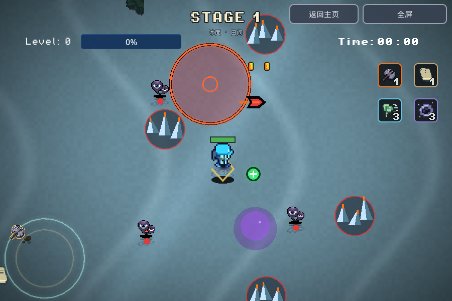
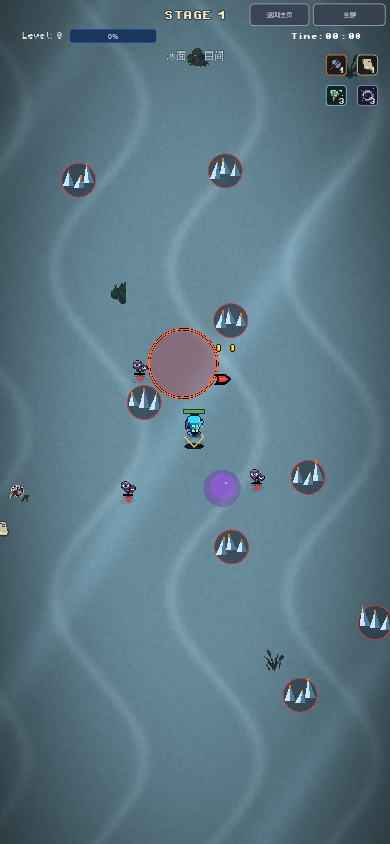
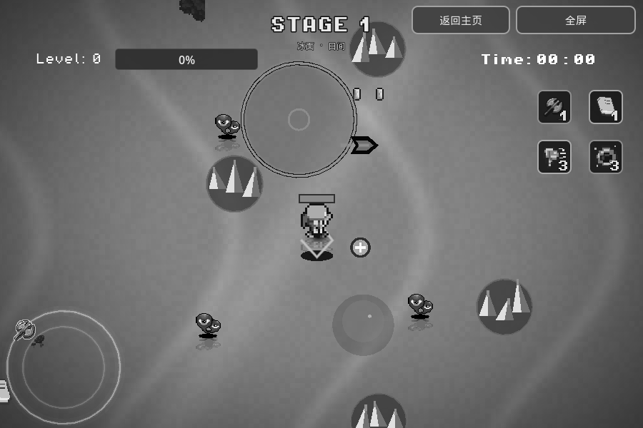

# 冰面尖刺

版本 **20261116-102807**。在冰面天气中增加可利用的地形伤害：把敌人引入或推上尖刺，同时避免自己滑进去。沿用冰面的惯性、风与雪景，不增加卡牌。

## 规则

- 每个96×96世界网格有约10%概率出现一簇尖刺。这里的密度指网格出现率，不是精确10%的地面伤害面积；每簇接触半径22。固定种子抽样10,000格命中1,006格。
- 每局独立随机种子，关卡/坐标确定布局；走远再返回位置与形状一致。只缓存镜头附近及两格缓冲区，逐步生成/回收；远处不留下无限实例。冰面初次进入点周围112单位不生成尖刺。
- 尖刺显示为深色圆形底座、白蓝尖锥、红色危险边缘和橙红尖端。首次进入冰面有0.8秒生效缓冲。关闭天气FX也不能隐藏有伤害的尖刺。
- 第一关玩家每次基础12伤害，普通怪/Boss36；每关分别增加2/6，六关22/66。每个目标全局共享1秒尖刺冷却，跨越多个尖刺不会叠加秒伤。尖刺不阻挡移动。
- 玩家经原`receive_attack`结算，减伤、护盾、冲刺与结束后无敌均保留。敌方伤害是预先计算的环境伤害，`from_status + damage_is_final`避免玩家暴击、背击、吸血、异常被动影响；正常死亡和掉落路径保留。
- 高速滑行/击退使用路径扫掠；超过300单位的瞬移仅检查落点，避免对传送路线判伤。玩家每物理步检测，敌人约每0.1秒统一扫描。暂停冻结计时；休息/试炼/转场/其他天气/结束关闭并清理暂态。

## 实现

`script/ice_spikes.gd`挂在天气控制器下：单绘制节点，固定128尖刺槽、12组复用尖锥形状、最多512个附近敌人接触记录。镜头跨网格才重建可见地形，位置哈希不消耗战斗全局RNG。每批仅一次`CombatTargets.fill_in_bounds`线性注册表查询，再按各目标经过的少量网格查表，避免“每根尖刺×全部怪物”嵌套搜索。死亡/离开范围的记录会移除。

天气控制器负责新局重置/结束清理；配色放在`GamePalette`。Debug继续25项分页，现有“冰面场景 · 滑行 / 尖刺”入口可直接测试，自带扇/黑洞与练习生命。

## 验证

6项原生专项最终通过：尖刺41断言、环境惯性、天气、控制卡、Dash无敌、木头人。最终Web PCK再跑尖刺、环境和天气3项。详细记录在`validation/ice-spikes-20261116.json`。

```sh
"$GODOT_BIN" --headless --rendering-method gl_compatibility --audio-driver Dummy --path . --editor --quit
"$GODOT_BIN" --headless --rendering-method gl_compatibility --audio-driver Dummy --path . --script res://tools/smoke_ice_spikes.gd
"$GODOT_BIN" --headless --rendering-method gl_compatibility --audio-driver Dummy --path . --export-release Web /ABSOLUTE/OUTPUT/index.html
"$GODOT_BIN" --main-pack /ABSOLUTE/OUTPUT/index.pck --headless --rendering-method gl_compatibility --audio-driver Dummy --script res://tools/smoke_ice_spikes.gd
```

原生Compatibility横屏900×600、竖屏390×844、灰度截图已检查。没有本轮托管浏览器、Safari真机或群怪FPS结果；既有ObjectDB/resources与渲染器退出警告单独记录。打包期间工作盘满，本轮生成的Web导出移至内存临时目录后重新完整导出和测试；源码、旧工作树、备份均保留。





后续试玩重点：10%网格密度是否足够、滑冰时伤害节奏、扇/黑洞对地形的利用价值与手机密集敌人负载。
