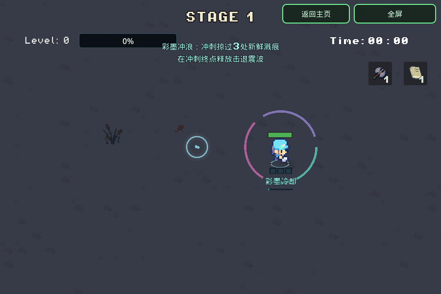

# 彩墨冲浪

版本 `20261108-004105`。这是默认开启的走位机制，不增加卡片或技能按键。目标是让玩家主动选冲刺路线，把清怪留下的位置转成下一次解围机会；趣味性与数值仍需玩家试玩。

- 怪物死亡后的墨迹完成飞散落地（0.42秒）后可吸收，在2秒开始淡出后不可吸收。
- 冲刺路径距主墨迹中心24单位以内即吸收，使用线段扫掠，避免低帧率跳过。普通走路不收；一次超过220单位的瞬移不算扫过路径。
- 积满3处，在本次冲刺终点释放彩墨震波：基础60伤害、90单位半径，幸存普通怪获得有抗性的向外击退。部分充能可留到下次冲刺，不要求三种颜色。
- 震波冷却6秒，冷却期间不消耗墨迹；每处只吸一次，每次冲刺最多一发。震波产生的新血迹会在冷却结束前过期，不能靠自己的击杀连续自充。
- 伤害走现有 `apply_hit`，使用 `from_status` 防止暴击、吸血或追加点燃等触发；原有减伤/已拥有的伤害倍率与试炼易伤窗口仍有效。奖励照常。Boss不被强制位移。
- 脚下3格充能与短提示、吸收/满额音效、冷却条和三段彩色圆弧展示状态，没有全屏闪光或新灯光。

主页 → Debug → **彩墨冲浪 · 冲刺吸墨震波**。沿角色朝向自动刷新练习墨迹，可以向右移动后按Shift（手机点击DASH）吸收并观察震波；附近三个高血量追击怪用于看伤害/击退。练习辅助只在此preset启用，正常开局不刷新免费墨迹。

`Game` 持有 `InkSurf`，`Player.dash_started` 与现有 `dash_completed` 负责可靠地覆盖整段路径。仅冲刺且可充能时扫描固定128组血迹；每次释放查询一次现有 `CombatTargets` 注册表并复用目标数组。伤害前先关追踪和设置冷却；generation检查避免奖励/过关同步清理后继续旧伤害循环。

暂停冻结时间，休息/转场清充能和冷却，新局/结束/返回主页重置全部临时状态与Debug辅助。木头人禁移动时不追踪，不更改任何dash无敌时间。

`tools/smoke_ink_surf.gd` 有23项聚焦断言：真实dash信号/线段扫掠、3次充能与跨dash保留、单次伤害/击退、半径/屏障、无暴击/吸血/点燃递归、奖励、冷却/暂停/休息、瞬移/空中/淡出排除、移动锁与Debug/主页/新局隔离。完整本轮验证范围见 [validation/ink-surf-20261107.json](validation/ink-surf-20261107.json)。

```bash
XDG_DATA_HOME=$(mktemp -d) "$GODOT_BIN" --headless --rendering-method gl_compatibility --audio-driver Dummy --path . --script res://tools/smoke_ink_surf.gd
```


