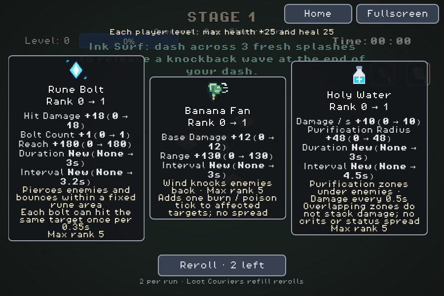
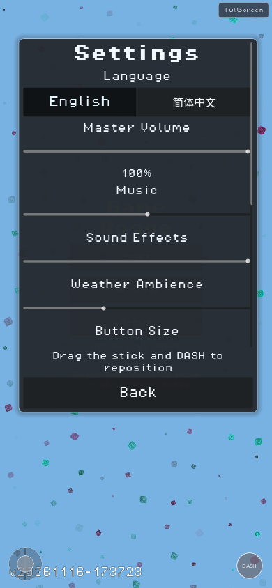
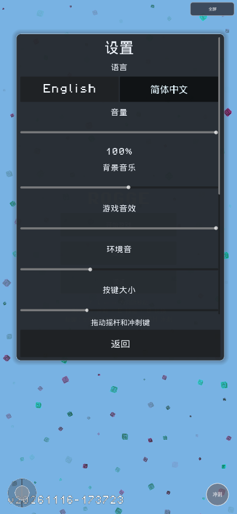
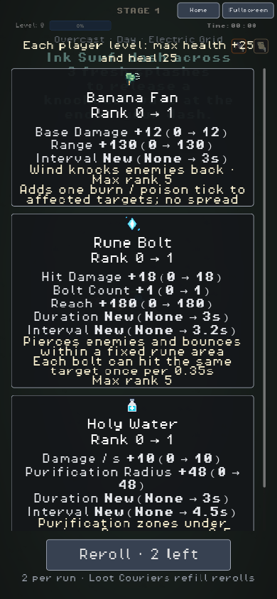

# English / 简体中文 · 第一版

版本 **20261116-173723**，分支 `feature/localization-20261116`，基于风场分支 `a7f8641`。入口：主页 **Settings → Language**，选择 **English / 简体中文**。新安装和没有语言字段的旧设置默认英文；选择保存到原 `user://rogge_settings.cfg` 的 `play/language`，保留原音量、难度和控件布局。

## 实现边界

- `locale/messages.csv` 是集中翻译表，805 个消息键含英文别名。Godot 导入生成 EN / zh_CN Translation；生成的 `.translation` 不进 Git，导入后再导出。
- `script/l10n.gd` 封装 TranslationServer。场景静态按钮/标签由 Godot 自动翻译；格式化提示先翻译模板，再填数值；常量标题/说明在读取时翻译。英文别名用于已创建的静态控件切换回中文，不靠逐帧场景树扫描。
- 设置页两种语言按钮即时切换；覆盖主页/返回/全屏/冲刺、升级卡、装备与组合提示、四神兽技能、Boss 行动提醒、试炼/休整/抽奖、天气/环境危险、事件提示、结算和 Debug。
- CardNumbers 保留原 `label` 数据键，只有展示文字翻译；before/after 和所有升级公式不变，移速卡仍固定 +20。卡名与等级比较分两行，必要时省略并保留完整 tooltip；正文自动换行且可在卡牌外层滚动。按钮省略不撑宽，技能/装备 tooltip 有宽度限制与 CJK 字体回退。
- 本版语言入口仅在主页设置。进入新一局生成对应语言的动态 HUD；没有新增战斗中热切换入口。按键标识、内部节点/动作/音频总线名称不翻译。
- 不改变战斗数值、抽卡/奖励、天气、移动或装备机制。未合并正式 master，未发布正式 itch。

## 验证与复现

```sh
python3 tools/audit_localization.py
GODOT --headless --rendering-method gl_compatibility --audio-driver Dummy --path . --editor --quit
GODOT --headless --rendering-method gl_compatibility --audio-driver Dummy --path . --script res://tools/smoke_localization.gd
GODOT --headless --rendering-method gl_compatibility --audio-driver Dummy --path . --script res://tools/smoke_palette_cards.gd
GODOT --headless --rendering-method gl_compatibility --audio-driver Dummy --path . --script res://tools/smoke_debug_menu.gd
GODOT --headless --rendering-method gl_compatibility --audio-driver Dummy --path . --script res://tools/smoke_menu_layout.gd
GODOT --headless --rendering-method gl_compatibility --audio-driver Dummy --path . --export-release Web /ABS/OUTPUT/index.html
```

使用独立 `XDG_DATA_HOME` 验证首次启动，避免修改真实用户设置。Godot 路径见交接文件。源码 4 项与最终 Web PCK 3 项通过：多语言 382 检查、实际升级数值 464 检查、Debug 7773 检查及菜单布局。新测试包含保存/重载、旧存档迁移、非法语言回退、控件设置保留、28 张卡数值一致、四技能说明及 900×600 / 390×844 / 844×390 布局。英文更长的卡片允许外层滚动；检查正文不裁切、底部能滚动到达和重抽始终可见，不再要求所有长卡同时完整塞进手机横屏。

CSV 审计检查重复键、空翻译、printf 参数一致、英文残留中文及源码中文展示字符串覆盖（字体预热/语言自称除外）。不是机器审美/翻译质量证明，后续仍需按试玩反馈润色。

原生截图命令：`DISPLAY=:105 ROGGE_CAPTURE_DIR=/ABS/CAPTURES GODOT --rendering-method gl_compatibility --audio-driver Dummy --path . res://tools/preview_localization.tscn`。截图为原生 Compatibility，未声称浏览器/Safari/手机实测；既有退出资源和 GL 泄漏警告未修复。导入/导出没有脚本错误。

Web 包因包含多语言 ICU 数据超过试玩站单文件限制；试玩 Site 的已有流式 gzip loader 扩展到 PCK，和 WASM 一样压缩传输、恢复原字节。26 项 Node 检查覆盖两类资源、已由主机解压/原 gzip、MIME、查询参数、非游戏请求及损坏文件。实际 Web PCK 测试通过仍不等于浏览器实机验证。

证据：[validation/localization-20261116.json](validation/localization-20261116.json)。临时构建/原始日志：`../localization`；持久代码、文档和截图以 GitHub 为准。

## 截图

英文横屏卡牌：



英文竖屏设置 / 中文切换：




英文竖屏卡牌（可滚动）：



## 后续维护

新增文案进 CSV，并使用 `L10n.text(template) % values`；内部 ID 不翻译。中英模板占位符必须一致，保留英文静态控件的反向别名。不要把已经格式化的整段动态内容交给 tr 查找。增加语言或战斗中设置入口时，需要让现存动态 HUD/卡牌在 locale_changed 后重新生成；本版没有暴露这一操作。

## 试玩发布

[打开私有试玩](https://rogge-palette-playtest-20261109.whiteber.chatgpt.site)，版本 **20261116-173723**。设置路径 **Settings → Language → 简体中文**。源码 [PR #27](https://github.com/wyb969/Rogge/pull/27)，发布于北京时间 2026-11-16 17:46；保留 owner-private 权限。发布成功不代表完成浏览器/Safari 实机测试。见 [发布证据](validation/localization-playtest-20261116.json)。
