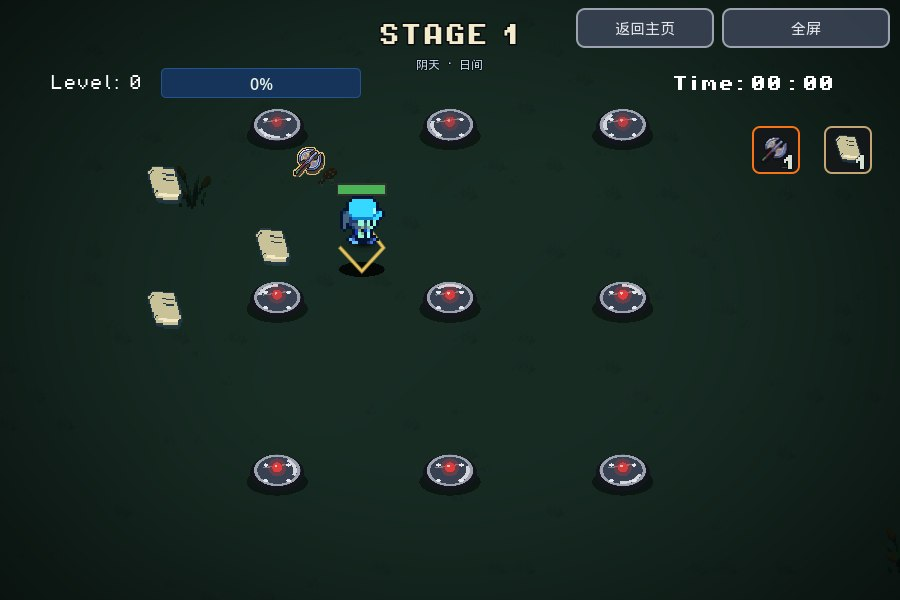
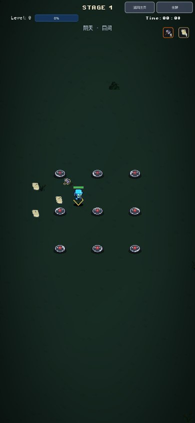
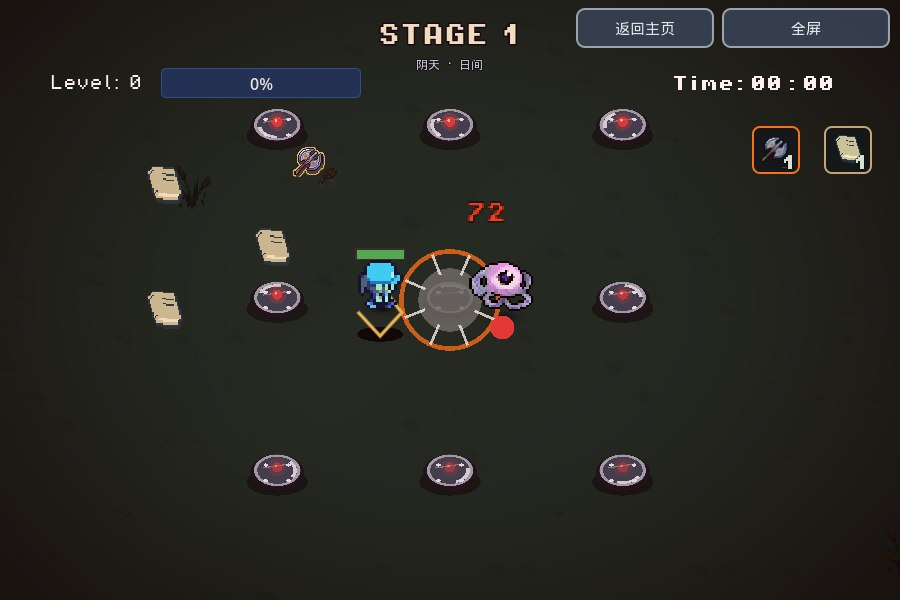

# 九宫格地雷

版本20261116-143125。Debug首项「九宫格地雷 · 爆炸 / 击退」，使用天气练习生命与阴天来单独观察地雷；普通局不限制天气。

## 规则

- 一组3×3共9枚，间距96世界单位，生成在当前视野中央附近；如果初始落点贴着玩家，会整体偏移半格，使玩家位于行列间。首次出现1秒布置预警。地雷固定在世界中，屏幕内的雷区不随相机滑动。
- 玩家探索至原阵列650以上且整组离开视野100余量后，在当前视野附近重新布置完整9枚，重新预警；没有无限累积的历史地雷。
- 压力触发半径16，普通高速移动扫掠判定；超过300的瞬移只看落点。踩中后0.16秒闪烁加速再爆炸，爆炸半径44。
- 从踩中时刻计时3秒恢复；最后0.55秒显示重组红灯，冷却期灯熄灭/底座变暗。暂停冻结计时。爆炸不会引爆旁边地雷，同批重叠爆炸对每个目标只计一次。
- 第一关玩家24、敌人72伤害，逐关+3/+9。环境伤害复用正常伤亡/奖励路径，不受玩家暴击/武器增伤、不触发命中类追加攻击；玩家保留正常减伤、护盾、受伤保护、Dash与武装组合无敌。
- 只有存活且未免疫的目标受到位移冲击。玩家260初速度/0.28秒线性衰减，无遮挡约36.4距离；普通怪360起、按体型与冰面系数调整；Boss保留28%力度。运动经过碰撞检测，不穿墙瞬移。
- 控制位移取消原攻击；恐龙/骑士/神兽重新走恢复和预警，避免被推开后旧攻击仍造成伤害。电麻痹计时与物理位移可以同时进行，不恢复玩家输入；试炼锁位仍有最高优先级。

## 实现

`environment_weather.gd`持有`minefield.gd`，与日夜/天气类型无关；复用surface.active的暂停、试炼、休息、转场、死亡判断。九个固定数据槽+单绘制节点+一个共用音效播放器，无每雷Area、Timer、灯或粒子系统。

怪物触发每0.1秒一次CombatTargets边界查询；需要爆炸时强制刷新一次快照。同批先确定全部目标，再统一伤害/冲击；单次最多512目标。复用原炸弹短音效，同批合为一次，不随怪物数量叠音。红灯、银灰外壳、旋转局部高光和橙白冲击环均使用GamePalette。

`terrain_impulse.gd`是独立RefCounted状态，以解析积分计算衰减位移，避免30/60Hz位移距离不同。玩家/普通怪/信使/宝藏守卫/骑士/四神兽接入自己的物理循环。电麻痹与地形冲击共享“取消旧攻击”函数，不借用电麻痹时长、试炼锁位或全局顿帧。结束清理仅地雷施加的地形冲击，原武器blast通道保留。

## 验证

- Godot4.7无头导入、Web导出通过；12项源码专项及最终实际Web PCK的地雷/电网/Boss节奏/Debug四项通过。详见`validation/minefields-20261116.json`。
- 新地雷252项检查：真实Debug、九宫格间距/安全出生、触发与严格3秒恢复、范围伤害/存活击退/死亡不击退、180怪/重叠爆炸去重与一次查询、Dash/护盾/试炼、30/60Hz/慢帧同位移、Boss攻击取消、电麻痹组合、全部天气、暂停/探索替换/结束清理。
- 原生横屏900×600、竖屏390×844及灰度，另有爆炸快照。未做本轮浏览器、Safari或群怪手机FPS实测；已有原生资源/GL退出警告继续记录。
- 开发中修正两个测试夹具问题：动态调用需显式Array[int]；“范围外”目标原先误放在相邻地雷触发圈，改到四雷之间再验证。最终产品代码检查无脚本错误。

```sh
"$GODOT" --headless --rendering-method gl_compatibility --audio-driver Dummy --path . --editor --quit
"$GODOT" --headless --rendering-method gl_compatibility --audio-driver Dummy --path . --script res://tools/smoke_minefield.gd
"$GODOT" --headless --rendering-method gl_compatibility --audio-driver Dummy --path . --export-release Web /absolute/output/index.html
DISPLAY=:104 ROGGE_CAPTURE_DIR=/absolute/captures "$GODOT" --rendering-method gl_compatibility --audio-driver Dummy --path . res://tools/preview_minefield.tscn
```




