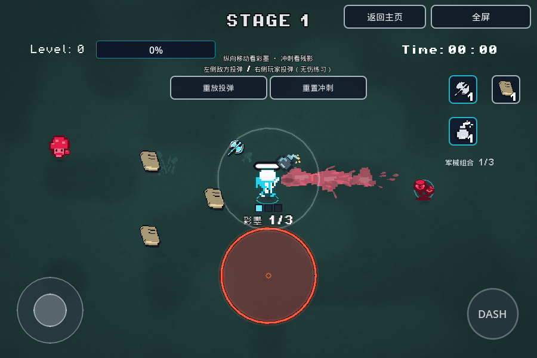
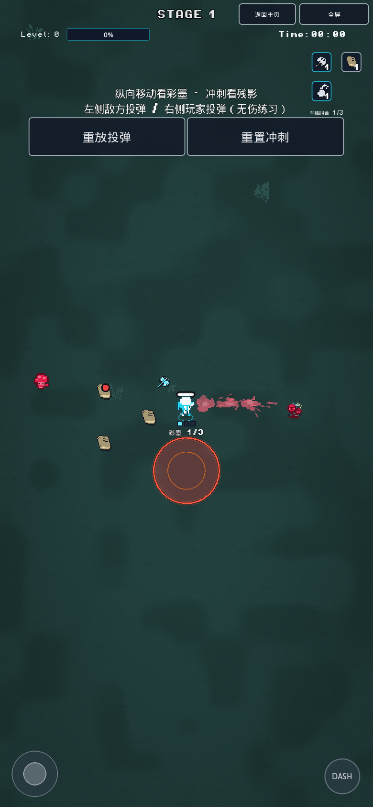

# 彩墨、冲刺和投弹的运动表现

彩墨提示固定继承Player变换，和玩家同次移动，不从世界坐标以30Hz另行追赶；不继承AnimatedSprite的冲刺形变。静态提示不需要每帧重绘。

冲刺沿实际经过的路径每18单位采样，启动即留一帧，8槽复用。0.22秒淡出、最高0.48透明度，独立共享shader只取贴图alpha并使用调色板青蓝色，保留角色轮廓。走路不生成残影，移动、碰撞、无敌和冲刺冷却不改。

双方投弹的物理年龄原来已经使用delta；真正的明显分段来自30Hz重绘门限。现在渲染帧在上一与当前物理年龄之间插值，采用同一抛物线函数，端点、飞行时间和最高点不变。伤害/引信/控制取消仍只由物理控制器推进；敌方预警生效以真实物理相位切换。空池关闭渲染回调，池上限不变。

## 试玩检查

主页 → Debug → **动态表现 · 彩墨 / 残影 / 投弹**。

1. 连续上下移动，观察彩墨三格和1/3文字始终固定在脚下；向上/下/斜向冲刺，文字不拉伸、不掉队。
2. 冲刺时观察青蓝角色轮廓依次留在原地并淡出；“重置冲刺”允许快速重复观察。
3. 左边怪物向玩家下方空地投弹，玩家向右边耐久目标投炸弹，每2秒重放；也可点击“重放投弹”。这是无伤视觉练习，普通敌人伤害未更改。
4. 横/竖屏、暂停/恢复、返回主页再普通Start，检查按钮/卡牌/练习状态正常清理。Retry重新进入同一练习。

## 有针对性的验证

```bash
GODOT=/path/to/Godot_v4.7-stable_linux.x86_64
"$GODOT" --headless --rendering-method gl_compatibility --audio-driver Dummy --path . --editor --import --quit
"$GODOT" --headless --rendering-method gl_compatibility --audio-driver Dummy --path . --script res://tools/smoke_motion_vfx.gd
mkdir -p export/web
"$GODOT" --headless --rendering-method gl_compatibility --audio-driver Dummy --path . --export-release Web export/web/index.html
```

相关回归：`smoke_ink_surf`、`smoke_bomb_card`、`smoke_tactical_enemies`、`smoke_dash_grace`、`smoke_dash_direction`、`smoke_player_motion`、`smoke_camera_motion`、`smoke_combat_feedback`、`smoke_debug_menu`、`smoke_session_toolbar`。用真实PCK复跑新增专项和彩墨/炸弹/战术怪；不以无头通过替代Web验证。

正常main_scene不启用`tools/preview_motion_vfx.tscn`；该QA入口只暴露测试遥测、物理频率和暂停命令。最终正常包与QA副本的763个游戏/资源文件一致。

## 本轮结果和边界

11项不同原生、4项最终实际PCK专项通过；新增专项170断言，含真实引擎120Hz渲染对30Hz物理的双方中间位置。Chromium软件WebGL2桌面和手机尺寸实际菜单/双指移动与冲刺/投弹/暂停/Home通过，正常原始导出也进入了新Debug练习，均无运行脚本错误。

软件录屏帧率不足以评价60/120FPS顺滑程度；最终浏览器低帧率没有采到30Hz tick内连续帧对，不把它描述为硬件高刷实测。旧CLI退出ObjectDB/资源警告保留，未做Safari真机、怪潮压力或全流程回归。证据见[检查记录](validation/motion-vfx-20261110.json)。

| 横屏（正常导出） | 竖屏（正常导出） |
| --- | --- |
|  |  |

[桌面录屏](screenshots/motion-vfx-20261110/desktop-vfx.webm) · [手机双指录屏](screenshots/motion-vfx-20261110/phone-vfx.webm)。短暂Dash截图可能晚于残影寿命，请结合实际录屏/试玩判断。截图与录屏目录带`.gdignore`，不进入游戏包。
