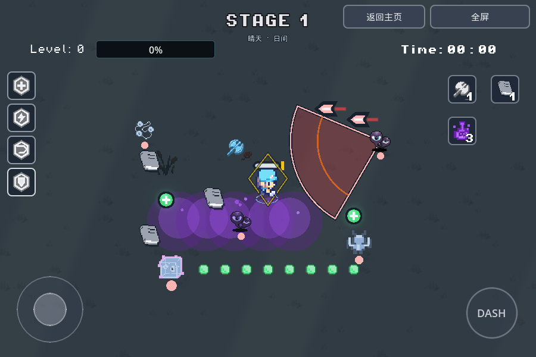
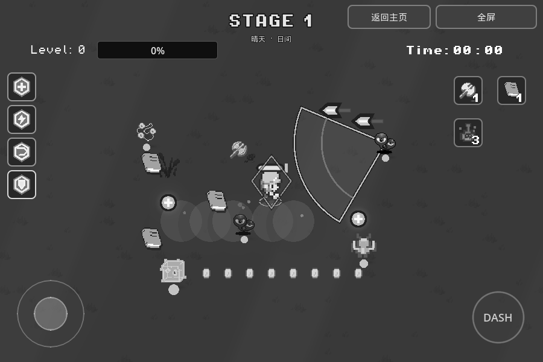
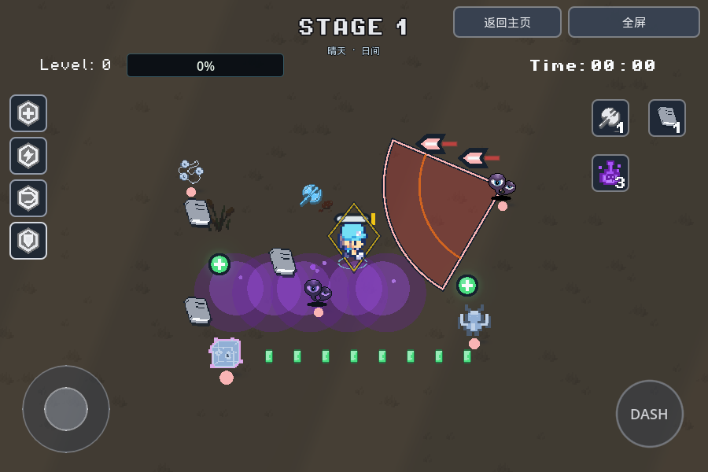
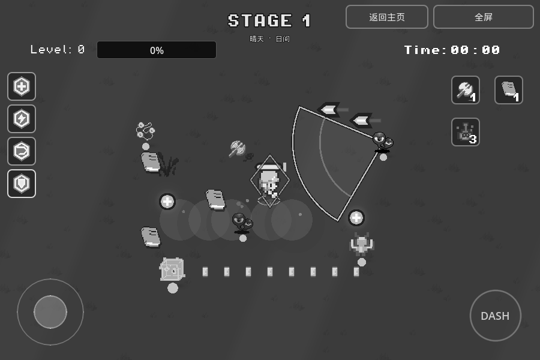
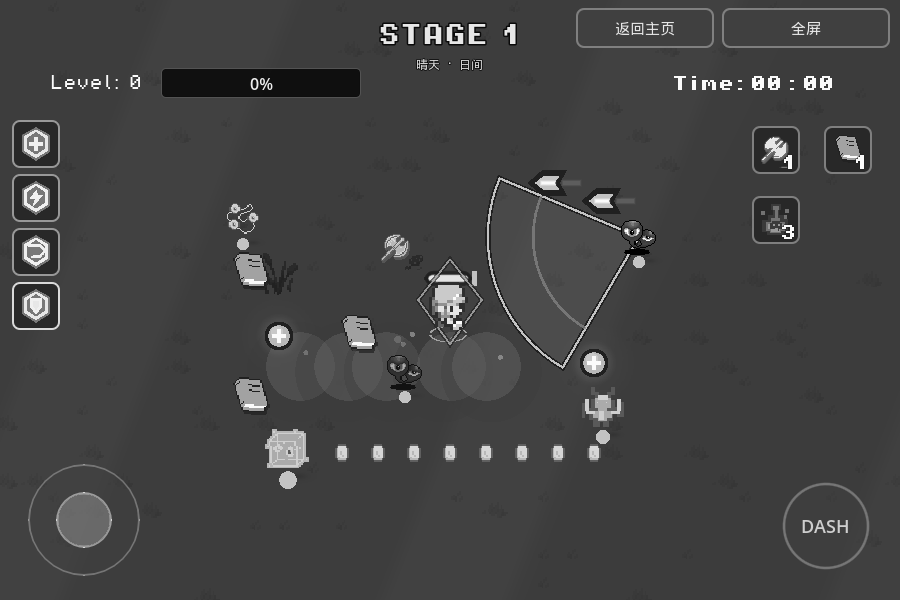
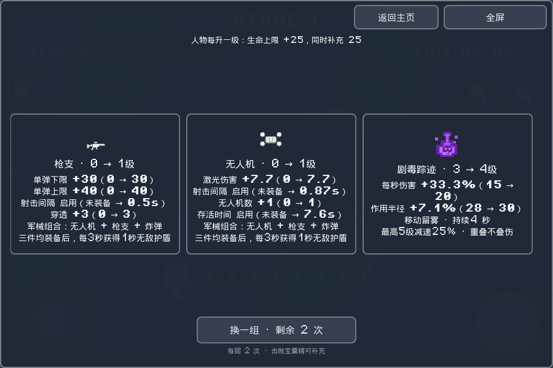
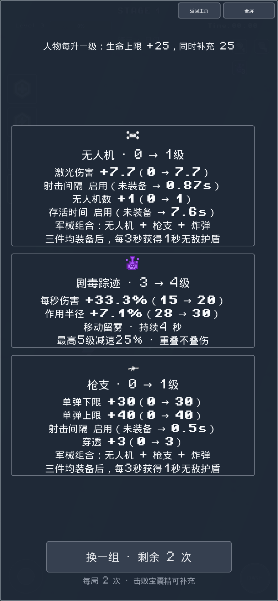
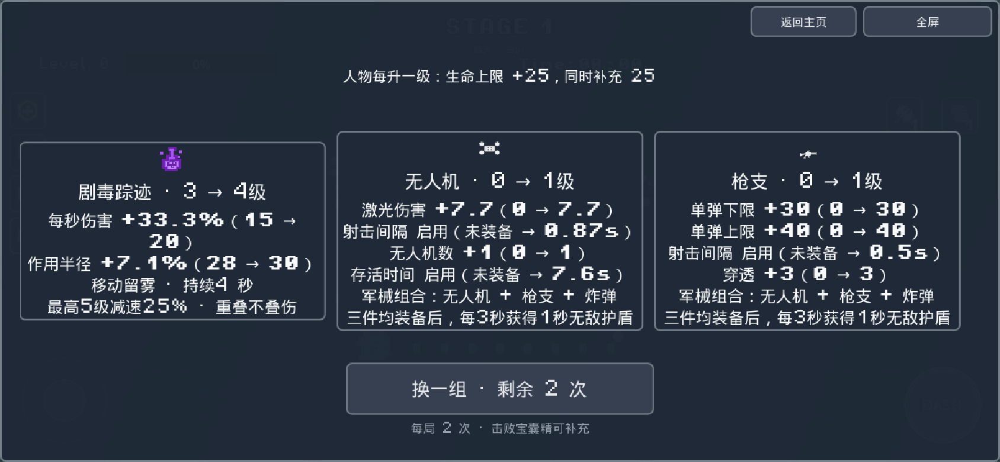
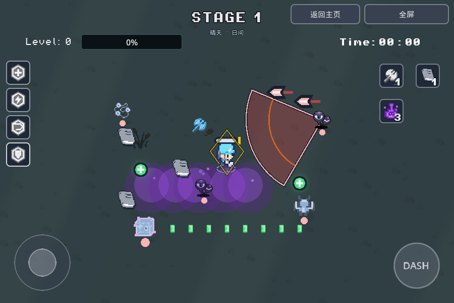
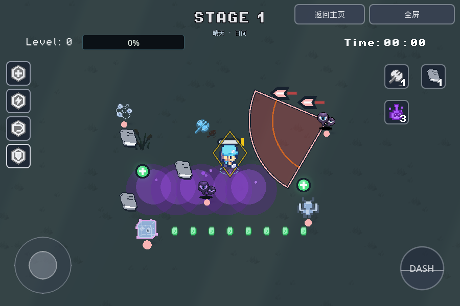

# 颜色语义与升级卡可读性

> 颜色实现已由 [Cursor 配色同步](palette-sync.md) 替换。本文颜色与材质条款为历史记录；CardNumbers/CardPreview 数值文案及非配色功能仍保留。

基于主分支 `master` 的 `7e81adf`（仓库没有 `main`），分支 `feature/palette-card-readability-20261109`。本次只调整颜色、UI、文案与供文案复用的只读数值接口；不调整伤害、概率、冷却、敌人行为和掉落规则。用户已确认移速卡保留固定 **+20**。未更新 itch；正式版本标识仍为 `20261109-192900`。

## 集中颜色定义

所有新增角色色和共享材质参数由 [`GamePalette`](../script/game_palette.gd) 管理；shader 接收 uniform，场景中重复的旧颜色 override 已移除。

| 常量 | 色值 | 用途 |
| --- | --- | --- |
| PICKUP_GREEN | #4ADE80 | 经验、回血和有益掉落物 |
| HEAL_GREEN | #6EE7A0 | 回血跳字、治疗特效 |
| POISON_PURPLE | #A855F7 | 毒雾、尾迹、泡泡 |
| POISON_PURPLE_DARK | #6B21A8 | 毒雾暗部 |
| POISON_TINT | #C084FC | 敌人中毒染色、毒伤数字 |
| DANGER_RED | #EF4444 | 敌方危险范围、普通预警 |
| DANGER_ORANGE | #F97316 | 强攻击、Boss预警；卡牌代价数字 |
| DANGER_PROJECTILE | #F9B4B4 | 敌弹亮部与边缘，提升暗地面上的亮度 |
| SHIELD_YELLOW | #FACC15 | 护盾条、护盾效果及护盾组合边框 |
| PLAYER_DAMAGE_WHITE | #F8FAFC | 普通、暴击和非毒异常伤害数字、增益数字 |
| UI_GREY_BASE | #374151 | 操作底色；触控底色透明度约0.45 |
| UI_GREY_BORDER | #9CA3AF | 边框，透明度约0.65 |
| UI_GREY_ACTIVE | #E5E7EB | 按下、就绪闪亮、文字 |
| UI_GREY_COOLDOWN | #1F2937 | 冷却遮罩，透明度约0.65 |

其他友方攻击、经验条连击、彩墨震波和生机组合边框使用同一文件的蓝/青/白色。死亡墨迹仍按怪种固定分色，改用浅蓝、粉紫色组。部分原图偏绿的敌人使用共享蓝灰材质，敌人形状、AI与原始图片文件不变。

冲刺默认、按下、冷却和就绪均为灰白；按下只把视觉放大到1.06，触控范围固定。就绪短暂放大提亮，保留原动画时序。摇杆仍为圆形。设置页保存的大小、透明度、位置继续生效，不重置设置。

毒颜色覆盖尾迹、毒圈/粒子、敌人染色、伤害数字和风触发的额外毒伤。保留原 `from_status`、异常增伤、64槽尾迹池和清理规则。共享材质缓存，不增加逐怪灯光或粒子节点。

原建议红色直接用于小敌弹时未达到原测试的4.5:1对比度，故增加同色系的浅红亮部；保留原阈值，12种地面全部通过。关卡地面、天气、玩家主体图片与场景、音频、设置存储、项目版本和导出配置没有修改。

## 卡牌数值

- [`CardNumbers`](../script/card_numbers.gd) 统一生成纯文本、富文本和结构化数值行。比例属性优先显示百分比和前后值；固定值显示增量与前后值；第一次启用的时间显示“未装备 → Ns”。增益白色加粗，代价橙色。
- [`CardPreview`](../script/card_preview.gd) 覆盖全部22种装备，读真实控制器等级，不以HUD显示代替真实状态。包含角色等级、双拳、生机组合和难度回复倍率，预览不改变状态、不消耗战斗随机数。
- 原升级计算抽成共享 helper 或增加可选等级参数，真实升级和文案共用同一计算；没有修改原公式或数值。移速首次显示 **+20%（100 → 120）**，第二次为 **+16.7%（120 → 140）**，实际仍每次+20。无人机首级正确显示伤害7.7、间隔0.87s，修正旧文案与实际的偏差。
- 斧头、书本包含当前角色等级；枪械显示实际随机伤害上下限、射击间隔和穿透；盾、冰冻、暴击、回复等展示各自有效数值。休息页也显示前后比较和实际上限。
- 升级页横屏三列、竖屏纵排；高度不足可滚动，换卡按钮固定在底部。手指滑动不选卡，完整抬手点击才选择。文字继续使用打包像素字体及CJK回退。

## 文件范围

| 范围 | 主要文件 |
| --- | --- |
| 色板、主题、材质 | `script/game_palette.gd`、`game_ui_theme.gd`、`shaders/semantic_ramp.gdshader`、`resource/ui_tooltip_theme.tres` |
| 数值与升级页 | `card_numbers.gd`、`card_preview.gd`、`pasue_menu.gd`、`upgrade_card.gd`、`rest_hub.gd`、`scenes/PasueMenu.tscn`、`UpgradeCard.tscn` |
| 共用真实公式 | `player.gd`、`hand_weapon.gd`、`circle_weapon.gd`、`circle_unit.gd`、`weapon.gd`、`drone_controller.gd`、`freeze_controller.gd`、`molotov_controller.gd`、`game.gd` |
| 控件与HUD | `mobile_controls.gd`、`dash_button.gd`、`beast_skill_icon.gd`、`equipment_panel.gd`、`equipment_combos.gd`、`health_bar.gd`、`xp_pickup_glow.gd`及对应场景/shader |
| 拾取、异常与攻击视觉 | `coin.gd`、`healing_orb.gd`、`poison_trail.gd`、`demage_text.gd`、`enemy_shell.gd`、`enemy_projectile.gd`、`enemy_attack_field.gd`、Boss/武器/反馈脚本与敌人资源的颜色项；`scenes/bullet.gd`也有材质设置 |
| 其他操作界面 | `settings_page.gd`、`debug_menu_layout.gd`、`game_end_ui.gd`、`treasure_lottery.gd`、`fullscreen_toggle.gd`、`juicy_hover.gd` |
| 验证 | `tools/smoke_palette_cards.gd`、`preview_palette.gd/.tscn`、既有颜色相关专项断言、本文截图、[机器记录](validation/palette-readability-20261109.json) |

机器记录的 `changed_source_files` 列出本次完整源码范围。截图目录有 `.gdignore`，保留于Git供审阅，不进入游戏资源导入/导出。

## 验证结果与边界

Godot **4.7.stable.official.5b4e0cb0f**，Compatibility渲染器。23项不同原生专项和10项实际Web PCK专项通过；新专项347断言，包含全部22卡真实升级后数值与预览比对、只读/RNG、难度/组合/双拳、三种布局与设置保留。其余检查覆盖毒、风异常、暴击、汽油、护盾、移动冲刺、怪物、神兽、奖励、休息和现有战斗接口。没有运行全部smoke脚本。

最终原项目及QA副本导入/导出无脚本、shader或构建错误。若干命令行检查仍有既有的退出阶段ObjectDB/资源仍被引用警告，已逐项保留在机器记录，没有把它们写成“所有日志零错误”。不在这次视觉任务中改动资源生命周期。

真实Chromium/WebGL2：900×600/DPR1、390×844/DPR2触屏、844×390/DPR2触屏，39张截图。每组覆盖3种未改地面、彩色与浏览器CSS灰度、四种冲刺状态和卡片。另实测手机滑动/选卡及正常导出入口的开始、键盘移动、冲刺和短时实战。没有脚本错误或WebGL上下文丢失。

视觉截图来自隔离QA导出：`tools/preview_palette.tscn` 实例化真实场景和控件，并冻结敌人/特效供对比；与原项目游戏代码、材质、场景、资源、素材字节一致，仅QA副本入口场景不同。正常游戏入口仍为 `main.tscn`，另有普通实战截图。截图不代表完整流程通关、itch iframe测试、Safari真机或密集怪潮性能结论。未做无障碍人群验证；灰度检查证明本次布局/亮度/形状仍可区分，不是所有天气组合的绝对保证。

可在项目目录执行（将环境变量指向Godot4.7，显式指定输出；构建目录放项目外）：

```bash
"$GODOT_BIN" --headless --rendering-method gl_compatibility --editor --path . --import
"$GODOT_BIN" --headless --rendering-method gl_compatibility --audio-driver Dummy --path . --script res://tools/smoke_palette_cards.gd
"$GODOT_BIN" --headless --rendering-method gl_compatibility --editor --path . --export-release Web ../web-build/index.html
"$GODOT_BIN" --headless --rendering-method gl_compatibility --audio-driver Dummy --main-pack ../web-build/index.pck --path ../packed-project --script res://tools/smoke_palette_cards.gd
```

PCK检查先创建空的 `../packed-project`，使用隔离用户数据目录，避免源码回退与存档干扰。其他实际执行的专项名称见机器记录。原生可运行预览场景，用B换地面、1～4换冲刺状态、C打开卡片、N换卡组；**仅测试夹具**，不会加入正常游戏菜单。

## 截图

以下为最终导出的浏览器画面。三种地面分别取原地面索引0、4、9；绿色小方形/十字为有益物，紫色圆雾与泡泡为毒，尖角轮廓为危险区。

| 地面 | 彩色 | 灰度 |
| --- | --- | --- |
| 0 |  |  |
| 4 |  |  |
| 9 |  |  |

| 横屏卡片 | 竖屏卡片 | 手机横屏 |
| --- | --- | --- |
|  |  |  |

| 默认 | 按下 | 冷却 | 就绪提亮 |
| --- | --- | --- | --- |
|  |  |  |  |

[白色增益/橙色代价](screenshots/palette-20261109/landscape-cards-cost.png) · [灰度卡片](screenshots/palette-20261109/landscape-cards-gray.png) · [竖屏场景](screenshots/palette-20261109/portrait-world-0.png) · [竖屏灰度](screenshots/palette-20261109/portrait-world-0-gray.png) · [正常入口短时实战](screenshots/palette-20261109/normal-web-gameplay.png)
