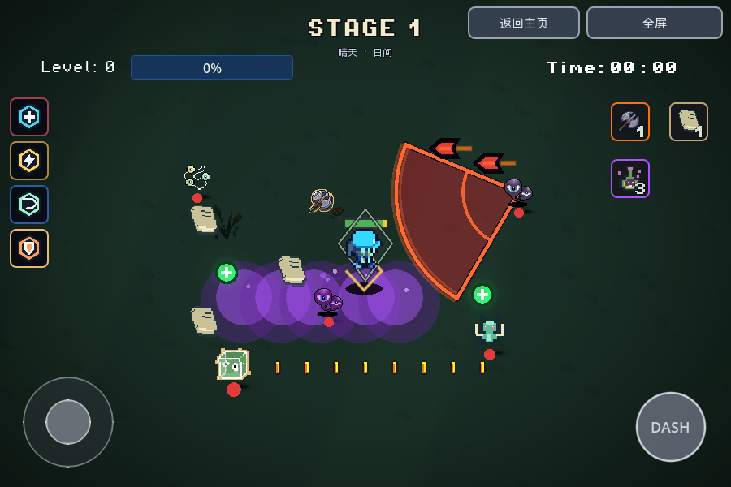
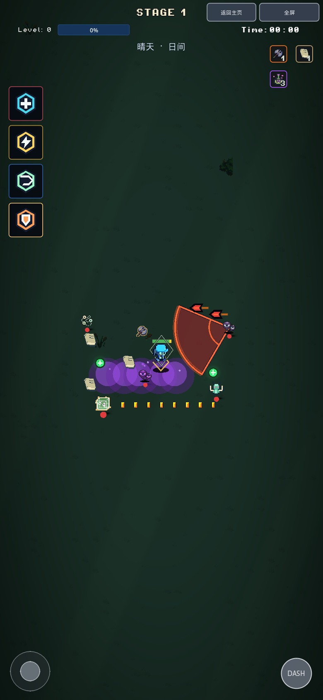
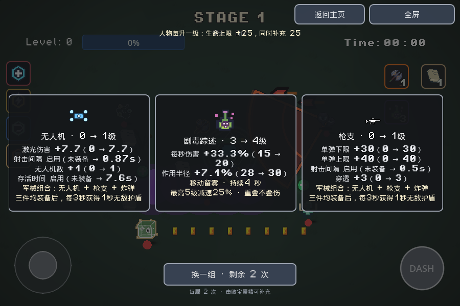

# Cursor 配色与当前功能同步

颜色源：`cursor/color-palette-v4-4455` / `137fa6d7968617eefed4e19fad76cf0983e408d1`。功能基线：`feature/vfx-motion-20261110` / `d9dcb3d`。本次以新增提交替换两轮旧配色，不删除历史、不回退游戏功能。

## 颜色生效路径

- `GamePalette`完整采用Cursor原始定义和方法；当前UI/残影的兼容名称统一指向这些角色。角色/怪物使用共享`body_tint.gdshader`，状态调制通道继续独立工作。
- 移除旧semantic-ramp材质和全局GameUiTheme覆盖，恢复Cursor的原武器、金币、图标和书卷颜色；常见角色/怪物/Boss、治疗、毒、敌弹和预警按来源同步。
- 地面、草丛、天气分级、暗角、共享光影、血条/经验条与中性摇杆/Dash来自Cursor。第一关固定深青苔，后面按其阶段颜色表变化。
- 卡牌保留可比较的当前→升级值；面板单独使用Cursor中性底色/边框，保留原有手机滚动与点选行为。来源中的暖白普通跳字、金色暴击和黄红异常字回归，当前紫色毒伤通道保留。

## 保留的功能

卡牌公式、移速卡固定+20、实际位移驱动左右步态、相机轻微延迟、脚下彩墨HUD固定跟随、距离采样的8槽冲刺残影、双方投弹物理年龄插值、17项Debug分页、普通/Debug/Retry/Home清理与按钮设置。

审计确认14个核心文件与基线逐字相同，22个关键方法逐字相同；完整Cursor调色板前缀也逐字相同。纯视觉文件按颜色源替换；混合文件保留数值计算和移动/命中代码，只调整外观入口。详见检查记录中的migration_audit。

## 验证命令

```bash
GODOT=/path/to/Godot_v4.7-stable_linux.x86_64
"$GODOT" --headless --rendering-method gl_compatibility --audio-driver Dummy --path . --editor --import --quit
"$GODOT" --headless --rendering-method gl_compatibility --audio-driver Dummy --path . --script res://tools/smoke_game_palette.gd
"$GODOT" --headless --rendering-method gl_compatibility --audio-driver Dummy --path . --script res://tools/smoke_palette_cards.gd
"$GODOT" --headless --rendering-method gl_compatibility --audio-driver Dummy --path . --script res://tools/smoke_motion_vfx.gd
mkdir -p export/web
"$GODOT" --headless --rendering-method gl_compatibility --audio-driver Dummy --path . --export-release Web export/web/index.html
```

还验证状态数字、芭蕉扇异常反馈、原型怪、光影、Boss入场/中文提示、Debug与返回主页。旧颜色专项的可视断言改为Cursor预期，卡牌数值和战斗断言保留。测试与构件证据见[检查记录](validation/palette-sync-20261110.json)。无头/PCK不替代浏览器验证；软件WebGL截图不作为Safari或高帧率性能结论。

正常入口不启用QA遥测；独立QA入口仅用于固定场景、切换背景、显示卡牌与按钮状态。截图目录带`.gdignore`。

| 横屏 | 竖屏 |
| --- | --- |
|  |  |


