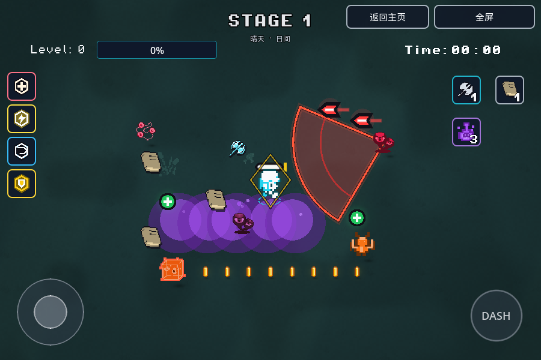
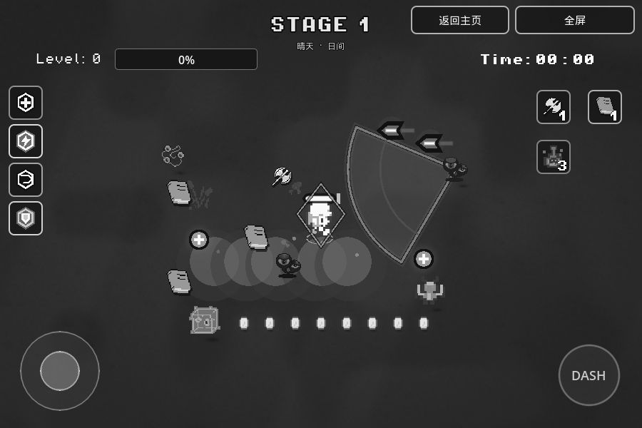
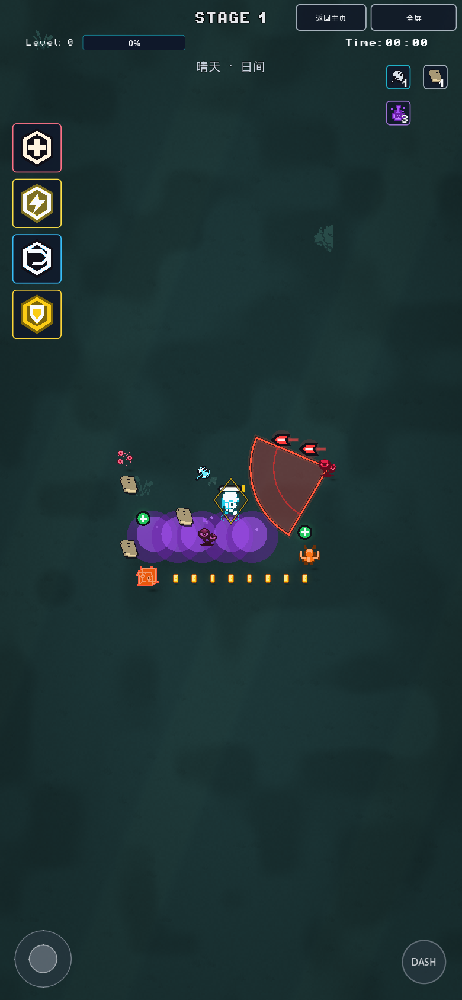
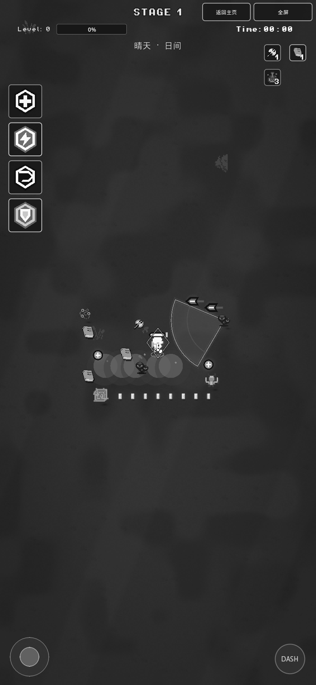

# Rogge · 配色稿 v4 落地

> 颜色实现已由 [Cursor 配色同步](palette-sync.md) 替换。本文颜色与材质条款为历史记录；CardNumbers/CardPreview 数值文案及非配色功能仍保留。

依据本轮目标稿与颜色语义实现，不做逐像素复制。分支 `feature/palette-v4-20261110` 从最新 `master` / `7e81adf` 新建；仓库没有 `main`。PR #6 尚未合并，因此本分支带入该PR的卡牌可比较文案与中性控件，继续实现v4。没有合入主分支或更新itch。

## 色彩用途

[`GamePalette`](../script/game_palette.gd) 是唯一角色色定义，保留旧常量名作为别名，shader只接收该色板的参数。

| 语义 | 色值 | 实际用途 |
| --- | --- | --- |
| PLAYER_PRIMARY / ATTACK | #22D3EE / #67E8F9 | 玩家服装中间色、轻微轮廓光、友方弹幕/枪火/风/冲击波、经验条 |
| ENEMY_CRIMSON | #E11D48 | 小怪、眼球类与多数Boss |
| ENEMY_ORANGE / RUST | #F97316 / #EA580C | 敏捷/刀怪；厚重、箱子、守卫类 |
| ENEMY_PROJECTILE | #FF3B3B | 敌弹主体与局部红色光晕；白色核心提供明暗对比 |
| ENEMY_TELEGRAPH_FILL / EDGE | #EF4444 / #FF5A3C | 红色预警填充约0.30，外边缘柔光；内弧#B83232 |
| POISON / RIM | #A855F7 / #C084FC | 毒尾迹/池/圈约0.55，边缘/泡泡、中毒染色与毒伤跳字 |
| COIN_GOLD / HIGHLIGHT / EDGE | #FACC15 / #FDE68A / #B45309 | 金币原有形状、轻微暖光和暗边 |
| PICKUP_GREEN / HEAL_GREEN | #4ADE80 / #22C55E | 独立有益拾取角色色；回血球白色加号、治疗跳字/VFX |
| PARCHMENT | #E8D3A3 | 世界书本、装备/升级卡/抽奖中的书卷 |
| SHIELD_GOLD | #FACC15 | 护盾菱形、血条护盾层、护盾技能与组合 |
| SHADOW | 黑色/0.35 | 玩家、怪物与掉落物的半透明椭圆阴影 |
| UI_PANEL / BUTTON | #0F172A / #111827 | 格子约0.80透明度、顶部半透明按钮 |
| UI_BORDER / TEXT | #CBD5E1 / #F8FAFC | 普通边框、白色粗体数量与黑色描边 |

技能功能边框按稿图单独使用：治疗玫红#FB7185配暖白图标，闪电#FDE047，循环/冷却#38BDF8，盾#FACC15。右侧武器钢银图标配青边、书卷羊皮纸、药瓶/毒道具紫色。功能图标中的黄色是本轮“技能和道具图标”条款指定的例外，未扩展到操作按钮。

摇杆、DASH及冷却仍沿用灰底#374151、边#9CA3AF、高亮#E5E7EB、遮罩#1F2937/0.65；按下1.06视觉放大、完成短白亮。保留用户大小/透明度/拖动位置，触控范围不随视觉动画变化。

## 金币与经验的原始设计

代码确认：`coin.gd.xp_value/prepared_xp` → `Game._on_prepared_coin_collected` → `_award_prepared_experience` → `level_manager.add_coin`。击杀、流星奖励、全屏拾取等复用同一金币场景，当前没有另一套金币余额或独立经验球掉落。

按用户“如果经验和金币是同一种掉落物，保留金色金币”的要求，本轮金币恢复金色，仍按原规则增加经验；没有新建货币、拆分掉落池、改收益或概率。`PICKUP_GREEN`保留为独立有益拾取物的语义，当前回血球使用更深的`HEAL_GREEN`并带白色十字，不把金币伪装成绿色经验球。

## 地面、阴影和开销

- 第一关四种暗青苔变体在#1F3A3A～#24433F之间；第二关暖褐、第三关暗紫，此后按三个色组轮换，每组四种。保留每关缓存、同关稳定、开局不重复与一次随机抽取。这里只调整地面显示，不改变刷怪、计时或关卡顺序。
- 地面继续复用现有纹理与72个装饰Sprite池。shader增加世界坐标2px噪点、平滑暗斑和轻微屏幕暗角；没有生成新的地砖、粒子或灯光。草丛中间色#2F5550，暗源图使用较低的明暗映射阈值，后续地面装饰保持低亮度。
- 移除小怪脚底彩色圆点；黑色椭圆复用现有3层光影批次。普通怪及其守卫/宝囊精子类共享缓存，Boss/试炼的自绘阴影也改黑色。
- 保留64怪物阴影上限；新增32拾取物阴影缓存、最多8金币暖光。源每0.1秒刷新，每类最多检查128个拾取物，绘制前校验对象/屏幕范围。满载时装饰阴影/暖光会舍弃超额源，实际掉落和拾取不受影响。
- 敌弹光晕和预警边缘是局部绘制，非逐弹`Light2D`。四个技能图标各增加一个固定TextureRect，使图标材质不会把彩色功能边框一并洗灰。没有逐敌新节点或无界场景树查询；未声称手机帧耗时完全不变。

## 文件分组

| 范围 | 主要文件 |
| --- | --- |
| 色板与重着色 | `script/game_palette.gd`、`visual_style.gd`、`shaders/semantic_ramp.gdshader`、既有`enemy.gdshader`参数 |
| 玩家/怪物/Boss | `player.gd`、`enemy_shell.gd`、`boss.gd`、`knight_boss.gd`、`beast_boss.gd`、`trial_enemy.gd`、`treasure_guardian.gd`、旧原型`enemy.gd`、敌人资源颜色项 |
| 敌方攻击预警 | `enemy_projectile.gd`、`enemy_attack_field.gd`、`boss_rush_feedback.gd`、`boss_reminder.gd`、`spawner.gd`及Boss/守卫绘制 |
| 掉落、地面、光影 | `coin.gd`、`healing_orb.gd`、`combat_lighting.gd`、`infinite_background.gd`、`infinite_ground.gdshader`、`poison_trail.gd` |
| UI与其他颜色接线 | `beast_skill_icon.gd`、`beast_powers.gd`、`equipment_panel.gd`、`game_ui_theme.gd`、`scenes/level_bar.gd`、菜单/试炼/天气/流星/闪电/彩墨相关脚本的颜色常量替换 |
| 验证 | `smoke_archetypes.gd`、`smoke_stage_variation.gd`、`smoke_combat_lighting.gd`、`smoke_visual_style.gd`与已有专项、`preview_palette.gd/.tscn` |

继承PR #6的卡牌formatter和真实数值helper，不再复制卡牌计算；移速仍固定+20。完整本轮增量文件清单、剩余字面量审计、导出哈希和测试记录见 [validation/palette-v4-20261110.json](validation/palette-v4-20261110.json)。剩余17处数字颜色均已分类：白/灰遮罩、亮度/透明度动画、黑色UI阴影，以及仅调试碰撞显示使用的粉色；这些不是运行时阵营色。原始素材未重绘或改路径。

## 验证与截图

最终检查结果以机器记录为准，和继承的PR #6旧报告分开记录。原生专项覆盖17个不同脚本，实际Web PCK专项8个；新卡牌比较专项仍含347断言。测试更新仅对应新色彩/地面显示合同，保留真实伤害、速度、冷却、奖励、碰撞与池上限的断言。

红色主体按稿指定#FF3B3B，原“整颗浅红子弹≥4.5”断言改为验证实际可见的白色核心≥4.5:1；没有把精确红色改回浅粉来绕过稿图。地面有益拾取对比与怪物实际攻击逻辑检查保留。灰度截图同时检查亮度、轮廓、形状，预警尖角/红边、金币小条、毒雾圆泡与按钮轮廓仍可区分。

浏览器为真实Chromium/WebGL2软件渲染，分别900×600、390×844/DPR2、844×390/DPR2。视觉夹具使用真实游戏场景/材质/控件，冻结演员便于三种地面、彩色/灰度、四种DASH状态和卡牌截图；仅QA副本入口不同。另单独检查正常Web入口短时战斗和手机滑动/点击选卡。不是Safari真机、itch iframe、全流程通关或密集群怪性能结论。

首次空缓存导入出现缺少导入字体/贴图及旧音频seek警告；生成缓存后最终无头导入与Web导出结果见机器记录。既有命令行退出ObjectDB/资源仍被引用警告按项保留，不混同为运行时脚本错误。

```bash
"$GODOT_BIN" --headless --rendering-method gl_compatibility --audio-driver Dummy --editor --path . --import
"$GODOT_BIN" --headless --rendering-method gl_compatibility --audio-driver Dummy --path . --script res://tools/smoke_visual_style.gd
"$GODOT_BIN" --headless --rendering-method gl_compatibility --audio-driver Dummy --path . --script res://tools/smoke_stage_variation.gd
"$GODOT_BIN" --headless --rendering-method gl_compatibility --audio-driver Dummy --editor --path . --export-release Web ../web-build/index.html
```

`GODOT_BIN`应指向4.7及匹配Web模板，构建目录在项目外。其余专项名称与实际PCK结果见机器记录；无需全量回归所有smoke脚本。

| 横屏 | 同画面灰度 |
| --- | --- |
|  |  |

| 竖屏 | 同画面灰度 |
| --- | --- |
|  |  |

[暖褐地面](screenshots/palette-v4-20261110/landscape-world-1.png) · [暗紫地面](screenshots/palette-v4-20261110/landscape-world-2.png) · [卡牌文案](screenshots/palette-v4-20261110/landscape-cards.png) · [正常入口实战](screenshots/palette-v4-20261110/normal-web-gameplay.png)
