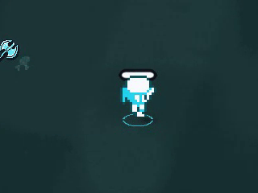
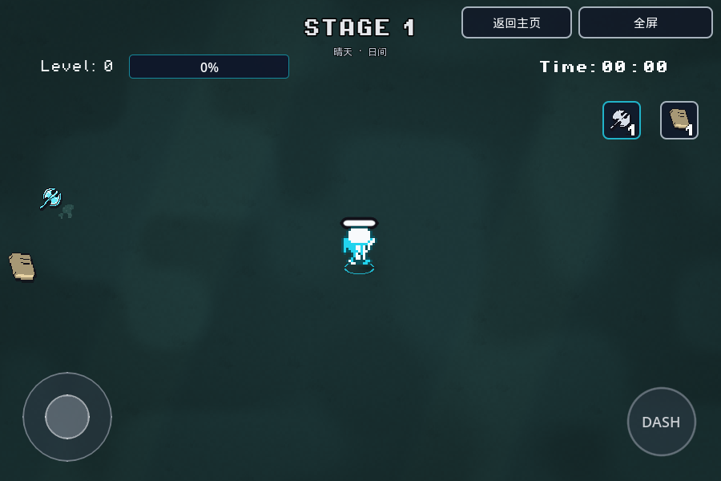
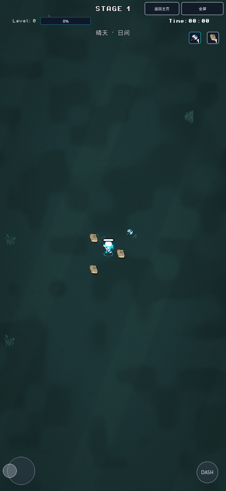

# 玩家移动、侧向步态与相机

基于v4开发分支 `a5e3b0e` 新建 `feature/player-motion-20261110`。v4的PR #7尚未合并，本轮PR以该分支为base，只审阅移动表现增量；不合并主分支或更新itch。试玩沿用现有所有者私有站点，部署结果在交接/机器记录收尾补入。

## 原因与修改

代码确认的旧问题：

- 身体朝向每个物理帧读取鼠标并在8套动画间切换；帧率固定5/6 FPS，与实际速度、加速卡、停止或碰撞无关。因此可能朝鼠标倒着走，站立仍摆腿。
- 走路不断把一次性CPUParticles2D重新设为emitting。粒子没有纹理，是带随机旋转、6～7倍缩放的四个方块；这会造成脚后不规则白块。额外的持续微缩放/旋转也会让最近邻像素边缘爬动。这些是确认存在的视觉来源，不能据此排除所有设备上的其他锯齿/掉帧原因。
- Camera2D内置平滑与旧负速度拖拽叠加；相机追踪意图速度，撞墙时也可能继续偏移。

现在走路只用已有的`left`/`right`帧。纯上下移动和站立保持最后一次左右朝向，鼠标不参与转身。360度键盘/摇杆移动与冲刺保留；没有方向输入时，键盘冲刺改用最近移动方向，与手机一致。

`move_and_slide`之后取真实位移，驱动`0 → 1 → 0 → 2`四姿态步态，50世界单位一循环；正常100移速约8姿态/秒，加速自然提高步频，极高移速上限18姿态/秒以避免闪烁。停下、顶墙和试炼锁定回到静止帧，冲刺用固定的侧向发力姿态。没有改变基础移速100、固定+20卡、900加速度、600摩擦、780冲刺速度、0.14秒时长、结束后0.5秒无敌或冷却。

步态在物理更新中手动设帧，AnimatedSprite自身暂停，不再叠加第二个时间动画钟。常态不做缩放和旋转；仅保留短暂受击/冲刺形变，碰撞体不受影响。Sprite基准缩放1.68改为5/3，在现有1.8相机倍率下对应3倍源像素；atlas明确开启filter_clip。原贴图、帧资源和v4色板保留。

旧脚步粒子节点/API保留给历史场景引用，但永久隐藏且不发射。冲刺残影仍用8槽固定池，显示更轻：0.10秒、最大0.16透明度、0.035秒采样间隔；没有新增逐步节点、粒子或音效。

相机改为实际世界位置的单层临界阻尼弹簧，正常响应20、冲刺30，延迟最多16世界单位，正常移速时较短。停止、反向与冲刺恢复平滑回位；大于240单位瞬移直接重置，暂停冻结，返回主页/新局清零。沿用原舒适度设置，设0立即关闭附加延迟；不改缩放、旋转和视野，也不移动角色碰撞体。

## 文件与验证

- `script/player.gd`：实际位移步态、左右朝向、停步/锁定清理、无鼠标闲置冲刺。
- `script/camera_motion.gd`、`scenes/game.tscn`：单层世界位置跟随，移除内置平滑叠加。
- `scenes/player.tscn`：侧向默认帧、像素缩放、atlas裁切；`script/combat_feedback.gd`：更短更淡的固定池残影。
- `tools/smoke_player_motion.gd`：32项真实30/60Hz物理输入、位移/步频、加速、鼠标/上下朝向、撞墙、冲刺、锁定、无粒子、帧裁切与碰撞体检查；相机专项改为实际位置模拟，加入撞墙意图速度与瞬移。
- 原反馈专项将旧的“必须0子节点”改为固定初始子节点数，兼容已存在的DeathStains节点；仍检查大量反馈不增加节点和既有池上限。

11项不同原生专项、6项实际最终Web PCK专项通过。最终原工程与QA副本无头导入、Web导出无脚本/shader/构建错误；既有退出ObjectDB/资源仍被引用警告保留于[机器记录](validation/player-motion-20261110.json)，没有写成所有日志零错误。未跑全部smoke。

真实Chromium/WebGL2已测试900×600键盘和390×844/DPR2触屏，包含鼠标位于反方向、启停、左右/上下、100→160加速、摇杆+冲刺双指、暂停冻结和恢复。额外录制v4原包与新原包的正常入口相同键鼠序列，两者均无脚本错误/WebGL丢失。每次随机天气不同，不把这两段当配色、性能或完全相同场景的比较。

静态/近景演示使用`tools/preview_player_motion.tscn`作为独立QA入口：真实玩家物理和相机，关闭刷怪/自动攻击便于观察；正常游戏不加载它。QA源与原项目游戏代码/资源一致，仅入口不同。该夹具可用F2实际领取三张加速卡，F3暂停，且仅Web夹具发布`window.__motion`测试数据。普通试玩不暴露这些测试键/数据。

桌面录屏样本55组，正常100、加速160，朝向只出现left/right；步行粒子/残影均为0，附加拖拽不超过16。浏览器wait已观察到真实冲刺触发；后续单独读取的截图/样本可能已进入恢复，不声称短时冲刺截图全部捕获在生效帧。没有Safari真机、高刷新显示器或密集怪潮帧耗时结论。

```bash
"$GODOT_BIN" --headless --rendering-method gl_compatibility --audio-driver Dummy --editor --path . --import
"$GODOT_BIN" --headless --rendering-method gl_compatibility --audio-driver Dummy --path . --script res://tools/smoke_player_motion.gd
"$GODOT_BIN" --headless --rendering-method gl_compatibility --audio-driver Dummy --path . --script res://tools/smoke_camera_motion.gd
"$GODOT_BIN" --headless --rendering-method gl_compatibility --audio-driver Dummy --editor --path . --export-release Web ../web-build/index.html
```

使用Godot4.7及匹配模板。实际PCK专项用空项目目录与隔离用户数据运行，测试名称/记录见机器记录。

## 演示



[完整桌面运动录屏](screenshots/player-motion-20261110/desktop-motion.webm) · [手机双指录屏](screenshots/player-motion-20261110/phone-motion.webm) · [v4原包](screenshots/player-motion-20261110/before-v4.webm) · [新正常游戏入口](screenshots/player-motion-20261110/after-motion.webm)

| 桌面行走 | 手机行走 |
| --- | --- |
|  |  |
