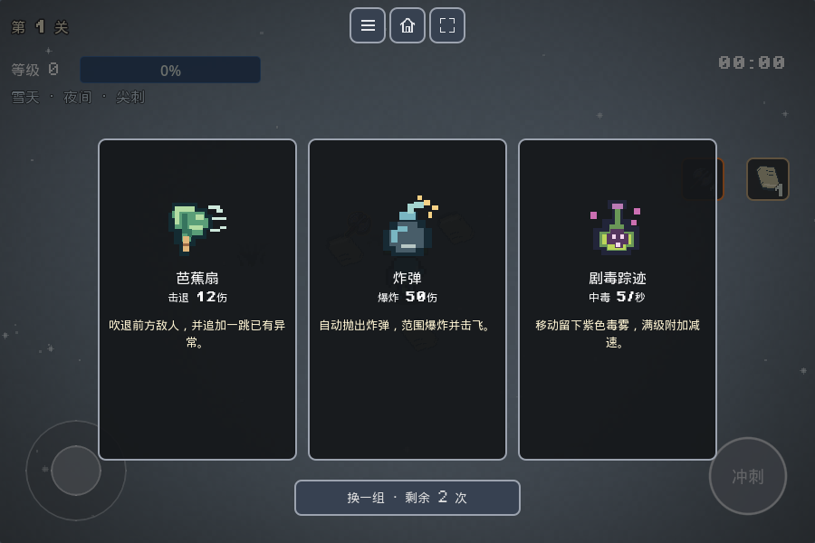
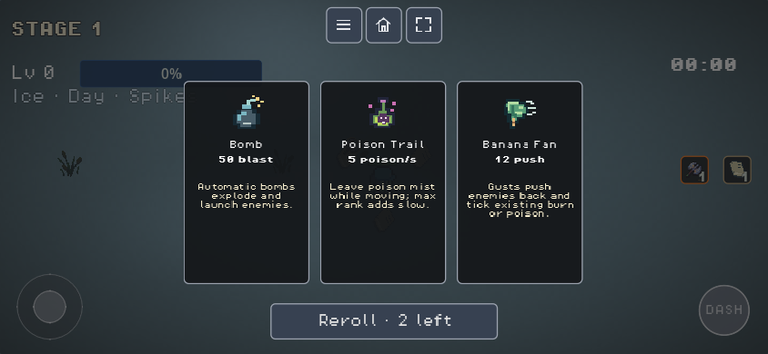
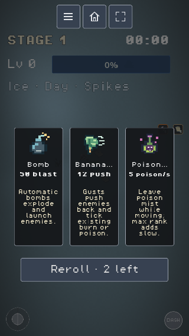
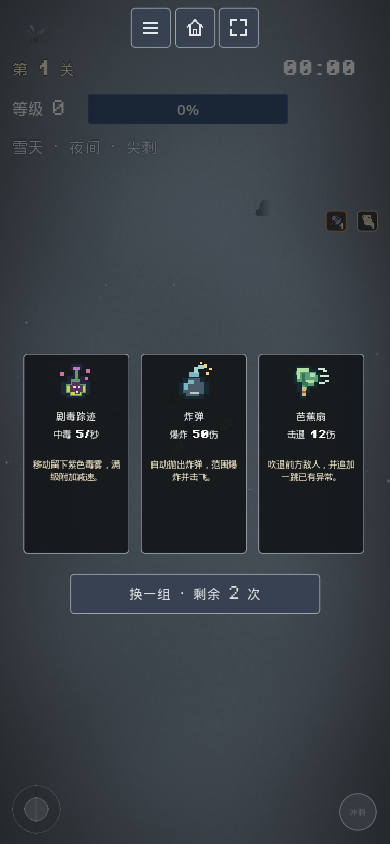
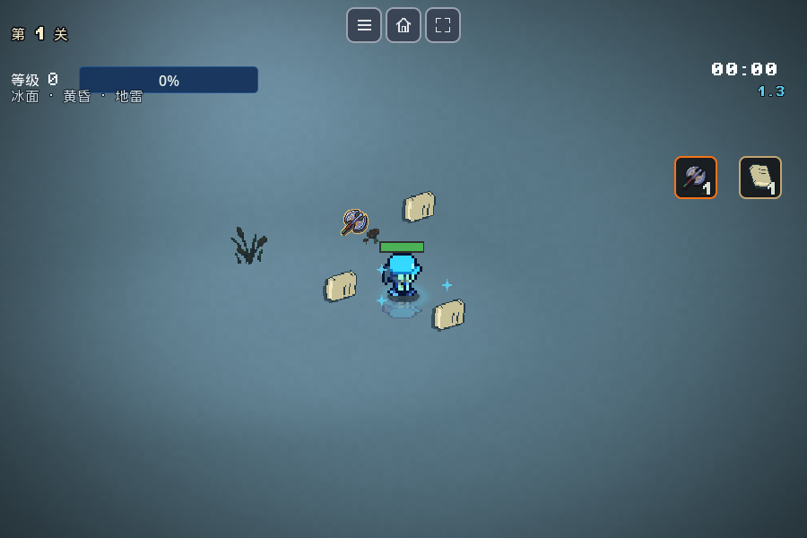

# Annotated-reference UI pass

Version 20261116-200630; based on f6c89ae, continuing PR30.

Header stage/level/weather uses16 displayed pixels, left alignment and40px row steps. XP remains200×30. Elapsed time moves down to the level row on wide screens; narrow screens put the header below the toolbar and time alongside stage. Long weather text ellipsizes. Both toolbar group and each SVG icon are centered. Boss bars/equipment follow the header height; health-only Boss display remains.

Cards are portrait rectangles, width/height approximately1:1.618 on roomy screens, capped at220×356. Narrow phones can grow to200px high to preserve readable text; short landscape fits available height. Icon, name and actual next primary value are followed by the existing translated Codex summary sentence. Values remain read-only CardPreview. No new gameplay rules, balancing or invented stats. Three cards always share one row; hover enter/exit unchanged; no scrolling/Details button. Reroll sits20 displayed pixels below the cards.

Validation: all28 cards, both languages, five viewports;3008 assertions for text/card bounds, actual selection and hover. Existing menu/pause/Codex and localization checks; final PCK evidence in [report](validation/reference-ui-20261116.json). Native Compatibility captures only; no browser/Safari/device-FPS test. Existing shutdown resource/GL warnings remain.

```sh
godot --headless --rendering-method gl_compatibility --audio-driver Dummy --path . --editor --quit
godot --headless --rendering-method gl_compatibility --audio-driver Dummy --path . --export-release Web /ABS/web/index.html
# In an existing empty directory, --main-pack /ABS/web/index.pck --script res://tools/smoke_three_cards.gd
# Also smoke_codex_menu and smoke_localization.
ROGGE_CAPTURE_DIR=/ABS/captures godot --rendering-method gl_compatibility --path . res://tools/preview_three_cards.tscn
ROGGE_CAPTURE_DIR=/ABS/captures godot --rendering-method gl_compatibility --path . res://tools/preview_compact_hud.tscn
```






