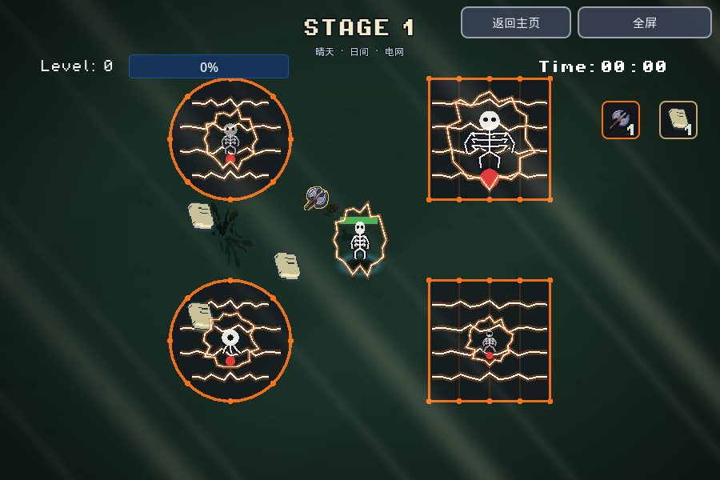
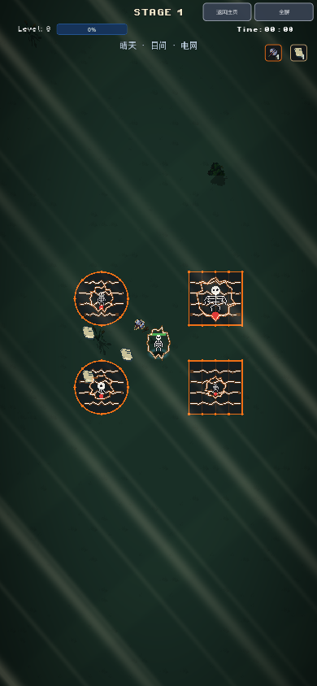
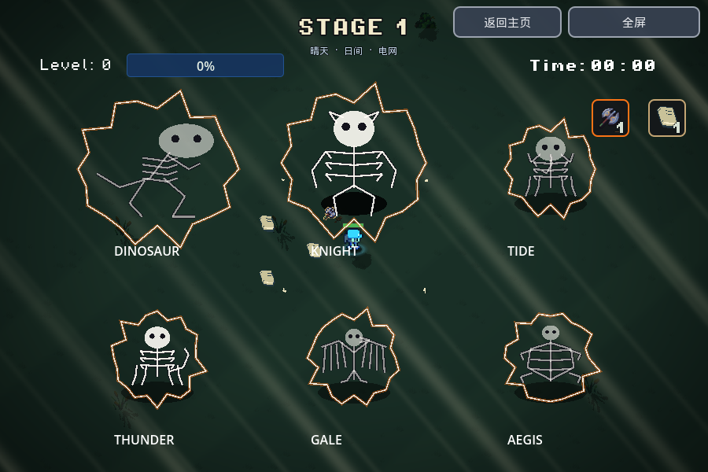
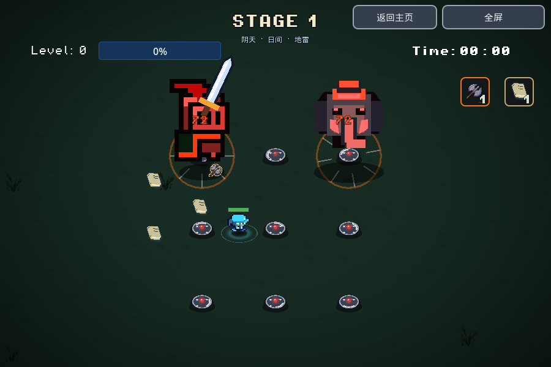

# Per-stage hazards, readable shocks and mine survivors

Version **20261116-164203**, branch `feature/stage-hazards-20261116`, based on `3c0fe96` / PR #24.

## Behavior

Each normal stage selects exactly one environmental hazard: mines, electric zones or spikes. Selection uses a separate shuffled bag and a per-stage cache, independent of weather and global combat RNG. Each three-stage bag includes all types, adjacent bag boundaries avoid repeats, and revisiting a stage restores its original selection. Weather/day-night preview never rerolls the hazard. The weather caption names the chosen hazard. Existing pause/rest/trial/transition/death gating still applies.

Electric terrain previously had a 4.5s global cycle despite a 0.5s escape grace; that was the long perceived gap. It now retains the initial/local 0.75s warning, then pulses every **0.5s**, with 0.32s live and 0.18s dark. A batch snapshots conduction positions, walks an iterative deduplicated queue and applies at most one hit per target; a separate per-target deadline prevents hits less than 0.5s apart across pulse boundaries. Deadlines are pruned to the current bounded snapshot. The player's 1s paralysis plus **0.5s free escape time** remains; intervening pulses cannot refresh that paralysis. Monster damage remains 3× player damage. No damage values were increased, but the faster requested pulse cadence increases sustained environmental DPS.

During a visible shock skeleton, original body art (and a knight's sword) is completely transparent via temporary visibility suppression. Color, material and poison/hurt tint are not overwritten. The existing 64 skeleton/128 link budget remains. Repeated hits refresh an existing skeleton rather than allocate duplicates; expired/dead/interrupted/stopped entries restore their prior visibility. Targets beyond the visual cap keep their art visible. Player, four monster archetypes, dinosaur, knight and all four guardian skeletons are supported.

Mine survivors already had a cosmetic hop, but the ordinary monster physics pose could overwrite its render pose. The hop is now composed inside the common pose function as well as advanced on display frames. Monster lift is now 32–42 world units by size; Boss lift is 34. Physical push/resistance, damage, collision and mine rearm remain unchanged. Actual mine-hit checks cover all four guardians, dinosaur, knight and a normal monster; killed targets do not start a new hop. Existing player launch/landing shake remains.

Two original short mono cues distinguish hazards: electric crackle (0.18s), mine thump/crack (0.30s). They use the SFX bus and one voice per hazard; electric batches have a 0.15s sound throttle, not one sound per victim. Mine audio previously reused a quieter weapon-bomb cue. Assets are generated offline by `tools/generate_terrain_sfx.py`; no per-frame synthesis.

## Files and testing

Core changes: `environment_weather.gd`, `electric_grid.gd`, `electric_zap_visual.gd`, `minefield.gd`, `ice_spikes.gd`, `enemy_shell.gd`, `boss.gd`; Debug launch/copy in `main.gd`/`main.tscn`; two WAVs/imports, focused tests and captures.

- 11 native-source targeted suites passed: stage hazards (293 checks), electric (1034), mines (252), spikes (41), airborne (41), weather, environment surface, knight, guardians, wooden trial and Debug menu (7773).
- New tests cover 30 stages × six weathers, one hazard at a time, cached/bag choices, exact half-second repeated damage, real surviving mine hits on all Bosses, source-art restoration including the knight sword, audio routing/length/polyphony, player escape time and lifecycle cleanup.
- Godot 4.7 headless import and explicit Web release export; five final Web PCK suites: stage hazards, electric, mines, spikes and airborne. Exact outcomes are in `validation/stage-hazards-20261116.json`.
- Native GLES landscape/portrait skeleton captures and mine survivor apex were reviewed, with grayscale images. These are deterministic phase captures, not real browser play. The sound waveform is validated offline and playback routing is tested using the Dummy audio driver; perceived loudness on speakers/phone remains unverified.
- Existing ObjectDB/resource and GL teardown warnings remain separate from parse/gameplay failures. No new browser/Safari/device FPS claim. An initial new fixture omitted EnemyGroup membership; corrected before passing. A mistyped harness script name was corrected to the existing Debug menu suite.

Debug → **九宫格地雷 · 爆炸 / 腾空**, **电网 · 0.5秒 / 骨架传导**, or **冰面场景** force that hazard for testing. Normal runs use random selection. Weather buttons preserve the chosen hazard.

```sh
"$GODOT" --headless --rendering-method gl_compatibility --audio-driver Dummy --path . --editor --quit
"$GODOT" --headless --rendering-method gl_compatibility --audio-driver Dummy --path . --script res://tools/smoke_stage_hazards.gd
"$GODOT" --headless --rendering-method gl_compatibility --audio-driver Dummy --path . --export-release Web /ABSOLUTE/OUTPUT/index.html
DISPLAY=:105 ROGGE_CAPTURE_DIR=/ABSOLUTE/CAPTURES "$GODOT" --rendering-method gl_compatibility --audio-driver Dummy --path . res://tools/preview_electric_grid.tscn
```






Private playtest published: https://rogge-palette-playtest-20261109.whiteber.chatgpt.site — version 20261116-164203, deployment succeeded at 2026-11-16 16:48 Beijing. Source is saved in PR #25; master/itch remain unchanged. All nine original export files match after decoding the existing gzip WASM and removing the loader injection. Publication evidence: `validation/stage-hazards-playtest-20261116.json`.
