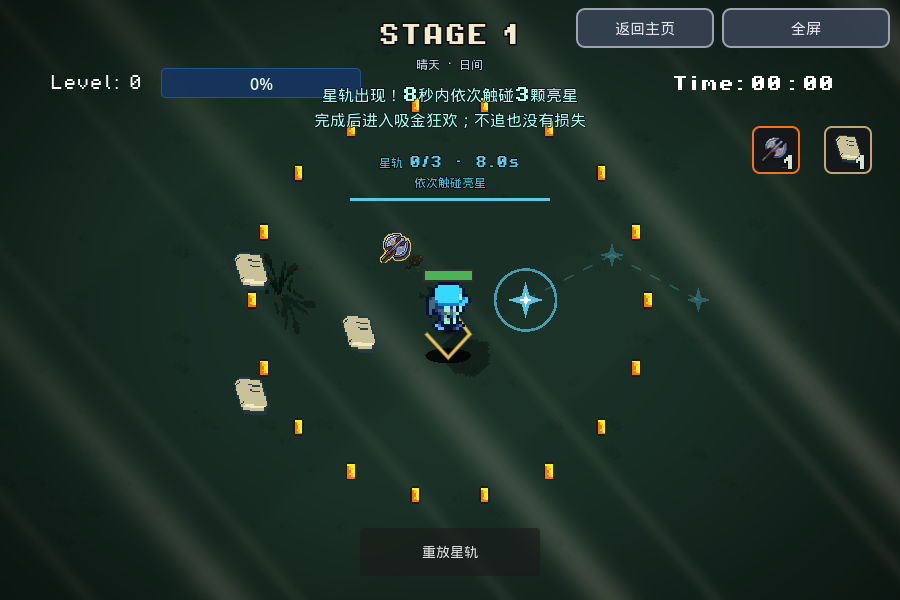
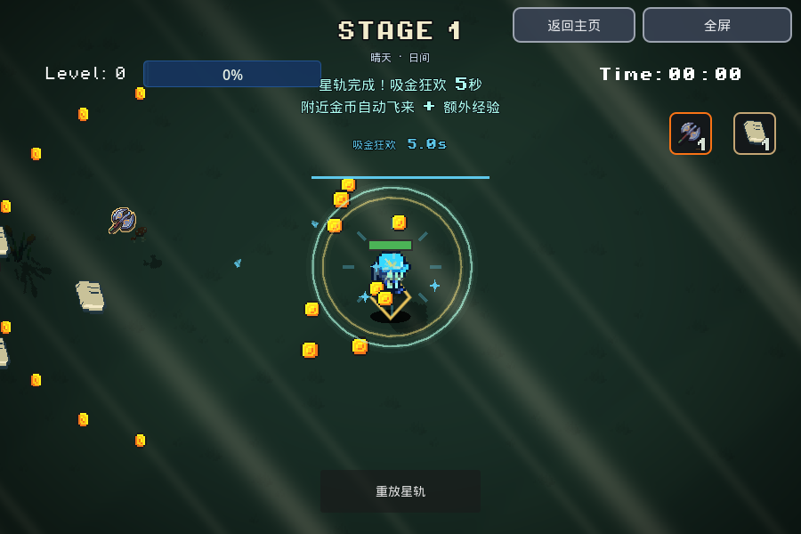
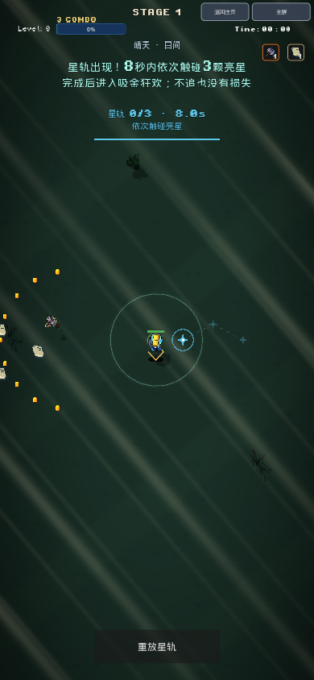

# 星轨连锁：可主动争取的短时奖励

## 为什么加它

现有内容已有28卡、彩墨冲浪、宝囊精、拾币连音和天气光影。继续叠加常驻闪光或全局增伤容易遮挡危险、压缩怪物生存时间。本轮加入一个“击杀蓄能→观察路线→走位收集→吸金庆祝”的可选目标，给玩家短暂改变路线的理由。

## 规则

- 普通战斗累计18次普通怪死亡后出现一条3星路线，不要求连续击杀。击杀计数来自实际spawner死亡入口，以敌人类型与死亡标记验证、最多18个ID去重；EnemyGroup会在死亡信号前移除，不能用活怪组过滤此事件。
- 在8秒内依次触碰当前亮星；走路和冲刺都可以。后续星星半透明，虚线连接；当前星环显示剩余时间。路径在创建时约束在可视世界范围内，之后留在世界坐标，不跟相机漂移。个人独立RNG只决定弯曲侧，不消耗战斗全局RNG。
- 使用玩家真实位移扫掠检测，半径24；一帧内按路径时间顺序收集，超过220单位的瞬移不算。长帧只检查倒计时仍有效的那一段。
- 完成后5秒吸金，自动吸取180世界单位内已有经验金币；额外掉落基础经验`8+2×关卡`，通过原spawn_xp_coin应用难度，拾取时再走原生机组合加成。没有无敌、伤害、移速、卡牌或全图拾取加强。
- 完成或超时后进入35秒间隔；完成后的5秒吸金包含在这个间隔内。间隔期间击杀不蓄能。超时不扣血、不扣已有经验，不给予额外经验。
- 暂停/升级选卡冻结计时；Boss、过渡、休息、试炼及移动锁定不插入走位任务，并清掉当前路线/吸金。已开始飞行的金币照原拾取流程完成，避免丢失已有掉落。

## Juice与预算

每颗星短暂放大HUD、青白八向光屑与递进音阶；冲刺一帧连拿三颗时，音阶排成75毫秒间隔，避免覆盖只剩最后一音。音源复用拾币样本并走SFX总线，最多一个音源、3条排队音符。完成调用已有受反馈设置控制的庆祝效果，5秒内玩家身边绕行3颗小星；金币弧线、拾币升调、经验条COMBO沿用原系统。

固定3个路径位置、8点星形、18条死亡去重上限，不逐星创建节点/灯/粒子。吸金每0.12秒滚动扫描最多48个已有金币引用、启动最多12个拾取动画；不搜索场景树、不重启已经飞行的金币。渲染不推进收集/奖励时钟。固定预算不等于真机性能保证。

## 调试与代码

主页→Debug→第一项“星轨连锁 · 追光 / 吸金狂欢”。立即出现星轨和18枚练习金币，增加500生命，保留正常怪潮；底部“重放星轨”可重试。普通新局不带调试生命、路线或按钮。22个入口继续分页，重放按钮登记diagnostic_ui以避免手机误触摇杆。

`star_chain.gd`拥有状态机、绘制、音阶队列与HUD；`spawner.gd`通报真实死亡；`game.gd`创建/重置/开始；`run_variety.gd`统一清暂态；`main.gd`和Debug页面派发练习。

## 验证

```sh
GODOT --headless --rendering-method gl_compatibility --audio-driver Dummy --path . --editor --import --quit
GODOT --headless --rendering-method gl_compatibility --audio-driver Dummy --path . --script res://tools/smoke_star_chain.gd
GODOT --headless --rendering-method gl_compatibility --audio-driver Dummy --path . --export-release Web /ABSOLUTE/web-build/index.html
GODOT --main-pack /ABSOLUTE/web-build/index.pck --headless --rendering-method gl_compatibility --audio-driver Dummy --path /EMPTY/DIR --script res://tools/smoke_star_chain.gd
```

原生6项：star_chain（63断言）、run_variety、ink_surf、growth_combo、trials、debug_menu。实际最终Web PCK再测star_chain、run_variety、debug_menu。检查实际死亡信号、去重、逆向/正向扫掠、领奖一次、音阶有界队列、吸金范围与分批、暂停/超时/冷却、瞬移、Boss/试炼、节点不增及Debug重放/新局。

原生横屏/竖屏/灰度截图已检查。截图夹具为了展示吸金关闭升级弹窗，正常导出仍保留升级选卡。没有本轮托管浏览器/Safari真机、密集金币FPS或完整关卡平衡结论；CLI退出资源和渲染器Texture/RID释放警告仍记录。完整证据见`validation/star-chain-20261115.json`。





下一轮试玩重点：18击杀/35秒间隔是否合适，路线在真实怪潮中是否值得冒险，手机三颗星是否容易识别与触碰。没有实测前不再叠加数值增益。
