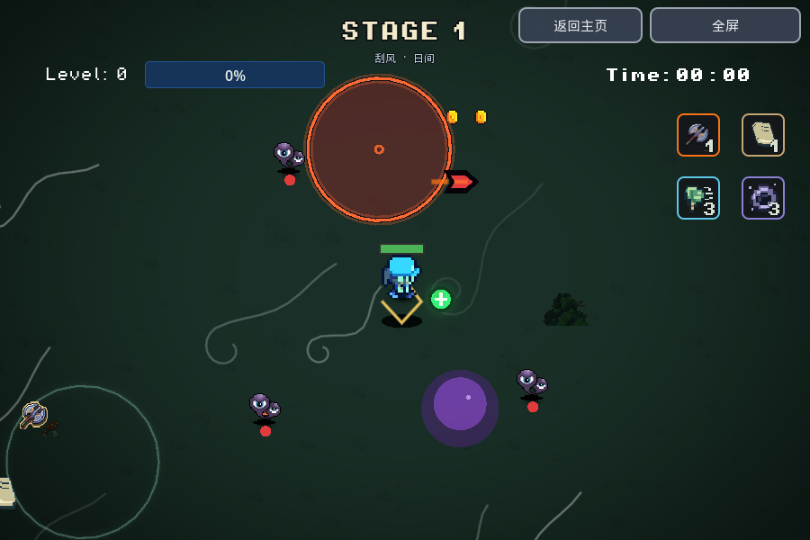
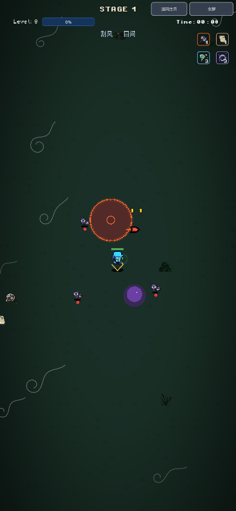
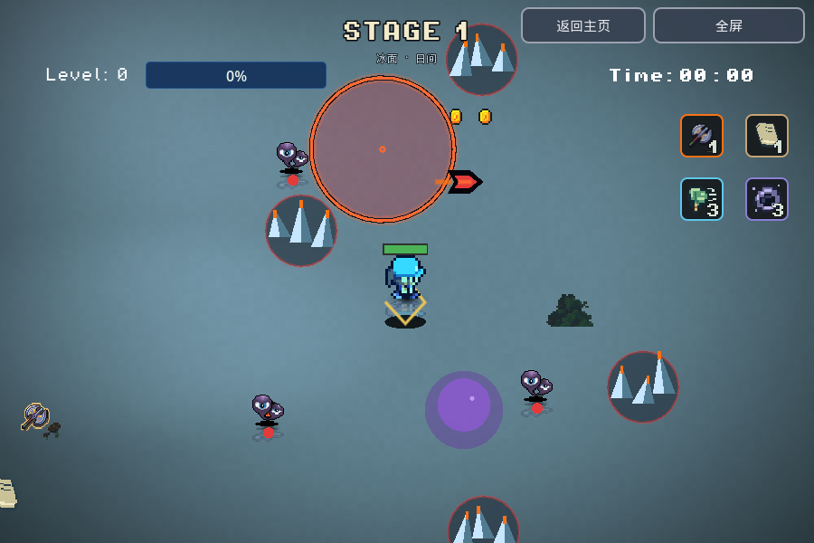
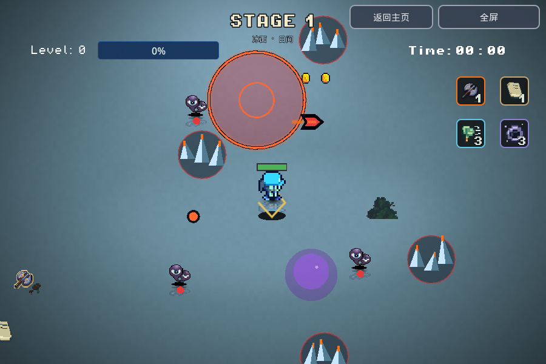
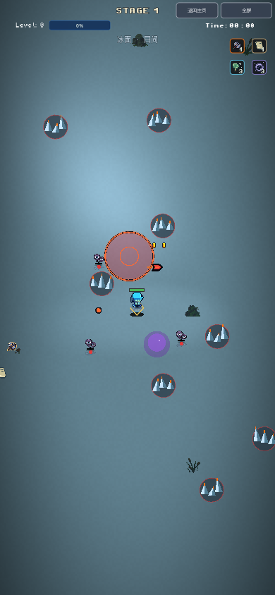
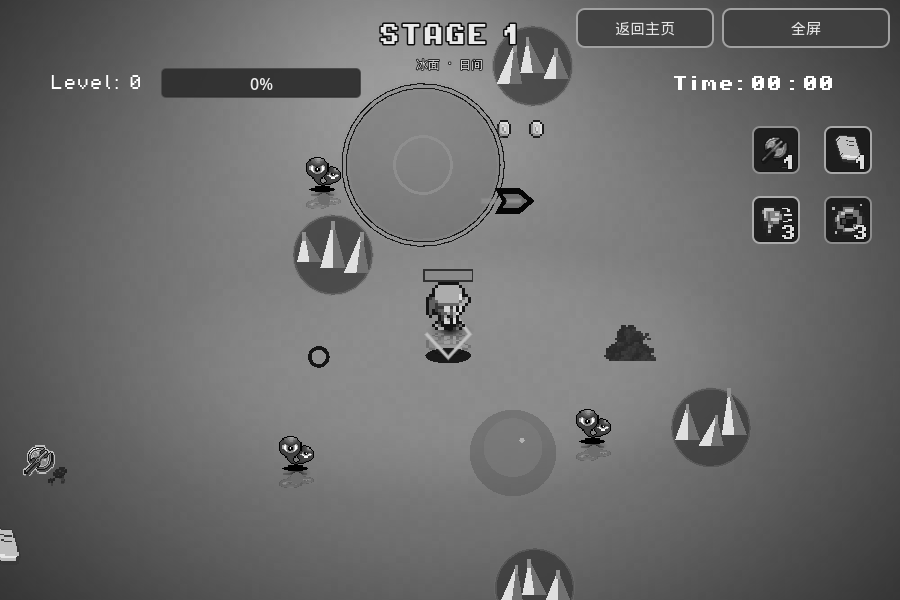

# 草、卷风与冰面高光

版本 **20261116-111619**，基于冰面尖刺PR #20，仅调整环境表现。风速、冰面摩擦、冲刺、控制卡、尖刺密度和伤害均保持。

## 改动

- 侧倒草对应`Decorations.png`的`Rect2(0,32,32,32)`（装饰变体5），现在顺时针旋转90°，尖端朝上。复用Sprite槽时其他图块恢复0°，避免树桩等装饰继承旋转。天气投影同时应用草的绘制旋转和正确底部锚点；人物/怪物仍使用原默认投影。
- 风改为18条有寿命的世界坐标阵风，每条25个点，曲线长度46～88、卷尾半径8～18，随机顺逆卷、弧度、角度和透明度。2.4～4.2秒内淡入淡出，轻微转动并沿真实风向平移；只有生成/重生时重建曲线，不新增节点或每帧分配形状。独立RNG，镜头移动不拖动现存气流。
- 冰面去掉原来的重复正弦扭曲、条纹和自行流动亮带。以相机世界位置和玩家`get_real_velocity()`计算平滑、幅度受限的观察倾斜，通过平面半角高光及一片宽天空反光表现方向变化。保留少量静态冰面颗粒及既有角色倒影；这是轻量2D镜面观感近似，不引入反射相机、屏幕复制或新增光源。
- 停止移动后倾斜平滑归零，暂停冻结；零天气FX关闭卷风/高光，仍保留有玩法意义的冰底色和尖刺。现有Debug前两项风/冰面即可测试。

涉及`environment_surface.gd`、`infinite_background.gd`、`weather_lighting.gd`、`infinite_ground.gdshader`。颜色仍从GamePalette传入。

## 验证

6项原生专项：新表现70断言、环境惯性、冰面尖刺、天气光影、世界雪花、相机。最终真实Web PCK再跑新表现、环境、尖刺3项；导入/导出无脚本或导出错误。详细结果与哈希见`validation/surface-art-20261116.json`。

```sh
"$GODOT_BIN" --headless --rendering-method gl_compatibility --audio-driver Dummy --path . --editor --quit
"$GODOT_BIN" --headless --rendering-method gl_compatibility --audio-driver Dummy --path . --script res://tools/smoke_surface_art.gd
"$GODOT_BIN" --headless --rendering-method gl_compatibility --audio-driver Dummy --path . --export-release Web /ABSOLUTE/OUTPUT/index.html
"$GODOT_BIN" --main-pack /ABSOLUTE/OUTPUT/index.pck --headless --rendering-method gl_compatibility --audio-driver Dummy --script res://tools/smoke_surface_art.gd
```

原生Compatibility横/竖屏、灰度、晴天/雨天投影已渲染检查。图块另单独放大确认(0,32)裁片旋转方向；避免仅凭数组序号猜测贴图。对比截图固定相机、分别设置左右极限观察倾斜，方便比较高光位置；另有真实键盘四方向输入断言验证实际移动接通shader，并检查静止/暂停/画质。截图夹具仅用于QA，Web主入口仍是正常main。








没有本轮托管浏览器/Safari实机或群怪FPS结论；既有CLI资源与原生渲染器退出警告未解决。本轮因工作盘空间紧张在临时内存工作树开发/打包，源码、截图、验证和交接均提交GitHub，勿把云端临时目录当唯一备份。后续收集手机上卷风密度和高光强度的观感。

## 晴天地表接缝 · 20261119-151635

旧地面在每个 500 × 333 世界单位的矩形边缘切换到底色，四角相交时形成暗十字。地面现在以恒定权重混合底色与绘景，在世界坐标中镜像采样苔地和石板内部。两轴都在边缘纹素中心折返，纹理密度沿用每世界单位 1.8 个纹素。

用固定相机、同一晴天光线渲染[修复前后对比](screenshots/daylight-ground-20261119.jpg)。关闭光照和装饰后，苔地原接缝中心与两侧的平均灰度差从横向暗带 20.08、纵向暗带 18.99 降到绝对值 0.07、0.09（0–255）。另外核对了石地、镜像折返点和负世界坐标。Web 包通过地表、积雪、环境互动、关卡美术及开局装备检查。
