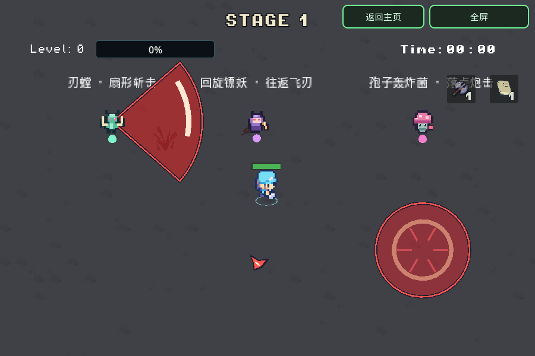

# 三种战术小怪

版本 `20261108-010552`。普通刷怪池从5种增至8种；仍使用原 `EnemyShell` 的受伤、暴击、异常、击杀奖励、经验与回血球流程。没有改动四神兽或木头人怪潮的专用名单。

| 怪物 | 攻击与躲法 | 基础数值 |
| --- | --- | --- |
| 刃螳 `BladeMantis` | 进入80单位内才准备攻击，近身在58单位处停步，锁定扇形朝向；走到侧面/背后或冲刺离开，挥砍后有停顿 | HP52，移动54，斩击26，半径84/半角0.72弧度，预警0.75秒，基础攻击间隔2.8秒 |
| 回旋镖妖 `BoomerangImp` | 红线预警后慢速飞刃沿固定路线出去再回来；横向走位或dash穿过 | HP40，移动39，伤害24，速度145，预警0.75秒，间隔4.4秒；AI进入220以内再投掷 |
| 孢子轰炸菌 `SporeBomber` | 锁定地面圆区后抛出孢子，落地才爆发；保持移动即可离开 | HP46，移动34，伤害30，半径44，预警/飞行共1.1秒，间隔4.6秒 |

数值仍走原有阶段/玩家等级/输出卡压力、难度血量和精英缩放，伤害倍率没有重复叠加；上表是未经成长的基值。每次攻击最多接触玩家一次，dash或其他护盾挡住这次接触后不会在同次攻击中再次扣血。

三种怪各有32×32像素形状的SVG贴图和固定荧光死亡色（薄荷 `#8cffbc`、亮粉 `#ff6de0`、亮蓝 `#779dff`）。怪物本体、敌方红色危险区域、掉落和地面墨迹仍分层绘制。刃螳锁定时的身体朝向不会因玩家绕后或轻微人群反冲而翻转。

## 普通刷怪与反制

- 维持每20个抽取位置中的15个为熟悉的主怪主题；新刃螳仅作少量支援，不作为整关主怪。
- 两种新远程怪与原远程怪一起占用远程位置和存活上限：第一关通常5%位置，玩家等级2前最多1只、之后最多2只；后续达到既有条件时位置升至10%，存活上限沿用原公式。
- 每轮名单结束时重建支援组合，避免远程位置一直只选到列表中的第一种怪。主怪主题不会因此重抽。
- 击杀施法怪、冰冻、风吹、爆炸击退或明显位移会取消未结束的攻击；黑洞造成超过18单位的位移也可打断。普通受击闪白不会无限打断。对未移动的施法怪，锁定后的红区不会追着玩家跑。
- 回旋刃飞到最远点再沿原路径返回，不追踪玩家；刀刃的连续路径检测覆盖低帧率跨过折返点的情况。

## 实现与预算

`EnemyData.attack_style` 默认为空，原四个Archetype的序号和旧行为保留。新怪组合一个无Node的 `TacticalEnemyAI`，由 `EnemyShell` 原物理移动入口调用；新远程仍归 `RANGED`，不绕过刷怪上限。

Game持有一个 `EnemyAttackField`。固定12个槽位、两个共享短音效播放器，没有逐攻击节点、场景树查找、粒子或灯光；当前同时最多3个斩击、4个回旋刃、3个炮击。伤害直接检测玩家一点和锁定几何，不遍历怪群。绘制约30Hz，空池停止物理处理；来源用WeakRef，死亡/冻结/位移在伤害前校验。暂停冻结，转场/休息/结束/回主页清空，释放后generation检查防同步结束游戏后继续旧循环。

主页 → Debug → **新怪物 · 斩击 / 回旋 / 炮击**（第三项），可直接和三种高血量训练怪交手。该训练场停止普通刷怪以便看清攻击；正常开局没有额外训练怪，普通随机池会自然刷到三种新怪。

## 验证与后续

`tools/smoke_tactical_enemies.gd` 72项断言覆盖实际AI/资源、锁定预警与真实伤害、斩击朝向/恢复、炮击落点、回旋往返与长帧扫掠、dash单次接触、控制/死亡取消、固定槽和同时攻击预算、共享远程上限及Debug/新局隔离。配套运行14个不同原生脚本和6项实际导出PCK检查；未运行全量61项。

原生GPU已核对三种贴图、红区、挥砍、抛射爆发和往返刀刃。Chromium原始Web导出的桌面/手机DPR2实战范围见 [validation/tactical-enemies-20261107.json](validation/tactical-enemies-20261107.json)；不代表Safari真机性能、托管gzip适配器浏览器QA或玩家胜率结论。后续优先收集新攻击是否清楚可躲、回旋飞刃是否看得懂，以及新支援怪出现频率的试玩反馈。

```bash
XDG_DATA_HOME=$(mktemp -d) "$GODOT_BIN" --headless --rendering-method gl_compatibility --audio-driver Dummy --path . --script res://tools/smoke_tactical_enemies.gd
```


