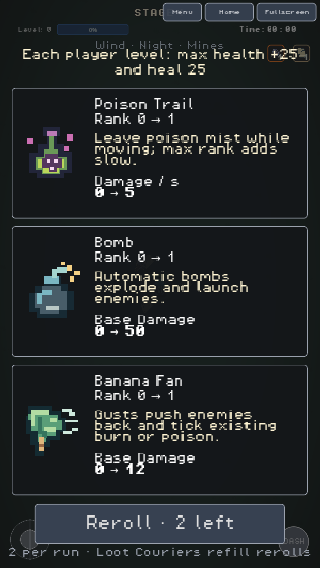
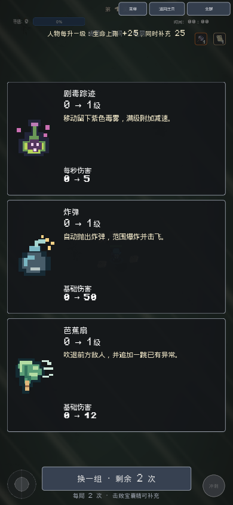
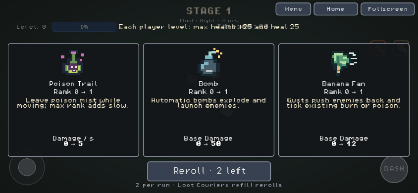
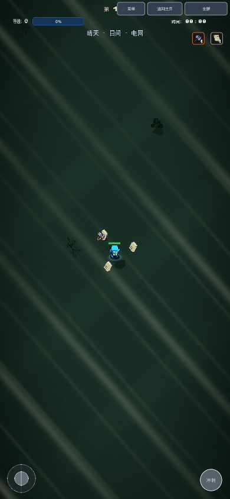

# 一屏三卡与 DASH 中文字体

版本 **20261116-184844**；继续 PR #28，基于 `356c5e0`。

DASH 的场景 Label 之前没有 UiFonts 覆盖，中文翻译“冲刺”落入缺少字形的默认字体。`dash_button.gd` 初始化时应用项目复合字体与中文 fallback；不修改翻译键、按钮布局设置、冷却、可用性或动画。

选卡页移除 ScrollContainer 和“查看详情”按钮。竖屏为三张横向卡片上下排列，横屏为三列；根据显示像素和 Web CSS/DPR 分配相同尺寸，保留大图标、名称/等级、简短功能介绍、一项主要伤害/功能当前→升级值。真实数值继续来自 CardPreview/CardNumbers，不修改装备机制。点击卡片任意位置选择，重抽按钮始终可见。完整资料从主页或 Esc / Menu 的词典进入。

源码：`script/dash_button.gd`、`pasue_menu.gd`、`upgrade_card.gd`、`codex_data.gd`、`scenes/UpgradeCard.tscn`；旧选卡预览/测试同步不滚动规则。保留既有节点路径，VBoxContainer 名称为兼容原路径保留，类型现为手动排布的 Control。

## 验证

```sh
python3 tools/audit_localization.py
GODOT --headless --rendering-method gl_compatibility --audio-driver Dummy --path . --editor --quit
GODOT --headless --rendering-method gl_compatibility --audio-driver Dummy --path . --script res://tools/smoke_three_cards.gd
GODOT --headless --rendering-method gl_compatibility --audio-driver Dummy --path . --script res://tools/smoke_codex_menu.gd
GODOT --headless --rendering-method gl_compatibility --audio-driver Dummy --path . --script res://tools/smoke_localization.gd
GODOT --headless --rendering-method gl_compatibility --audio-driver Dummy --path . --script res://tools/smoke_palette_cards.gd
GODOT --headless --rendering-method gl_compatibility --audio-driver Dummy --path . --export-release Web /ABS/OUTPUT/index.html
```

新检查2406项：全部28卡、两语言、五种视口（最小320×568，横屏667×375），所有三张卡片完整在屏内、简介与数值不裁切、无滚动/详情按钮、重抽可见、真实点击第三张只领取该卡并恢复游戏；DASH字体含“冲刺”两个字形。其余检查保留暂停/词典状态、语言设置和真实升级公式。最终 Web PCK 由原生引擎执行同四项专项；不是浏览器运行的证明。

原生 Compatibility 截图：`DISPLAY=:105 ROGGE_CAPTURE_DIR=/ABS/CAPTURES GODOT --rendering-method gl_compatibility --audio-driver Dummy --path . res://tools/preview_three_cards.tscn`。捕获脚本显式显示触控控件以检查中文；实际是否启用触控仍遵守原设备判断。未实测本轮 Safari/手机浏览器，既有退出资源和原生 GL 警告不属于本轮修复。






## 试玩

[打开最新版](https://rogge-palette-playtest-20261109.whiteber.chatgpt.site)，版本 **20261116-184844**。源码 `16f2f32` / [PR #28](https://github.com/wyb969/Rogge/pull/28)。2026-11-16 北京时间18:52发布成功，保持 owner-private 权限；9个原始导出文件字节核对、26项loader验证通过。见 [发布证据](validation/three-cards-playtest-20261116.json)。
