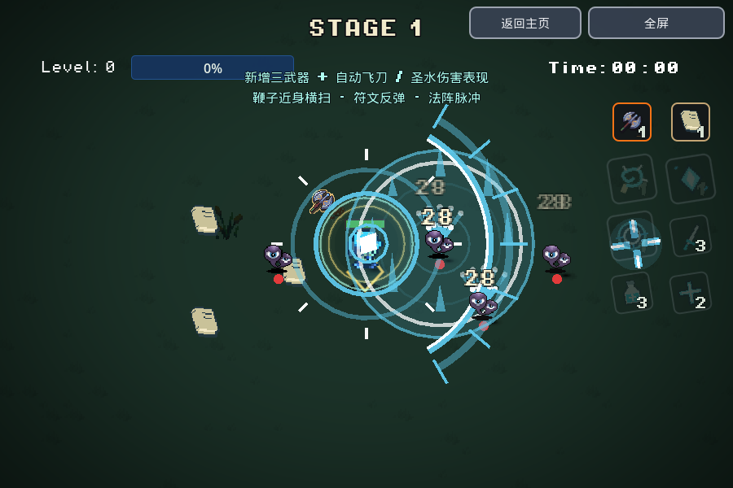
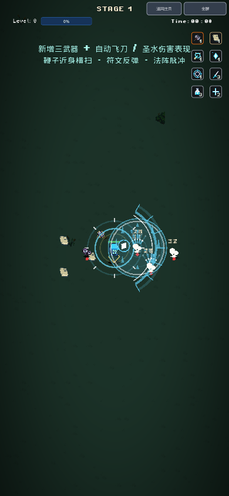

# 武器扩展二期与命中可读性

## 行为与成长

银翼飞刀独立于移动方向，自动瞄准附近有效敌人；可以后退走位还击。伤害、穿透、距离与冷却沿用上一轮。

净化圣水移除类似回血标记的中央十字，加入青白色焰舌、伤害节拍亮环和命中敌人脚下的上冲光线，伤害数字使用玩家青色。0.5秒伤害节拍、3秒区域、重叠只取最高秒伤不变；视觉命中池固定24槽，无新增逐命中节点或灯光。

以下数值为未叠加全局增伤的基础值；全局增伤/暴击仍通过现有 apply_hit 生效，升级界面由同一 stats_for 和 CardPreview 计算。

| 卡片（最高5级） | 1级 → 5级 | 攻击规则 |
|---|---|---|
| 荆棘鞭 | 伤害28→60；距离110→166；间隔1.50→1.02秒 | 朝附近敌人施放120°扇形横扫，每次每敌一次 |
| 符文飞弹 | 伤害18→38；反弹区域半边长180→240；间隔3.20→2.40秒；4级由1枚变2枚 | 固定施放点周围方形边界反弹，速度270、存活3秒；穿透，同一枚对同一敌人间隔至少0.35秒 |
| 脉冲法阵 | 伤害8→24；半径65→97；间隔1.25→0.85秒 | 玩家周围周期范围攻击，from_status，不暴击、不触发递归异常 |

新增图标为自制32px SVG。没有复制其他游戏素材。新增控制器固定8飞弹/12闪光槽，复用1个音源；目标用 CombatTargets 注册表查询（线性，不声称空间索引）。符文逐反射段扫掠、每帧渲染插值，超长帧反射最多5段；池满不再生成。暂停冻结，休息/试炼切换/结束清除暂态并保留卡等级，新局清空等级。速度试炼的攻击窗口不绕过。

## 接入

`arcane_weapons.gd`负责攻击与共享升级公式；`game.gd`负责创建/升级/重置和攻击成长计数；`pasue_menu.gd`、`equipment_panel.gd`、`card_preview.gd`接入抽卡、装备栏、满级过滤、实际前后数值与通用宝藏奖励。总计28张卡。`run_variety.gd`清暂态。

`main.gd`、`main.tscn`、`debug_menu_layout.gd`新增Debug首项“新武器二期 · 鞭 / 符文 / 法阵”，装备三新卡以及飞刀/圣水各1级，额外500生命方便试玩，保留正常波次。Debug共20入口，继续分页；正常Start不带调试装备。旧三武器Debug入口保留。

## 验证与复现

```sh
GODOT --headless --rendering-method gl_compatibility --audio-driver Dummy --path . --editor --import --quit
GODOT --headless --rendering-method gl_compatibility --audio-driver Dummy --path . --script res://tools/smoke_arcane_weapons.gd
GODOT --headless --rendering-method gl_compatibility --audio-driver Dummy --path . --script res://tools/smoke_relic_weapons.gd
GODOT --headless --rendering-method gl_compatibility --audio-driver Dummy --path . --export-release Web /ABSOLUTE/web-build/index.html
GODOT --main-pack /ABSOLUTE/web-build/index.pck --headless --rendering-method gl_compatibility --audio-driver Dummy --path /EMPTY/DIRECTORY --script res://tools/smoke_arcane_weapons.gd
```

另运行smoke_palette_cards、smoke_debug_menu、smoke_status_numbers、smoke_trials、smoke_hitstop。实际结果和已知退出警告见 `validation/weapon-expansion-20261115.json`。

手测：Debug首项进入后，向远离敌人的方向移动，观察飞刀回射；将敌人引入圣水，观察每0.5秒亮环/喷涌/青色数字；观察鞭子近身横扫、符文折返、脚下脉冲；Home后普通Start确认装备清空。专项直接调用实际攻击和宝藏派发，覆盖命中、未命中、同目标间隔、满级、暂停、试炼窗口、清理，不等于六关通关或真机负载测试。

原生Godot 4.7 Compatibility/llvmpipe截图：




截图为固定QA场景，正常导出仍从原main启动。渲染期间未见脚本错误；CLI退出仍有ObjectDB/资源警告，截图运行在关闭渲染器时另有Texture/RID释放警告，尚未定位，不宣称零泄漏。没有本轮托管浏览器/Safari真机或密集怪性能结论。待试玩重点：符文回弹可读性、三新卡伤害强度、手机密集场景。
