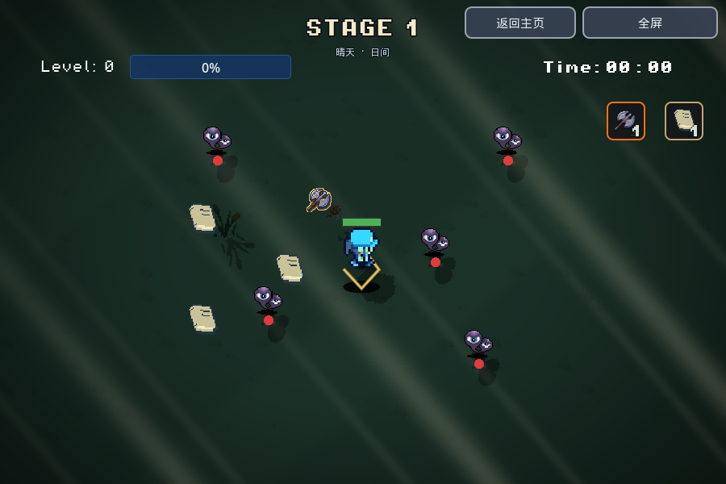
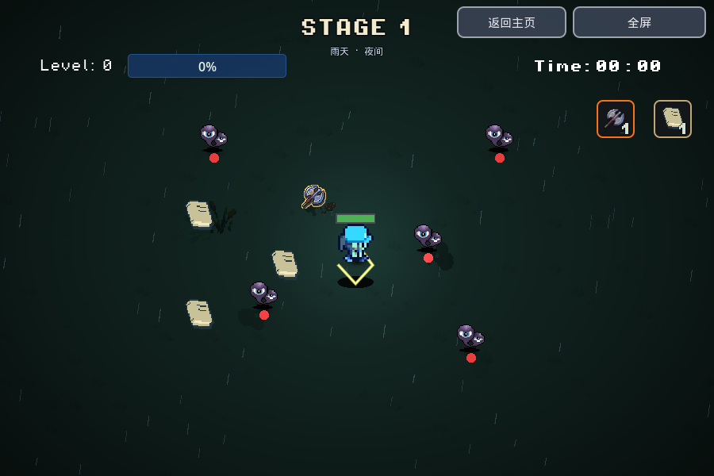
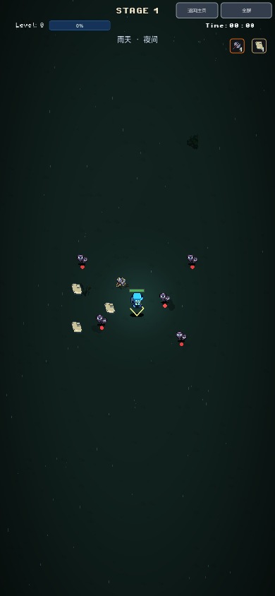

# 晴天光束与雨天玩家灯

当前分支保留28卡和上一轮平衡，只有光影、天气Debug入口及相关测试变化。伤害、掉落、怪物行为、天气抽取、雪粒子世界坐标和关卡底色未改。

## 表现与预算

- 晴天白昼：世界坐标中的两组不同宽度斜光束，缓慢变化；光束与阴影共用`environment_weather.sun_direction`，夜晚消失。单层shader最高透明度0.18，无屏幕纹理采样、模糊或噪声循环；光束在玩家、怪物、预警下方，不遮UI。
- 晴天投影：用当前精灵帧的透明轮廓绘制黑色地面影子，长度12～70世界单位。玩家、普通怪与Boss共用既有最多64怪物影子槽；每0.1秒最多检查192注册目标，绘制帧读取缓存。保留脚底接触影，敏捷怪跳跃继续使用原跳跃影子。
- 雨天：只增加1个PointLight2D，半径135世界单位，最高energy0.8，共用已有64×64渐变纹理，不启用实时阴影贴图。位置每渲染帧跟随真实玩家；周围怪物/草丛轮廓影向远离玩家方向投射，35～135距离内渐弱，远处不投射灯影，玩家不投射自身灯的长影。
- 草丛：一个批次最多32个投影，在地面上、装饰精灵下。不为每个物体创建灯/遮挡器/粒子。原战斗光效三批次保留。
- 所有新增光影受天气强度设置控制，强度0关闭；随天气权重过渡、昼夜变化；暂停不推进光束时钟；stop/Home停止绘制并关灯。仅在`GamePalette`追加暖白阳光与冷白灯色，保留现有Cursor配色。

这是适合当前2D像素画面的丁达尔光束和投影近似，不是物理体积散射或真正遮挡阴影。没有新增碰撞或遮挡规则。单灯仍有GPU开销，固定预算不等于真机帧率保证。

## 代码与测试

`weather_lighting.gd`拥有单灯、世界光束、草丛投影和共用精灵投影函数；`weather_shafts.gdshader`绘制光束；`environment_weather.gd`驱动权重/方向/启停；`combat_lighting.gd`使用缓存精灵绘制怪物和玩家轮廓。`main.tscn`/`debug_menu_layout.gd`新增“天气光影 · 阳光 / 雨灯”首项，复用weather调试模式。默认晴天日间，可点“下个天气”两次到雨天、切换昼夜；可移动检查灯影反向。21入口保持分页，普通新局不含调试控制。

```sh
GODOT --headless --rendering-method gl_compatibility --audio-driver Dummy --path . --editor --import --quit
GODOT --headless --rendering-method gl_compatibility --audio-driver Dummy --path . --script res://tools/smoke_weather_lighting.gd
GODOT --headless --rendering-method gl_compatibility --audio-driver Dummy --path . --export-release Web /ABSOLUTE/web-build/index.html
GODOT --main-pack /ABSOLUTE/web-build/index.pck --headless --rendering-method gl_compatibility --audio-driver Dummy --path /EMPTY/DIR --script res://tools/smoke_weather_lighting.gd
```

原生5项：weather_lighting（实际Debug、单灯/方向/范围、跨过物体反转、暂停、过渡、设置、80敌人64槽、120帧不增节点、删除/新局），weather、combat_lighting、world_snow、debug_menu。最终实际Web PCK运行前3项。完整结果见`validation/weather-lighting-20261115.json`。最终导入/导出没有错误；冷缓存首轮导入的资源缺失在生成缓存后解决。

原生渲染截图夹具不作为正常游戏入口。横竖屏和灰度截图已看；没有本轮浏览器/Safari真机或密集怪FPS结论。CLI退出资源警告及渲染器关闭时Texture/RID警告仍保留，不声称无泄漏。





后续真机重点：雨天怪群GPU负载、移动灯影舒适度、不同关卡地面上的光束强度。需要降配时先减灯energy/半径、关闭轮廓投影，不能改变怪物命中或雪粒子坐标。
