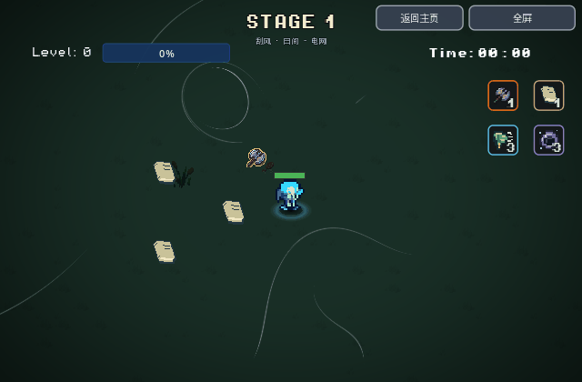
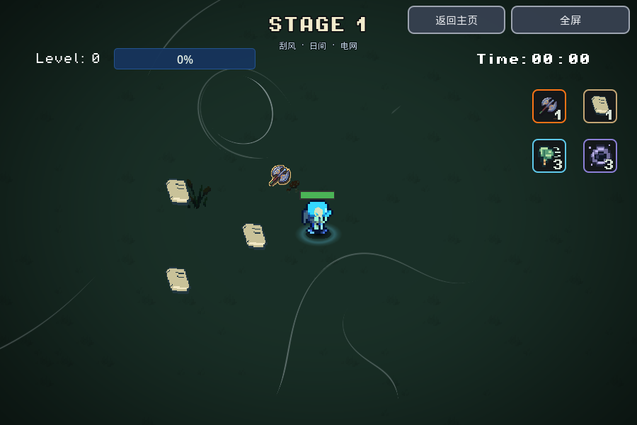
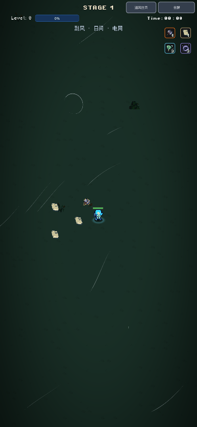
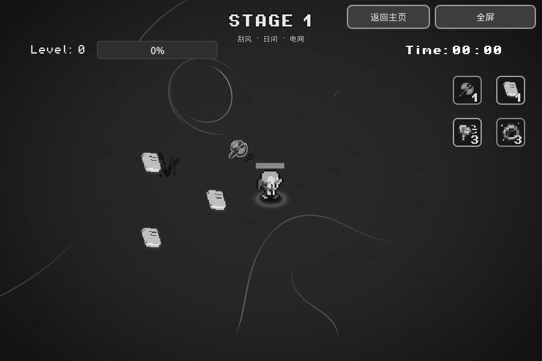

# Wind-field particle-history trails

Version **20261116-170330**, branch `feature/wind-trails-20261116`, based on `f481f39` / PR #25. Visual-only: existing wind forces, ice, weather selection, per-stage hazards and combat values stay unchanged.

## Reference and compatibility

The requested [Single-Minded Ryan tutorial](https://www.youtube.com/watch?v=IdcMU7gJtvI) is titled *How to create 2D Wind Trail Effect in Godot 4 using the GPUParticles2D node*. The title/description and supplied screenshot were accessible; full video playback, transcript and exact editor parameters were **not** accessible in this environment. This is a reference-inspired implementation, not a claim to reproduce unviewed settings.

Godot's [particle-trail documentation](https://docs.godotengine.org/en/4.6/tutorials/3d/particles/trails.html) limits GPU particle trails to Forward+/Mobile. A native Godot **4.7** Compatibility probe with `GPUParticles2D.trail_enabled` also printed `The Compatibility renderer does not support particle trails.` We therefore implement particle-motion histories with pooled Line2D ribbons for the game's current Web/Compatibility target, without changing renderer or adding an invisible GPU-only effect. The [GPUParticles2D reference](https://docs.godotengine.org/en/stable/classes/class_gpuparticles2d.html) describes trail lifetimes and section subdivisions behind the reference approach.

## Implementation

The old 18 pre-drawn curls were translated as complete shapes. They are replaced by 14 moving particle heads in a shared spatial velocity field: dominant wind, broad transverse waves and three local rotating pockets. Each head records 64 world-space samples; these form a moving trail rather than a drifting curl graphic. Midpoint integration runs at a fixed 60 Hz with display interpolation between steps. Curves naturally grow, bend and curl, then taper and fade on both ends and near particle expiry.

`wind_trails.gd` owns one fixed pool of fourteen Line2D nodes, two 64-point buffers per trail, three vortices, one shared width curve, one length gradient and one small cross-section texture. Soft texture filtering and a minimum displayed width keep thin lines readable in portrait without changing pixel-art character filtering. Palette color `GamePalette.WIND_TRAIL` is a restrained grey-white, rendered beneath actors/telegraphs, without additive light or full-screen glow.

All existing history stays in world coordinates when the camera moves. Only expired/distant particles and distant vortices respawn near the view. Visual RNG is independent of combat. Low FX displays fewer/softer ribbons; zero FX releases visible history while retaining gameplay wind. Pause freezes time; rest, weather exit, death and new runs clear or reinitialize the pool. Slow frames process at most eight integration steps rather than accumulating an unbounded catch-up workload. No target scans, per-frame node creation, physics bodies or particle lights.

Changed runtime files: `environment_surface.gd`, new `wind_trails.gd`, palette/version metadata. Updated existing surface-art test/preview to use the new controller; added focused wind test and native capture fixture. Other weather rendering and mechanics were retained.

## Verification

- Five source suites: wind trails (113 checks), surface art (50), environment surface (36), weather, stage hazards (293). Covers 30/60/120 Hz trajectory equivalence, substep interpolation, anchored histories, independent RNG, bounded pool/catch-up, settings, pause/rest/weather/exit and existing wind/ice/hazard behavior.
- Godot 4.7 headless import and Web release export. Three suites also run against the final exported Web PCK: wind trails, environment surface and stage hazards. Exact records in `validation/wind-trails-20261116.json`.
- Native GLES captures at 900×600 and 390×844 reviewed in color/grayscale. The GIF is 48 deterministic native rendered frames at 24 simulated frames/sec, not a browser recording or performance measurement. Capture fixtures suppress combat/hazards to expose wind motion.
- Known resource/ObjectDB/GL shutdown warnings remain. No current browser/Safari/phone FPS conclusion. The initial native GPU trail probe intentionally emits its compatibility warning; the replacement runtime does not use that unsupported feature.

Try **Home → Debug → 阵风场景**. Move and stop, rotate the device, and vary weather intensity. Existing wind moves player/monsters as before; this update improves how the flow is drawn.

```sh
"$GODOT" --headless --rendering-method gl_compatibility --audio-driver Dummy --path . --editor --quit
"$GODOT" --headless --rendering-method gl_compatibility --audio-driver Dummy --path . --script res://tools/smoke_wind_trails.gd
"$GODOT" --headless --rendering-method gl_compatibility --audio-driver Dummy --path . --export-release Web /ABSOLUTE/OUTPUT/index.html
DISPLAY=:105 ROGGE_CAPTURE_DIR=/ABSOLUTE/CAPTURES "$GODOT" --rendering-method gl_compatibility --audio-driver Dummy --path . res://tools/preview_wind_trails.tscn
```






Private playtest published: https://rogge-palette-playtest-20261109.whiteber.chatgpt.site — version 20261116-170330, deployment succeeded at 2026-11-16 17:08 Beijing. PR #26 preserves the source; master/itch remain unchanged. All nine original exported files match after decoding the existing gzip WASM and removing the loader injection. Publication evidence: `validation/wind-trails-playtest-20261116.json`.
