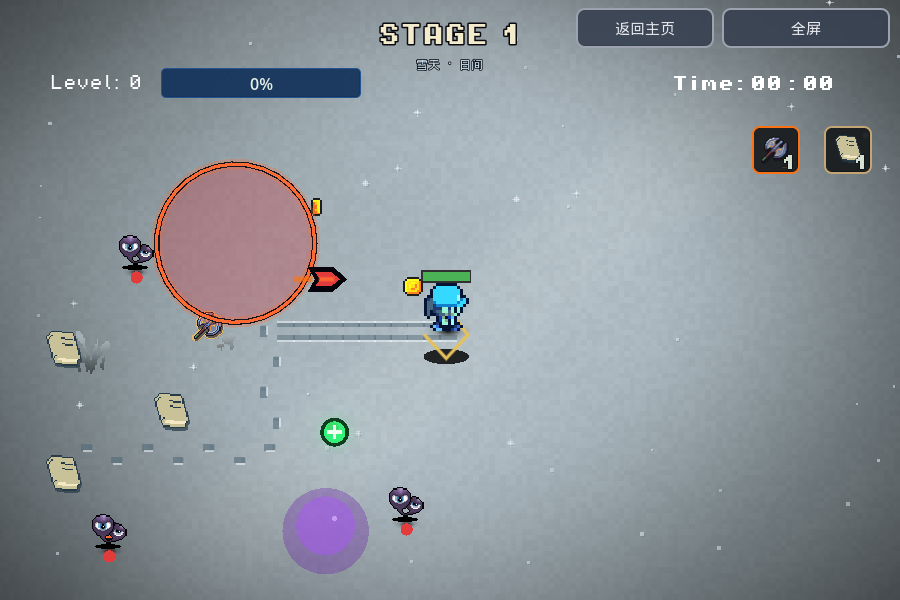
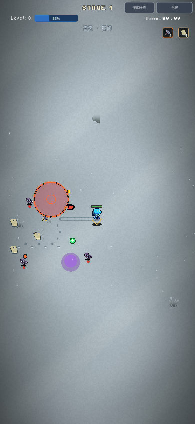
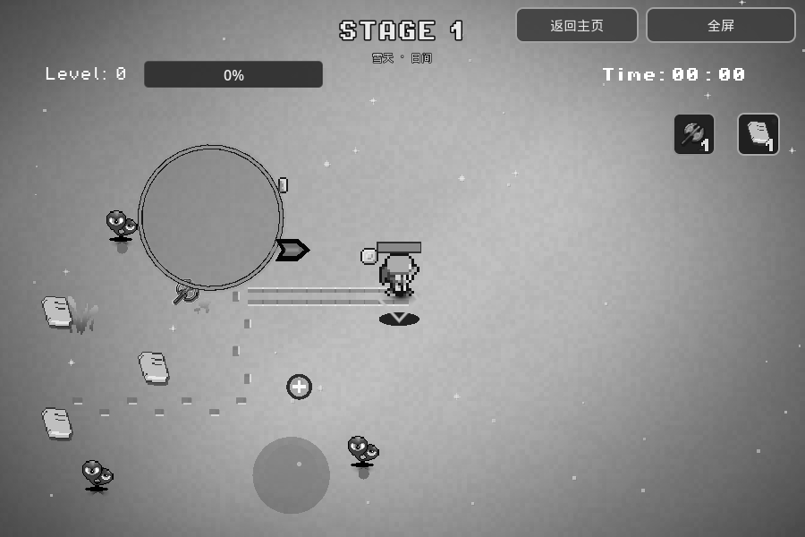

# 冬季积雪与移动雪痕

雪天天气现在同时驱动积雪地面、草丛覆雪、屏幕内的世界雪花，以及玩家踩出的地面痕迹。保留原随机天气/昼夜与所有战斗数值；不另加滑动、减速或伤害机制。

## 表现与生命周期

- 地面：沿用原`infinite_ground` shader，在雪天天气权重上混合冷白积雪，附世界坐标像素细纹和缓慢起伏的雪层覆盖分布。原关卡tint不改，雪停按原2.5秒天气过渡恢复地面；夜晚沿用环境光与暗角。
- 草丛：72个既有装饰精灵共用一个`snow_decor`材质，上部覆雪较多，保留纹理透明度。雪量0时输出原纹理和调色；没有逐场景换贴图。
- 雪花：保留64槽和原世界坐标运动/风摆/屏外回收，提升亮度与粒径，四分之一为较大的十字雪花并附薄暗边，在白地上也可见。移到z=3前景，低于敌方弹幕与攻击预警；玩家附近透明度仍降低。相机移动不拖动雪花，也不新增GPU粒子系统。
- 行走：按真实移动距离每17世界单位留下一个左右交替的脚印。只画在地面，站立、顶墙或移动锁定不产生新痕迹。
- 冲刺：沿实际冲刺每9世界单位绘制双雪沟和浅色雪沿，起止使用已有dash信号；没有新增走路粒子，动画/碰撞/移速/无敌时间不改。
- 痕迹：固定128槽循环覆盖，8秒寿命、最后3秒淡去。每次采样最多16笔，超过220单位瞬移不画跨图长线；雪量渐退时痕迹同步变淡，强度0/stop/Home清除并停处理，新局清空。暂停冻结雪花和痕迹。

## 实现与预算

`winter_tracks.gd`为单个地面绘制节点，复用128份记录，不为脚印创建节点、粒子、灯或纹理；渐隐最多30Hz重绘，新落点即时重绘。`environment_weather.gd`同步雪覆盖和雪花；`infinite_background.gd`只更新已有地面/共享草丛shader参数。雪色集中在GamePalette的SNOW_GROUND/SNOW_FLAKE/SNOW_TRACK。

两层材料仍有GPU开销，固定池不等于真机性能保证。不要为更厚雪景重新引入跟随相机的雪花或每帧构建地面网格。

## 调试与验证

主页→Debug第一项“冬季雪景 · 脚印 / 冲刺雪痕”，默认雪天日间，复用天气控制按钮切换天气/昼夜，可直接走动和Shift/DASH。共23入口继续分页；普通游戏仍随机天气，无强制雪天。

```sh
GODOT --headless --rendering-method gl_compatibility --audio-driver Dummy --path . --editor --import --quit
GODOT --headless --rendering-method gl_compatibility --audio-driver Dummy --path . --script res://tools/smoke_winter.gd
GODOT --headless --rendering-method gl_compatibility --audio-driver Dummy --path . --export-release Web /ABSOLUTE/web-build/index.html
GODOT --main-pack /ABSOLUTE/web-build/index.pck --headless --rendering-method gl_compatibility --audio-driver Dummy --path /EMPTY/DIR --script res://tools/smoke_winter.gd
```

原生6项：winter（51断言）、world_snow、weather、weather_lighting、debug_menu、player_motion。实际最终Web PCK再测winter/world_snow/weather。检查真实键盘走路、完整dash物理/计时器、静止、等距/交替、世界坐标、128槽、过期、瞬移、暂停、天气过渡、设置和新局；原玩家移动32断言仍通过。

原生横/竖/灰度画面已检查。截图使用QA固定路径和冻结的红色攻击/毒区/拾取物，普通main入口未改变。没有本轮浏览器/Safari真机或密集怪FPS结论。最终导入/导出无错误；既有CLI与原生渲染器关闭时ObjectDB/Texture/RID警告继续保留，详情见`validation/winter-snow-20261116.json`。





后续优先真机检查白地长时间舒适度、移动雪花是否仍稳定、脚印密度及密集怪雪天帧率。
